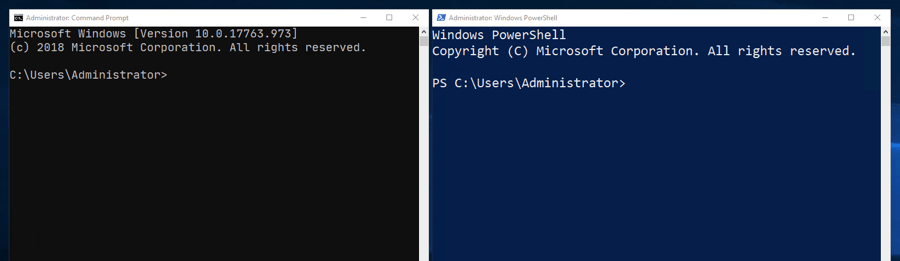
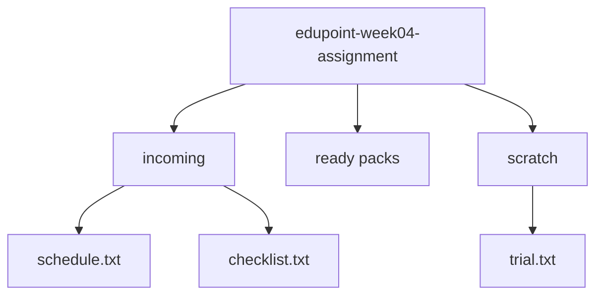

<!-- layout: workbook -->
# Assignment 02 — The Campus Fair Workspace

**100L · Semester 1 · Week 04: File System & Terminal · Individual take-home · 10 points**

## Your mission

A fictional campus fair team needs its files organised. Build a workspace, change it with terminal
commands, investigate a path error and check your tools. Use the [Week 04 workbook](../week-04/class-notes.md).

**Hand in:** your log, captures, path investigation and tool record. Allow **90 minutes outside class**.
Your tutor announces the deadline and destination. Download the materials and class kit to work offline.

| Task | What you demonstrate | Points | Suggested time |
|---|---|---|---|
| 1 | Create and locate your starting workspace | 2 | 15 min |
| 2 | Move, copy, rename and safely delete | 3 | 25 min |
| 3 | Verify paths and recover from an error | 2 | 20 min |
| 4 | Record installation and check four tools | 2 | 20 min |
| 5 | Explain your work and check the evidence | 1 | 10 min |

## Before you type

- Use your notes; **no AI may write, complete, check or fix your work**. On shared devices, type your
  own commands in a separate folder.
- Use an ordinary terminal. Keep Tasks 1–3 inside your new folder; check targets before deleting.
- Choose PowerShell, CMD, Bash or zsh. Follow that shell's workbook examples throughout.

*Figure 1. Which prompt matches your Windows shell? These reference windows say Administrator;
use an ordinary window. On macOS/Linux, record Bash or zsh. Unchanged MDN image, CC BY-SA 2.5;
credit on the final page.*

**Record:** operating system __________ · shell __________ · own / shared device __________

<!-- pagebreak -->

## Task 1 · Build the starting workspace · 2 points

1. Use your terminal to go to your home folder and list it. Create a new folder named
   `edupoint-week04-assignment`. If it exists, use a fresh name ending in `-02` or `-03` and record it.
   Keep earlier work. On a shared device, each learner chooses a different unused name.
2. Enter your new folder. Display and record its **absolute path**: the full route from the drive or
   file-system root. Identify its parent folder in your record.
3. Use terminal commands to create the starting structure below. These are all new practice files.
   Text files may be empty; CMD users may put one short word in each, as in the workbook.
4. Capture your current location and listings of all three child folders **before Task 2**.

*Starting structure only. Arrows mean “contains”. Both `ready packs` and `scratch` are folders;
`ready packs` starts empty. Point to the name that needs quotes when you use it in a path.*

## Task 2 · Prepare the fair pack · 3 points

Use terminal commands for every change. Choose the commands yourself from the workbook.

| Step | Requirement | Evidence to keep |
|---|---|---|
| A | Move `schedule.txt` from `incoming` to `ready packs`. | Listings of both folders after the move |
| B | Copy `checklist.txt` from `incoming` into `ready packs`. Keep the original. | Listings showing both copies |
| C | Rename only the copy in `ready packs` to `event-checklist.txt`, using your shell's move command. | Listing after the rename |
| D | List `scratch`, then delete only `trial.txt` using the workbook's confirmation option. Keep `scratch`. | Confirmation prompt, your response and a listing afterwards |

Before D, write down the exact file you intend to delete. Do not use wildcards, recursive deletion or
commands that remove folders. If a destination file already exists unexpectedly, stop and investigate.

**Keep a log throughout Tasks 1–3:** at least eight meaningful entries, including the move, copy,
rename, deletion and failed/successful navigation. Write each prediction **before** running its command.

| Starting folder | Command I ran | My prediction | Actual result |
|---|---|---|---|
| | | | |

Copy these headings onto paper or into your document; add rows as needed. Preserve actual output in
captures where requested. A final folder listing alone does not show how you got there.

<!-- pagebreak -->

## Task 3 · Find it, break a path, recover · 2 points

### A. Reach the same file by two routes

1. Navigate into `incoming`. Display your current location.
2. On paper or in your document, write an **absolute path** and a **relative path** to
   `event-checklist.txt` in `ready packs`. A relative path begins at your current folder.
3. Stay in `incoming`. Use your shell's listing command with each path to verify that both find the
   same file. Capture the commands and their results. Account for the space in the folder name.
4. Draw the folder structure as it now stands. Circle your current folder and draw the route taken
   by your relative path. Name the final extension of each remaining file.

**Record:**

| Item | Your evidence or explanation |
|---|---|
| Current absolute location | |
| Absolute path to the target file | |
| Relative path from `incoming` | |
| Why both paths reach the same file | |

### B. Investigate a failed command

1. Return to the assignment's top folder. Try to enter a child folder named `lost-box` without
   creating it. Use the change-folder command for your chosen shell.
2. Capture the exact failed command and error. Check and display your location and folder contents.
3. Use that evidence to decide why the command failed. Do not create `lost-box` to make it succeed.
4. Navigate into an existing child folder instead. Display the resulting location and capture it.

Write three short sentences: what you expected, what your checks showed, and how your correction
followed from those checks. Keep this failed attempt and the successful retry in your log.

### Your investigation checklist

- [ ] Both file paths were tested from the same recorded starting folder.
- [ ] My diagram shows my actual final structure, including empty folders.
- [ ] My error capture shows a real device command, not a browser simulation.
- [ ] My correction is supported by a location check and a listing.

**No computer available?** Draw and trace Tasks 1–3 on paper and label them **simulation**. Hand in your
reasoning and tell the tutor which practical steps remain. The tutor will arrange a shared-device
turn. A paper trace or the presentation's sandbox does not count as executed commands.

<!-- pagebreak -->

## Task 4 · Prove the tools run · 2 points

Use section 5 of the Week 04 workbook. Check first; keep tools that already work. Installation uses
the separate class `edupoint-installers` folder, outside your assignment workspace.

### A. Keep an honest installation record

For **Node.js**, record:

- The operating system, shell and whether you used your own device or a shared/prepared station.
- The installer or archive filename supplied by the tutor. Use the OS-matched class kit.
- The command you personally used to launch the installer or unpack the archive, and what happened.
- The status: **installed in class**, **installed for this assignment**, **already installed before
  class**, **observed only** or **blocked**. Include the date of any earlier installation evidence.
- The command used to check the installed tool and its actual version output, or the exact blocker.

If you personally completed the Week 04 installation activity, you may reuse **your own** installation
record and capture, clearly labelled as earlier evidence. Run the checks in Part B afresh. Do not
reinstall a working tool just to take a new screenshot. If you have not personally launched an
installer or unpacked the archive, arrange a prepared-station turn with the tutor.

**Stop after three minutes on a blocker.** Record the message and request a station or follow-up.
Do not guess administrator commands or download replacement installers. “Observed only” and
“blocked” identify unfinished practical work; they do not claim a successful installation.

### B. Make a fresh four-tool check

| Tool | What to do | Record |
|---|---|---|
| Browser | Open the application and a local class PDF or its start page. | Application name; readable capture of the running window |
| VS Code | Launch the application. No configuration or coding needed. | Readable capture of the running window |
| Git | Run `git --version`. No repository commands. | Exact command and version output, or blocker |
| Node.js | Run the version check for your workbook installation route. | Exact command and version output, or blocker |

For a standard Windows/macOS installation, the workbook uses `node --version`. For its Linux portable
route, use the executable path shown there from the installer folder. Record the **version you get**;
it does not need to match the workbook's sample number. Check it against the tutor's kit record.

## Task 5 · Explain your choices · 1 point

Write one or two sentences for each question. Refer to your own evidence.

1. Which of your operations kept the source file, and which changed its location? Point to the
   listings that prove it.
2. Why could your Task 3 relative path stop working if you ran it from another folder?
3. Would renaming `schedule.txt` to `schedule.pdf` make it a real PDF? Explain without changing the file.

Be ready to demonstrate one operation and explain one path to your tutor without a partner answering.

<!-- pagebreak -->

## Submit your evidence pack

Use task order. Write on paper or in a familiar word processor; disable AI writing features.

- [ ] Task 1: OS, shell, device route, absolute location, parent folder and starting listings.
- [ ] Task 2: before/after evidence, deletion confirmation and the eight-entry command log.
- [ ] Task 3: final diagram, file extensions, both verified paths, error, checks and successful retry.
- [ ] Task 4: labelled installation record plus fresh results for all four tools; blockers identified.
- [ ] Task 5: three explanations in your own words.

**Typed:** combine everything into `assignment-02-<surname>-<firstname>.pdf`.
**Paper/mixed:** number pages/captures in order. Name photos
`assignment-02-<surname>-<firstname>-<n>.jpg`, or use `.png` for screenshots.
The tutor can collect numbered paper pages. Check legibility.

Submit to the **class destination** by the announced deadline. No pull request is needed. Keep student
work out of this public repository. Retain your workspace for demonstration; submit only the evidence.

**Offline:** give the tutor your pack by USB/local transfer or numbered paper pages. Have receipt
recorded and keep a copy. Shared-device learners identify their own actions in individual logs.
Exclude private files, unrelated windows and other students' details from captures.

## Marking · 10 points

| Criterion | Points | What earns the marks |
|---|---|---|
| 1. Starting workspace | 2 | Correct starting structure made with commands (1); absolute location, parent and readable starting evidence (1) |
| 2. File operations | 3 | Move and copy, with evidence of the source after each (1); correct rename (1); only the intended file deleted with confirmation, folder retained (1) |
| 3. Paths and diagnosis | 2 | Both paths verified from `incoming`, accurate final diagram/extensions (1); failed command investigated and corrected, with evidence (1) |
| 4. Tool readiness | 2 | Personal launch/unpack evidence and honest installation record (1); fresh verification of all four tools (1) |
| 5. Reasoning and evidence | 1 | Eight-entry prediction/result log, clear individual evidence and three explanations you can defend |
| **Total** | **10** | |

Equipment or permission blockers leave the affected practical criteria **pending** until a suitable
station is available. Paper reasoning can receive feedback now. Your tutor confirms where this mark
is recorded; the assignment adds no new semester grading weight.

## Sources and image credit

- Programme curriculum §4, Week 04 (File System & Terminal), and §11 (assessment model).
- [Week 04 workbook](../week-04/class-notes.md) and [lab](../week-04/lab.md): command reference and offline installation routes. The challenge is original.
- MDN contributors: [Command line crash course](https://developer.mozilla.org/en-US/docs/Learn_web_development/Getting_started/Environment_setup/Command_line). Use only the sections assigned in Week 04; skip later tools and exercises.
- Figure 1: MDN contributors' [Windows terminal screenshot](https://developer.mozilla.org/en-US/docs/Learn_web_development/Getting_started/Environment_setup/Command_line/win-terminals.png), unchanged; displayed smaller. [CC BY-SA 2.5](https://creativecommons.org/licenses/by-sa/2.5/), per [MDN's content licence](https://developer.mozilla.org/en-US/docs/MDN/Writing_guidelines/Attrib_copyright_license). Credit/licence apply to the reused image. Links checked 30 October 2026.
