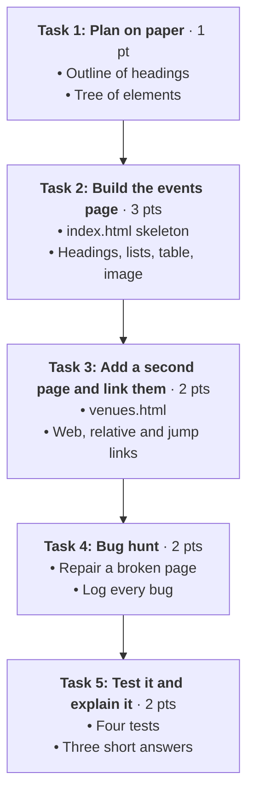

# Assignment 03: The Campus Events Board

**100L · Semester 1 · Week 06: HTML I — Structure · Individual take-home · 10 points · About 2 hours**

In Week 06 you learnt to give a page its **structure**: headings, paragraphs, lists, links, images,
tables and the attributes that make them work (`id`, `class`, `src`, `href`, `alt`).

In this assignment you use those skills twice. First, you turn a plain-text notice into a small
**two-page website**. Then you play detective: you repair a page someone else broke, and you log
every bug you find.

Everything is **structure only**. Colours, fonts and layout come with CSS in Week 08.

---

## Mission Roadmap



---

## Before You Start

> [!IMPORTANT]
> **Your own work, unaided.** This is 100L: no AI tool may write, complete, check or fix any part of
> this assignment, and VS Code's AI features stay switched off. You may use your Week 06 notes, the
> references at the end, and your tutor. You may talk about ideas with classmates, but you type every
> line yourself.

**Tools:** VS Code and a browser, as set up in Week 05. No internet is needed except for the optional
validator check in Task 5.

**Your folder.** In your home folder, create this structure. Use these names exactly.

```text
assignment-03-events-board/
├── index.html        the events page (Task 2)
├── venues.html       the second page (Task 3)
├── bug-hunt.html     the repaired page (Task 4)
└── images/
    └── your-image.jpg   or .png: a picture you made
```

> [!TIP]
> Name every file and folder in **lowercase, with hyphens instead of spaces**. `Tech Week.JPG` is easy
> to mistype in a `src`; `tech-week.jpg` is not.

---

## The Brief

The Department of Computing is running a made-up **Tech Week**. Here is the notice, typed with no
formatting. It is your content for Tasks 1–3.

```text
Tech Week 2026
Five days of talks, workshops and games for every level. Free for all students.

What's on
Monday | Opening talk: How the web works | Main Hall | 10:00
Tuesday | Workshop: Your first web page | Lab 2 | 14:00
Wednesday | Quiz: Guess the file extension | Lab 1 | 12:00
Thursday | Panel: Careers in software | Main Hall | 11:00
Friday | Show and tell | Lab 2 | 15:00

What to bring
Your student ID
A laptop and charger, if you have one
A notebook and pen

How to register
Go to the department office
Write your name on the sign-up sheet
Collect your wristband on Monday

Questions
Visit the department office, Room 104, between 9:00 and 16:00.
```

---

## Task 1: Plan on Paper · 1 point

> [!NOTE]
> **The Mental Model:** Plan a page the way you plan an essay. The **outline** (your headings) comes
> first; the words fill it in later. A page whose headings make sense on their own is easy to read,
> easy to search and easy to listen to with a screen reader.

1. **(paper)** Write the outline of `index.html`: the one `h1`, then each `h2` in order. Under each
   heading, write what goes there: a paragraph, a `ul`, an `ol`, the table or the image.
2. **(paper)** Draw `index.html` as a **tree**: `html` at the top, `head` and `body` under it, and every
   element hanging from the one it sits inside. Go down to the `li` and `tr` level.
3. **(paper)** Decide:
   - Which list needs **numbers** (an `ol`) because its order matters, and which does not.
   - Which section gets an `id` so a **jump link** can reach it.
   - Which two or more elements share a `class` because they belong together, for example every
     event held in the Main Hall.
4. Photograph the page. This is your plan evidence.

---

## Task 2: Build the Events Page · 3 points

Build `index.html` from the brief. Start with **!** and Tab in VS Code to get the skeleton, then fill it.

| Part | Requirement |
|---|---|
| **Skeleton** | `<!DOCTYPE html>`, `<html lang="en">`, a `head` with `<meta charset="UTF-8">` and a `<title>` of your choice. All visible content inside `body`. |
| **Headings** | One `h1` (*Tech Week 2026*). Each section of the brief is an `h2`. No skipped levels. |
| **Paragraphs** | The opening sentences and the *Questions* line are `p` elements. |
| **Lists** | *What to bring* and *How to register* become lists. Choose `ul` or `ol` for each, and be ready to say why. |
| **Table** | *What's on* becomes a `table`. One header row of `th` cells (you choose the four column names), then one `tr` per event with four `td` cells. The `\|` signs in the brief only show where cells split; don't type them. |
| **Image** | One `img` from your `images/` folder, with a **relative** `src` and an `alt` that tells a stranger what it shows. Use a photo or drawing **you made** (for example, a poster for Tech Week drawn on paper and photographed), or a screenshot of your own work. |
| **`id` and `class`** | The schedule's section has an `id`, ready for the jump link in Task 3. At least two elements share a `class`, such as the rows of every Main Hall event. |
| **Your addition** | Add one short section of your own under a new `h2`: for example, *Which event I would attend, and why*. Two or three sentences, in your own words. |

```html
<!-- 🔴 The table is not a layout tool. Never use it to place your image beside your text. -->
<!-- 🟢 A table holds data with rows and columns, such as the Tech Week schedule. -->
```

> [!WARNING]
> **Structure only.** No `style` attribute, no `<style>` element, no `border` attribute on the table
> and no `<br>` tags to make space. Your table will have **no lines** between cells, and that is
> correct: borders are CSS, in Week 08. Styling earns no marks; remove it before you submit.

> [!CAUTION]
> **Privacy.** Don't put your phone number, home address, matric number or anyone else's photo on
> the page. If a photo shows other people, choose a different one.

---

## Task 3: Add a Second Page and Link Them · 2 points

Create `venues.html`, a second page that tells visitors how to find each venue.

1. Give it the same skeleton as `index.html`, with its own `title`.
2. Add an `h1` (such as *Getting to the venues*), then one `h2` per venue: **Main Hall**, **Lab 1** and
   **Lab 2**. Under each, write a sentence or two of directions. Make them up; this department is
   fictional.
3. Give each venue's `h2` an `id`, such as `id="main-hall"`. Every `id` on a page must be unique.

Now add these links:

| Link | From | To | Kind |
|---|---|---|---|
| A | `index.html` | `venues.html` | **Relative** link to another page in the folder |
| B | `venues.html` | `index.html` | **Relative** link back home |
| C | `index.html`, near the top | The schedule table's section on the same page | **Jump** link to an `id` (`href="#…"`) |
| D | `index.html` | `venues.html#lab-2` (or your id for Lab 2) | Relative link to a **section of another page** |
| E | `index.html` | One real web page that helped you learn HTML | **Absolute** link starting with `https://` |

> [!TIP]
> Link text should make sense on its own. *"How to find the venues"* tells a reader where the link
> goes; *"click here"* does not. Screen-reader users often list all of a page's links, out of context.

---

## Task 4: Bug Hunt · 2 points

A volunteer typed the department's *Lost and Found* page. It "sort of works", but it has
**at least eight problems**. Some show in the browser; some don't show at all, but still break the
rules you learnt in Week 06.

1. Create `bug-hunt.html` and type or paste this code exactly as it is.

```html
<!DOCTYPE html>
<html>
<head>
<title>Lost and Found</title>
</head>
<body>
<h1>Lost and Found</h1>
<p>Items handed in to the department office this week.
<h3>Found on Monday</h3>
<ul>
  <li>A blue water bottle</li>
  <li>A calculator<li>
</ul>

<h2 id="collect">How to collect an item</h2>
<ol>
  <li>Come to Room 104.</li>
  <li>Describe the item.</li>
  <li>Show your student ID.</li>
<ol>
<p>Questions? <a href="#colect">Read the steps again</a>.</p>
<p id="collect">Office hours: 9:00 to 16:00.</p>
</body>
</html>
```

2. **Before you fix anything**, take a screenshot of the page in your browser.
3. Find and fix the bugs one by one. For each bug, add a row to your **bug log**:

| # | Line | What I noticed | The rule it breaks | My fix |
|---|---|---|---|---|
| 1 | | | | |

4. When you have fixed at least eight, take an **after** screenshot.

> [!TIP]
> Read the code **slowly, one line at a time**, and ask four questions of every line: Is every element
> closed? Is it inside the right parent? Does every attribute have what it needs? Could this file
> work on someone else's computer? Use **Format Document** (*Shift+Alt+F* on Windows, *⇧⌥F* on macOS,
> *Ctrl+Shift+I* on Linux) to make wrong nesting easier to spot.

> [!NOTE]
> The image has nothing to show yet: you won't have `bottle.jpg`. Fixing that line means making it
> **correct**, so it would work once the photo is put in the folder. Decide where the photo should
> live and what its `src` and `alt` should be.

---

## Task 5: Test It and Explain It · 2 points

### A. Run four tests

Record each result in a short **test log** (what you did · what you expected · what happened).

1. **Move test.** Copy the whole `assignment-03-events-board` folder to another place, such as your
   Desktop or a USB stick. Open `index.html` from the copy. Do the image and every relative link still
   work? If something breaks, a path points outside the folder: fix it and test again. Delete the copy
   afterwards.
2. **`alt` test.** Change one letter of your image's `src` and refresh. Screenshot what the browser
   shows in its place. Then change the letter back.
3. **Jump test.** Click link C, then link D. Screenshot each with the **address bar** showing the `#`.
4. **Outline test.** Write down only your page's headings, in order, with their levels (`h1`, `h2`).
   Read the list aloud. Does it sound like a table of contents for the page?

**Optional, if you are online:** paste `index.html` into the W3C validator's
[Validate by direct input](https://validator.w3.org/#validate_by_input) tab. Record how many errors
it reports, and fix what you understand.

### B. Answer three questions

Two or three sentences each, in your own words. Point to your own code.

1. Why did you choose `ul` for one list and `ol` for the other?
2. Link A and link E both open a page. Why does one need `https://` and the other must not have it?
3. In the bug hunt, choose one bug that **did not show** in the browser. Why is it still worth fixing?

> [!IMPORTANT]
> Be ready to open your page in class, click any link, and explain any element on it without your
> notes. Work you can't explain earns no marks for that criterion.

---

## Rookie Traps to Avoid

| What you see | What happened | How to fix it |
|---|---|---|
| A broken-image icon, or just the `alt` words | The `src` doesn't match the file's real name or folder, or the image isn't inside your folder | Compare the `src` letter by letter with the file name, including the extension and capital letters |
| A whole section is big and bold | A heading was never closed, so the following content sits inside it | Find the heading just above the problem and check its closing tag |
| Text runs together on one line | Lines typed in the editor without `p` or list tags | The browser ignores your Enter key; wrap each piece in an element |
| A jump link does nothing | The `href="#…"` and the `id` don't match exactly | Copy the `id` into the `href`, after the `#` |
| The table columns don't line up | One row has more or fewer cells than the header row | Count the `td` cells in each `tr` against the `th` cells |
| `₦` shows as strange symbols | The `meta charset` line is missing | Keep `<meta charset="UTF-8">` in the `head` |

---

## Submit

Submit on **Google Classroom**, under *Assignment 03 — The Campus Events Board*, by the due date
shown there.

1. **Your website:** zip the whole `assignment-03-events-board` folder, so the image travels with the
   pages. Name it `assignment-03-<surname>-<firstname>.zip`.
2. **Your evidence:** one PDF named `assignment-03-<surname>-<firstname>-evidence.pdf`, in this order:
   - The photo of your Task 1 plan
   - The Task 4 bug log, with the before and after screenshots
   - The Task 5 test log, with the `alt` and jump screenshots
   - Your three Task 5 answers

   If you can't make a PDF, attach the photos and screenshots as separate images, numbered in order
   (`assignment-03-<surname>-<firstname>-1.jpg`, `-2.jpg`, …).
3. Click **Turn in**. Keep your folder unchanged on your computer: you may be asked to open it in class.

> [!NOTE]
> **No internet?** Save everything on your computer and hand it to your tutor on a USB stick, or
> hand in the paper logs. Ask the tutor to record that they received it. Late connectivity never
> cancels work you finished on time.

---

## Marking · 10 points

| Criterion | Points | What earns full marks |
|---|---|---|
| 1. Plan | 1 | A photographed outline and element tree that match the finished page |
| 2. Events page | 3 | Complete skeleton with `lang`, `charset` and `title` (1); headings in order, paragraphs, and a `ul` and an `ol` each used for the right reason (1); a schedule table with a header row and five event rows, and an image with a relative `src` and meaningful `alt` (1) |
| 3. Second page and links | 2 | `venues.html` with unique `id`s and a shared `class` used on either page (1); links A–E all work, including after the move test (1) |
| 4. Bug hunt | 2 | At least eight bugs fixed in the final file (1); a bug log naming the line, the rule broken and the fix, with before and after screenshots (1) |
| 5. Tests and explanations | 2 | Four test results recorded with screenshots (1); three answers in your own words that match your code (1) |
| **Total** | **10** | |

Styling is not marked. Any criterion you can't explain when asked in class earns no marks. If a
device problem stopped you, tell your tutor before the deadline: that criterion stays pending until
you have had a fair turn on a working machine.

---

## 📚 References

* [MDN: Basic HTML syntax](https://developer.mozilla.org/en-US/docs/Learn_web_development/Core/Structuring_content/Basic_HTML_syntax) — Elements, nesting, attributes and the page skeleton.
* [MDN: Headings and paragraphs](https://developer.mozilla.org/en-US/docs/Learn_web_development/Core/Structuring_content/Headings_and_paragraphs) — Why heading levels are an outline, not a font size.
* [MDN: Lists](https://developer.mozilla.org/en-US/docs/Learn_web_development/Core/Structuring_content/Lists) — When to use `ul` and when to use `ol`.
* [MDN: Creating links](https://developer.mozilla.org/en-US/docs/Learn_web_development/Core/Structuring_content/Creating_links) — Absolute and relative URLs, and links to parts of a page.
* [MDN: HTML images](https://developer.mozilla.org/en-US/docs/Learn_web_development/Core/Structuring_content/HTML_images) — `src`, `alt` and writing useful alternative text.
* [MDN: HTML table basics](https://developer.mozilla.org/en-US/docs/Learn_web_development/Core/Structuring_content/HTML_table_basics) — Rows, cells and header cells.
* [Week 06 class notes](https://github.com/ajibolagenius/EduPoint/blob/main/curriculum/100L-S1/week-06/class-notes.md) — Every element in this assignment, with examples.

### Sources

- Programme curriculum §4, Week 06 (HTML I — Structure): document structure, DOCTYPE, elements,
  headings, paragraphs, lists, links, images, tables; attributes `id`, `class`, `src`, `href`, `alt`.
  Deliverable: "Start the Personal Portfolio: structure only".
- The Tech Week notice, the Lost and Found page and all tasks are original and made up.
  Links checked 14 November 2026.
