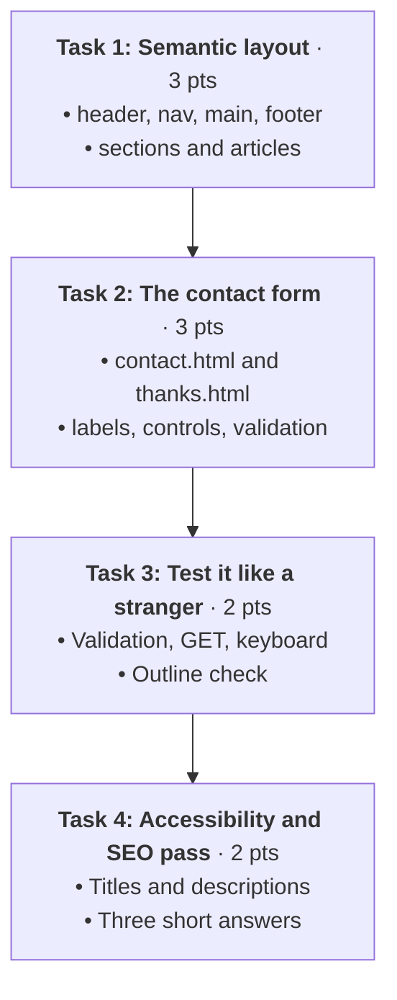

# Assignment 04: The Portfolio Contact Desk

**100L · Semester 1 · Week 07: HTML II — Forms, Semantics & Accessibility · Individual take-home · 10 points · About 2 hours**

Your portfolio can show people what you've built, but it can't hear back from them. In this
assignment you give it a **front desk**: a semantic layout that every visitor (and every screen reader
and search engine) can find their way around, and a **contact form** that checks its answers before
they are sent.

This is the Week 7 curriculum deliverable:

> **"Add a contact form and semantic layout to the portfolio."**

You started it in class (Level 3 of the exercises). Here you finish it, test it like a stranger, and
hand it in. It's still **HTML only**: no CSS until Week 8.

---

## Mission Roadmap



---

## Before You Start

> [!IMPORTANT]
> **Your own work, unaided.** This is 100L: no AI tool may write, complete, check or fix any part of
> this assignment, and VS Code's AI features stay switched off. Use your Week 7 class notes, the
> references below, and your tutor. Talk ideas through with classmates if you like, but type every
> line yourself, in your own words.

**Work in your Week 6 `portfolio` folder.** It keeps growing all semester, and goes on GitHub in
Week 11. When you finish, it should look like this:

```text
portfolio/
├── index.html      updated: semantic layout (Task 1)
├── contact.html    new: the contact form (Task 2)
├── thanks.html     new: where the form goes (Task 2)
├── hello.html      from Week 6
└── images/         from Week 6
```

> [!TIP]
> **Missed Week 6, or lost your folder?** Create a fresh `portfolio` folder with an `index.html` that
> has an `h1` with your name, and at least three `h2` sections about you. Tell your tutor, then carry on.

---

## Task 1: Semantic Layout · 3 points

> [!NOTE]
> **The Mental Model:** A page is a building. `header` is the entrance, `nav` the signboard, `main`
> the rooms, `footer` the back office. Landmarks don't change the look: they tell browsers, screen
> readers and search engines what each area is *for*.

Update `index.html` so that:

| Part | Requirement |
| :--- | :--- |
| **`header`** | Holds your `h1` (your name, or the name you want employers to see) and the `nav` |
| **`nav`** | A `ul` of links: at least one jump link to a section of this page, and a link to `contact.html` |
| **`main`** | Exactly **one**. Holds everything unique to this page |
| **`section`s** | At least three, each with its own `h2` and a unique `id` |
| **`article`s** | Each thing you've built (your Week 5 page, your Week 6 page, any other) is its own `article`, with an `h3`, a sentence or two about it, and a link to it |
| **`footer`** | Your name and the current year, plus one more line of your choice |

Then give `contact.html` and `thanks.html` the **same** `header`, `nav` and `footer`, so visitors can
move between your pages from any of them.

> [!WARNING]
> **Keep your Week 6 structure.** Wrapping content in landmarks should not delete anything. Your
> headings, lists, image, table and links from last week all stay, now inside the right regions.

---

## Task 2: The Contact Form · 3 points

On `contact.html`, inside `main`, build a form that a visitor would use to get in touch with you.

| Control | Requirement |
| :--- | :--- |
| **Name** | `text`, required, at least 2 characters |
| **Email** | `email`, required |
| **Reason for getting in touch** | Either a `select` (with an empty first option) or a group of at least three `radio` buttons in a `fieldset` with a `legend`. Required. You choose the reasons. |
| **How did you find me?** | At least two `checkbox`es in a `fieldset` with a `legend`. Not required. |
| **Message** | `textarea`, required, with a `maxlength` you choose |
| **One more control of your choice** | Any other input type from the class notes (`number`, `date`, `tel`…), with a validation rule that suits it |
| **Send** | A `button` with `type="submit"` and clear text, such as *Send message* |

And these rules for the whole form:

1. Every control has a real `<label>`, connected with `for` and `id`, or by wrapping.
2. Every control that sends an answer has a `name`.
3. The form uses `method="get"` and `action="thanks.html"`.
4. `thanks.html` thanks the visitor and links back to `index.html`.

> [!CAUTION]
> **A placeholder is not a label.** It vanishes as soon as typing starts, and assistive technologies
> don't all treat it as a label. Use `placeholder` only for an example, if at all. And never put your real phone number,
> home address or matric number in the form or the page.

---

## Task 3: Test It Like a Stranger · 2 points

Run each test and record it in a **test log**: what you did · what you expected · what happened.

1. **Validation test.** Break each rule once: an empty required field, a 1-character name, an email
   without `@`, no reason chosen, and your own control's rule. Write down the exact message the
   browser shows each time. Screenshot **two** of them.
2. **GET test.** Fill in the whole form, including a message with a comma and an `&`, and send it.
   Screenshot `thanks.html` with the **address bar** showing. In your log, copy the query string and
   circle each `name=value` pair and each encoded character.
3. **Keyboard test.** Put the mouse away. Starting from the address bar, use only Tab, Shift+Tab,
   arrow keys, Space and Enter to fill in and send the form. Note any control you couldn't reach, and
   whether you could always see where you were.
4. **Outline test.** Write down every heading on `index.html`, in order, with its level, and every
   landmark (`header`, `nav`, `main`, `section`, `article`, `footer`). Does it read like a sensible map
   of the page?

**Optional:** turn on your device's screen reader (see Module 6 of the class notes), Tab through your
form, and note what it says for one control. **Optional, online:** check each page with the W3C
validator's [Validate by direct input](https://validator.w3.org/#validate_by_input) tab and record the
number of errors.

---

## Task 4: Accessibility and SEO Pass · 2 points

### A. Finish the `head` of every page

On `index.html`, `contact.html` and `thanks.html`:

1. A **unique** `<title>` that says what the page is, such as *Contact · Ada Obi*.
2. A `<meta name="description">` of one or two sentences, written for a person reading search results.
3. `<html lang="en">` and `<meta charset="UTF-8">` still in place.

Also check that every image has a meaningful `alt`, and that no link says only *click here*.

### B. Answer three questions

Two or three sentences each, in your own words. Point to your own code.

1. In your form, choose one control. What do its `id` and its `name` each do?
2. Why did you choose a `select` or radio buttons for the reason, and checkboxes for *How did you
   find me?*
3. Your form uses `method="get"`. Name one kind of form that should use `post` instead, and explain why.

> [!IMPORTANT]
> Be ready to open your portfolio in class, send your form, and explain any element without your
> notes. Work you can't explain earns no marks for that criterion.

---

## Rookie Traps to Avoid

| What you see | What happened | How to fix it |
| :--- | :--- | :--- |
| An answer is missing from the query string | That control has no `name` | Add a `name` to every control that sends an answer |
| Clicking a label doesn't focus its box | `for` and `id` don't match exactly | Copy the `id` into the `for` |
| Several reasons stay selected at once | The radio buttons have different `name`s | Give the whole group one `name` |
| The query string shows `reason=Choose…` | The `select`'s first option has no `value=""` | Add `value=""` to the first option |
| Sending opens *Your file couldn't be accessed* | `action` names a file that doesn't exist or is misspelt | Check `thanks.html` is in the same folder, spelt the same way |
| Your footer text appears inside the message box | `<textarea>` was never closed | Add `</textarea>` |

---

## Submit

Submit on **Google Classroom**, under *Assignment 04 — The Portfolio Contact Desk*, by the due date
shown there.

1. **Your website:** zip the whole `portfolio` folder. Name it `assignment-04-<surname>-<firstname>.zip`.
2. **Your evidence:** one PDF named `assignment-04-<surname>-<firstname>-evidence.pdf`, in this order:
   - The Task 3 test log, with the two validation screenshots and the GET screenshot
   - Your outline from the Task 3 outline test
   - Your three Task 4 answers

   If you can't make a PDF, attach the photos and screenshots as separate images, numbered in order
   (`assignment-04-<surname>-<firstname>-1.jpg`, `-2.jpg`, …).
3. Click **Turn in**. Keep working in your `portfolio` folder: it's the base for Week 8.

> [!NOTE]
> **No internet?** Save everything on your computer and hand it to your tutor on a USB stick, or
> hand in the paper logs. Ask the tutor to record that they received it. Late connectivity never
> cancels work you finished on time.

---

## Marking · 10 points

| Criterion | Points | What earns full marks |
| :--- | :--- | :--- |
| 1. Semantic layout | 3 | `header` with `h1` and `nav`; exactly one `main`; a `footer` (1). Three or more `section`s, each with a heading and unique `id`; each project in its own `article` (1). The same header, nav and footer on all three pages, with working links between them (1) |
| 2. Contact form | 3 | Every control required by Task 2 is present and of the right type, with `fieldset` and `legend` for grouped choices (1). Every control has a connected `label` and a `name` (1). Validation rules match the brief, and the form sends with GET to a working `thanks.html` (1) |
| 3. Testing | 2 | Validation and GET tests recorded with screenshots and the query string explained (1). Keyboard and outline tests recorded honestly, including anything that didn't work (1) |
| 4. Accessibility, SEO and explanations | 2 | Unique titles, descriptions, `lang`, meaningful `alt` and descriptive link text on all pages (1). Three answers in your own words that match your code (1) |
| **Total** | **10** | |

Styling is not marked. Any criterion you can't explain when asked in class earns no marks. If a
device problem stopped you, tell your tutor before the deadline: that criterion stays pending until
you have had a fair turn on a working machine.

---

## 📚 References

* [Week 7 class notes](https://github.com/ajibolagenius/EduPoint/blob/main/curriculum/100L-S1/week-07/class-notes.md) — Every element and test in this assignment, with examples.
* [MDN: Structuring documents](https://developer.mozilla.org/en-US/docs/Learn_web_development/Core/Structuring_content/Structuring_documents) — Landmarks, with a full example page.
* [MDN: How to structure a web form](https://developer.mozilla.org/en-US/docs/Learn_web_development/Extensions/Forms/How_to_structure_a_web_form) — Labels, `fieldset` and `legend`.
* [MDN: Client-side form validation](https://developer.mozilla.org/en-US/docs/Learn_web_development/Extensions/Forms/Form_validation) — Read up to "Validating forms using JavaScript".
* [MDN: Sending form data](https://developer.mozilla.org/en-US/docs/Learn_web_development/Extensions/Forms/Sending_and_retrieving_form_data) — GET, POST and the query string.
* [MDN: What's in the head?](https://developer.mozilla.org/en-US/docs/Learn_web_development/Core/Structuring_content/Webpage_metadata) — `title`, `meta description` and `lang`.

### Sources

- Programme curriculum §4, Week 07 (HTML II — Forms, Semantics & Accessibility). Deliverable:
  "Add a contact form and semantic layout to the portfolio".
- All tasks are original. Links checked 14 November 2026.
