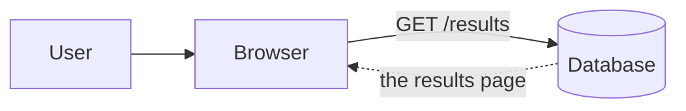
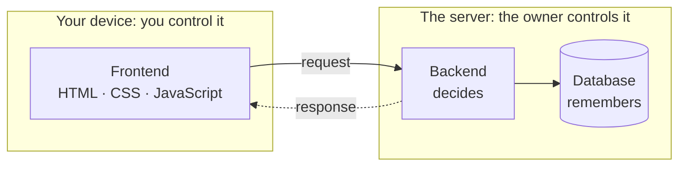
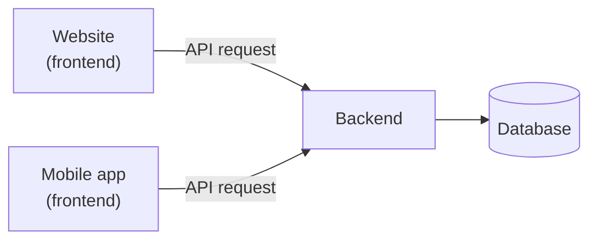
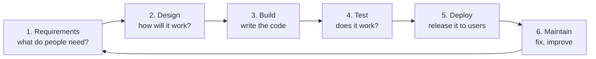

# Week 02 — Class Notes: Self-Appraisal & Orientation

**100L · Semester 1 · Web Foundations & Developer Mindset · Shared by both tracks**

Last week you followed a request from the browser to the server and back. Today you find out what each
part of that journey is *for*: what a page can do by itself, where JavaScript comes in, why a site needs a
backend and a database, and how programs talk to each other. Then you look at the jobs this leads to, and
at the steps every software project goes through.

## How to use these notes

We go through these notes together on the projector. The tutor shows each step on screen while you do it
yourself. Every section follows the same pattern:

| Marker | What it means |
|---|---|
| **▶ Try it** | Something to do. Each step is marked with what you need: **(phone)**, **(laptop)**, **(paper)**, or **(watch)**, which means watch the tutor's screen. |
| **✓ What you should see** | How you can tell it worked |
| **? Check** | One question to answer before we move on. Open **Answer** afterwards to check yourself. |

- **No laptop or data?** Everything marked **(watch)** or **(paper)** works without either. Your partner
  can share their screen for the rest.
- **Missed the session?** Work through these notes on your own. Every step tells you what you should see.

## By the end of today, you can…

1. Say what problem a piece of software solves, and for whom.
2. Name the three layers of a web page, and say which one a feature needs.
3. Switch JavaScript off in a browser, and describe what still works.
4. Explain why anything sent to your browser can't be kept secret.
5. Explain what an API is, and read a simple API reply.
6. Describe the difference between frontend, backend and mobile development.
7. Name at least five jobs in software, and say which one interests you right now.
8. Put the stages of the software development lifecycle in order.

---

## 1. Warm-up: spot the mistake

Here is a diagram a student drew of last week's journey. Something important is wrong.

**▶ Try it (paper)**
1. Take out your week 1 diagram.
2. Compare it with the one above. Write down what is missing or wrong.
3. Tell your neighbour, then the class.

**✓ What you should see:** most people spot that the **server** is missing. The browser is talking
straight to the database.

**? Check:** Why does it matter that the browser never talks to the database directly?

Answer

The database holds *everyone's* records. The server sits in front of it and decides who may see which
rows. If any browser could ask the database directly, any user could ask for anyone's results. Today
you'll see why that decision can only be made on the server.

---

## 2. Why software development?

Software is a way of solving a problem once, so that thousands of people never have to solve it again.
Think of the POS terminal at the shop, the transfer you make with a bank app, or the portal that shows your
results without a queue at the exams office. Each one began as a problem somebody noticed.

A developer's job is **less typing and more thinking**: understanding the problem, deciding what to build,
building it, checking it works, and fixing it when it doesn't.

**▶ Try it (paper)**
1. Write down **three everyday problems** you or people around you have: on campus, at home, at the market.
2. For each one, write: *who* has the problem, and would they use a **phone** or a **computer** to solve it?
3. Circle the one you would most like to solve.

**✓ What you should see:** a short list. Most problems you write down will involve phones. Keep the
circled one; you use it again in section 8.

**? Check:** What comes first when building software: writing code, or understanding the problem?

Answer

**Understanding the problem.** Code that perfectly solves the wrong problem is wasted. Section 8 shows
how every software project starts by finding out what people actually need.

---

## 3. The three layers of a page

Every web page is built from up to three languages, each with its own job:

| Layer | Its job | Like a market stall's… |
|---|---|---|
| **HTML** | What is on the page: headings, text, images, links, forms | Goods, laid out on the table |
| **CSS** | How it looks: colours, fonts, spacing, layout on big and small screens | Paint, signboard and arrangement |
| **JavaScript** | What it *does*: reacting, calculating, changing the page without loading a new one | The trader, who answers you and counts your change |

HTML and CSS can already do more than you might expect. Links, forms, colours that change when you point
at something, and a layout that fits a small screen all work without JavaScript. The **Answer** boxes in
these notes open and close without JavaScript too: HTML has a built-in box that does that.

The best way to see what JavaScript adds is to take it away.

**▶ Try it (phone or laptop)**
1. Switch JavaScript **off**:
   - **Android, Chrome:** ⋮ menu → **Settings** → **Site settings** → **JavaScript** → turn it off.
   - **iPhone, Safari:** the **Settings** app → **Safari** (on newer iPhones: **Apps** → **Safari**) →
     **Advanced** → turn **JavaScript** off.
   - **Laptop, Chrome:** open developer tools (`F12`, or `Cmd+Option+I` on a Mac), press `Ctrl+Shift+P`
     (`Cmd+Shift+P` on a Mac), type `Disable JavaScript` and press Enter. It stays off while developer
     tools is open.
2. Open a Wikipedia article: <https://en.wikipedia.org/wiki/Jollof_rice>. Scroll, tap a link.
3. Open a drawing app: <https://excalidraw.com/>
4. **Switch JavaScript back on**, the same way, and reload both pages.

**✓ What you should see:**
- The Wikipedia article still works: you can read it and follow its links. A few extras may be missing.
- Excalidraw shows almost nothing, just a message like *"You need to enable JavaScript to run this
  app."*
- With JavaScript back on, both work normally.

**? Check:** A page has a button that adds up the prices in your shopping list and shows the total. Which
layer does that need?

Answer

**JavaScript.** HTML can show the prices and CSS can make them look good, but neither can *calculate*.
Adding up, reacting to a tap, and changing what the page shows without loading a new page are
JavaScript's jobs.

---

## 4. Everything you receive, you can read

Last week you changed a number on a web page and watched it come back when you reloaded. That showed you
that the frontend runs on *your* device, under *your* control. Here is the other half of that idea.

**▶ Try it (phone with Chrome, laptop, or watch)**
1. Open the address bar and type `view-source:https://github.com/login`
   - **Laptop:** you can also open <https://github.com/login> and press `Ctrl+U` (`Cmd+Option+U` on a Mac).
   - **iPhone:** Safari can't show page source, so watch the tutor's screen.
2. Use **Find in page** (in the ⋮ menu, or `Ctrl+F`) and search for `password`.

**✓ What you should see:** a long page of code. That is the HTML, exactly as the server sent it. Searching
for `password` finds a box with `type="password"`, which is the field you type into. You won't find a list
of anyone's passwords.

Whatever the server sends to your browser, you can read it, save it and change it. So anything secret, and
any decision that must be trusted, has to stay on the server:

- The **backend** is the code on the server. It *decides*: who you are, what you may see, whether a
  payment goes through.
- The **database** is where the server keeps its records. It *remembers*: across every user, every device,
  and every day.

**? Check:** You add three items to a shopping cart on your phone. Later you open the same site on a
laptop, log in, and the same three items are there. Where must the cart have been stored?

Answer

In a **database** on the server. Your phone and your laptop share nothing with each other directly. The
only thing they have in common is the site's server, so that is where the cart must live.

---

## 5. APIs: how programs ask each other

At a bank you can't walk into the vault. You go to the counter, fill in a slip in the exact format the
bank expects, and get back a receipt in a format you know. The bank decides which slips it accepts.

Programs do the same. An **API** (Application Programming Interface) is the list of requests a program
agrees to answer, and the exact format of the questions and answers. A person uses a screen; a program
uses an API.

Many API replies are written in **JSON** (JavaScript Object Notation): plain text that lists names and
values, made for programs to read rather than people.

**▶ Try it (phone or laptop)**
1. Open this address. It asks a free weather service for the temperature in Lagos:
   <https://api.open-meteo.com/v1/forecast?latitude=6.45&longitude=3.39&current=temperature_2m>
2. Find `"temperature_2m"` near the end of the reply.
3. Now change `temperature_2m` at the end of the address to `temperatur` (misspelt) and open it again.

**✓ What you should see:**
- Step 1: no design, no pictures, just text in braces `{ }`. Near the end, something like
  `"temperature_2m":28.3`, the current temperature in °C.
- Step 3: `"error":true` and a reason. Behind the scenes the status code is **400**. Remember week 1:
  4xx means *you* asked wrongly. The API only answers questions in the format it agreed to.

**? Check:** The weather app on your phone and a weather website both show the same temperature. How?

Answer

Both are frontends asking the **same API** (or a backend that asks it for them). One backend can serve
many frontends: a website, an Android app, an iPhone app. That is why APIs matter so much: the data lives
in one place, and every app asks for it in the agreed format.

---

## 6. Frontend, backend and mobile development

You've now met all the parts. Developers usually specialise in one or two:

| | **Frontend** | **Backend** | **Mobile** |
|---|---|---|---|
| Builds | What you see and touch in a browser | The logic and data behind it | Apps you install from an app store |
| Runs on | The user's device, in the browser | The server | The user's phone, as its own app |
| Needs a connection? | To load at first | Always on | Can work offline, for some features |
| In this programme | Everyone: HTML, CSS, JavaScript, React | Track A: PHP and MySQL | Track B: React Native and Expo |

A mobile app is a frontend too. It just lives on the phone instead of in a browser. When it needs
something trusted, such as your balance, it calls the same backend through an API:

Everyone in this programme learns the frontend first, up to React. At the end of 200L Semester 1 you
choose a track: **Full Stack** (backend with PHP and MySQL) or **Mobile** (React Native and Expo). You
don't need to choose now.

**▶ Try it (paper)**
1. Take out your **airplane-mode table** from the pre-read.
2. For each app, decide: is it **mostly on the phone**, or **a window onto a server**?
3. Compare with your partner.

**✓ What you should see:** the calculator works fully offline, because it has no backend. WhatsApp opens
and shows old messages but can't send new ones. The bank app opens but won't log you in or show your
balance. The browser shows an error page.

**? Check:** WhatsApp on airplane mode still shows your old messages. Where are they coming from?

Answer

**From your phone.** The app keeps its own copy of your chats on the device. Anything *new*, such as
sending a message or receiving one, needs the server. Mobile apps often keep a local copy like this so they
stay useful on a bad connection, something a normal website can't easily do.

---

## 7. Jobs in software

"Developer" is many different jobs. The Stack Overflow Developer Survey asks developers around the world
what they do. In the 2025 survey:

| Role | What they do | Share of people who answered |
|---|---|---|
| Full-stack developer | Frontend and backend | 27% |
| Back-end developer | Servers, APIs, databases | 14.2% |
| Front-end developer | What users see in the browser | 4.3% |
| Mobile developer | Android and iPhone apps | 3% |
| DevOps engineer | Getting code onto servers safely and keeping it running | 2.3% |
| Data engineer | Moving and organising large amounts of data | 1.7% |
| AI/ML engineer | Building features with machine learning and AI models | 1.4% |

Other software jobs don't always mean writing code all day: **UI/UX designer** (how it looks and feels to
use), **QA tester** (finding bugs before users do), **product manager** (deciding what to build next), and
**technical writer** (the docs you read in the pre-read).

The survey shows who answered it, not the whole job market. It's a picture, not a forecast.

**▶ Try it (phone or laptop)**
1. Open <https://roadmap.sh/> and choose **Frontend**, **Backend** or **Android**.
2. Don't try to read it all. Scan it for words you met in weeks 1 and 2, such as *HTTP*, *DNS*, *HTML*,
   *API* or *database*.
3. Count how many you find.

**✓ What you should see:** a huge map, too big to take in at once. Somewhere on it are words you
already know, after only two weeks.

**? Check:** Full-stack is the most common role. Does a full-stack developer know everything?

Answer

No. Most full-stack developers know one side deeply and the other side well enough to get by. Flavio
Copes gives the same advice: learn the whole picture at a high level, then go deep on one part.

---

## 8. The software development lifecycle

Every software project, from a class assignment to a banking app, goes through the same stages. Together
they are called the **software development lifecycle (SDLC)**. Different books split it slightly
differently; this is a common version:

It's a **loop**, not a line. Once real people use the software, they find bugs and ask for new things, and
the cycle starts again.

Each of our sessions follows the same loop: the **warm-up** fixes last week's problems, the **lab**
builds, **show & tell** tests your work in front of others, and **ship** releases it.

**▶ Try it (paper)**
1. Take the problem you circled in section 2.
2. Write one sentence for each of the six stages. For example, for *Requirements*: "Students need to know
   which buses go to campus and when."

**✓ What you should see:** six sentences. Stages 1 and 2 are probably the hardest to write, and that's
normal. Most of the thinking happens before the code.

**? Check:** A month after the new portal launches, students report that results won't load on older
phones. Which stage is the team in, and where does the loop send them next?

Answer

**Maintain.** The report becomes a new requirement ("it must work on older phones"), so the loop sends them
back to stage 1, and on through design, build and test again before the fix is deployed.

---

## Key words

| Word | Meaning |
|---|---|
| HTML | The layer that says what is on a page |
| CSS | The layer that says how the page looks |
| JavaScript | The layer that makes a page react, calculate and change |
| Static site | A site that sends the same files to everyone |
| Dynamic site | A site that builds its pages when they're asked for, often from a database |
| Backend | Code on the server that makes trusted decisions |
| Database | Where the server keeps its records |
| API | The agreed list of requests a program will answer, and their format |
| JSON | A plain-text format for data, made for programs to read |
| Native app | An app built for one kind of phone and installed from its app store |
| Track | Your specialism from 200L Semester 2: Full Stack or Mobile |
| SDLC | The software development lifecycle: requirements, design, build, test, deploy, maintain |

## Questions people ask

Do I need to be good at maths?

For most web and mobile work, no more than secondary-school maths. What you need much more is patience and
clear step-by-step thinking, like the garri exercise last week. Some areas, such as graphics, data and AI,
use more maths, and you'll meet them later if you choose to.

Should I choose Full Stack or Mobile now?

No. Everyone follows the same path until the end of 200L Semester 1, and the choice is made then, in a
guided session. By then you'll have built web pages, JavaScript programs and React apps, so you'll know
what you enjoy.

Is CSS programming?

Not by last week's test. CSS describes how things should look, but it can't make decisions or calculate.
It's still a skill that takes real practice, and a page with poor CSS is hard to use.

Can't JavaScript check my password, since it can calculate?

JavaScript in the browser runs on the user's device, and you saw in section 4 that the user can read
everything sent to the device. Think about where the correct password would have to be for the browser to
check it. You'll answer this properly in today's worksheet.

Will AI replace developers?

That's next week's topic. Week 3 looks at where AI really helps a developer and where it goes wrong.

## Read more

- MDN: [What is JavaScript?](https://developer.mozilla.org/en-US/docs/Learn_web_development/Core/Scripting/What_is_JavaScript) ·
  [Introduction to the server side](https://developer.mozilla.org/en-US/docs/Learn_web_development/Extensions/Server-side/First_steps/Introduction) ·
  [Client-server overview](https://developer.mozilla.org/en-US/docs/Learn_web_development/Extensions/Server-side/First_steps/Client-Server_overview)
- MDN Glossary: [API](https://developer.mozilla.org/en-US/docs/Glossary/API) ·
  [JSON](https://developer.mozilla.org/en-US/docs/Glossary/JSON) ·
  [Database](https://developer.mozilla.org/en-US/docs/Glossary/Database)
- MDN: [What is a progressive web app?](https://developer.mozilla.org/en-US/docs/Web/Progressive_web_apps/Guides/What_is_a_progressive_web_app):
  websites compared with installed apps
- Flavio Copes: [Frontend vs backend](https://flaviocopes.com/frontend-vs-backend/) ·
  [How to become a full stack developer](https://flaviocopes.com/how-to-become-full-stack-developer/)
- React Native: [Core components and native components](https://reactnative.dev/docs/intro-react-native-components):
  how one codebase becomes Android and iPhone apps (a preview of Track B)
- [GitHub: What is the SDLC?](https://github.com/resources/articles/what-is-sdlc) ·
  [Atlassian: Software development life cycle](https://www.atlassian.com/agile/software-development/sdlc)
- [Stack Overflow Developer Survey 2025: Developers](https://survey.stackoverflow.co/2025/developers) ·
  [roadmap.sh](https://roadmap.sh/)

---

## For tutors

These notes are projected, so keep each section moving: **no more than two minutes of explanation,
then straight to ▶ Try it.** If the class is reading rather than doing, cut the talking.

### Session plan (3 h 25 min)

| Time | Block | Activity |
|---|---|---|
| 0:00–0:15 | Warm-up | Section 1, then a quick hands-up on Task 2, question 3 (devices) to prepare the pairs |
| 0:15–1:10 | Concept | Sections 2–8, about 8 minutes each. If you run short, set section 7 as reading. |
| 1:10–1:20 | Break | Lay out the card-sort kits; write the pair list on the board |
| 1:20–3:00 | Lab | [`lab.md`](lab.md): pair up → strip it down → card sort → the worksheet |
| 3:00–3:15 | Show & tell | Two pairs show their Part 1 evidence: one surprise each |
| 3:15–3:25 | Ship | Hand in, preview week 3 (AI in software development) |

### Prep checklist

- [ ] Projector: browser tabs open on the Wikipedia article, Excalidraw, `view-source:https://github.com/login`,
      the Open-Meteo address (both the correct and the misspelt version) and roadmap.sh.
- [ ] Practise switching JavaScript off and on in your own browser, so you can show it fast.
- [ ] **Offline fallback.** Screenshot these beforehand, in case the room has no connection:
  - Wikipedia and Excalidraw, each with JavaScript on and off
  - the login page source, with the `type="password"` line visible
  - both Open-Meteo replies
  - the roadmap.sh frontend map
- [ ] Print the same screenshots for [`lab.md` → Kit](lab.md#kit); students without devices use them in Part 1.
- [ ] A pair list, or a plan to make one in the warm-up. See [`lab.md` → Making the pairs](lab.md#making-the-pairs).

### Running the demos

- **JavaScript off (section 3).** Before moving on, check that every student has switched JavaScript
  **back on**. Students who forget will find sites broken all week and blame their phone.
- **View source (section 4).** Students expect to find passwords in the page. Let them search before you
  explain. The *absence* is the lesson. Don't answer "so how does login work?" in full; that's question 3
  of the worksheet.
- **Open-Meteo (section 5).** The temperature changes during the day, so students' numbers won't match
  yours exactly. That's a feature: it shows the data is live. If a student gets an error in step 1, check
  their address for a typo before anything else; it's the same lesson as step 3.
- **Survey numbers (section 7).** Stress that respondents are mostly Stack Overflow users worldwide. Nigeria
  was about 0.6% of them. Don't present the figures as Nigerian job-market data.
- **The check answers are collapsed.** Take answers from the room before you click **Answer**.

---

## Sources

- MDN Web Docs: [What is JavaScript?](https://developer.mozilla.org/en-US/docs/Learn_web_development/Core/Scripting/What_is_JavaScript)
  (the three layers), [Introduction to the server side](https://developer.mozilla.org/en-US/docs/Learn_web_development/Extensions/Server-side/First_steps/Introduction)
  (static and dynamic sites, what server-side code does), [Client-side form validation](https://developer.mozilla.org/en-US/docs/Learn_web_development/Extensions/Forms/Form_validation)
  ("never trust data passed to your server from the client"), [Glossary: API](https://developer.mozilla.org/en-US/docs/Glossary/API),
  [What is a progressive web app?](https://developer.mozilla.org/en-US/docs/Web/Progressive_web_apps/Guides/What_is_a_progressive_web_app)
- Flavio Copes: [The difference between frontend and backend web development](https://flaviocopes.com/frontend-vs-backend/)
- React Native: [Core components and native components](https://reactnative.dev/docs/intro-react-native-components)
- GitHub: [What is the SDLC?](https://github.com/resources/articles/what-is-sdlc) (stage names)
- Stack Overflow: [2025 Developer Survey, Developers](https://survey.stackoverflow.co/2025/developers) (role percentages)
- [Open-Meteo](https://open-meteo.com/): free weather API used in section 5, no account needed
