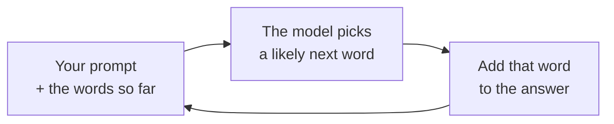
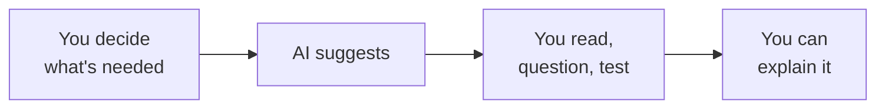
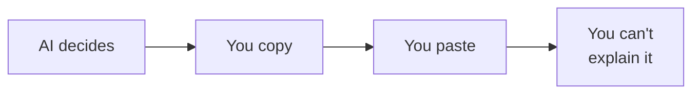

# Week 03 — Class Notes: AI in Software & Mobile Development

**100L · Semester 1 · Web Foundations & Developer Mindset · Shared by both tracks**

AI assistants can now write code, explain errors and answer questions in seconds. Today you find out how
they produce those answers, why they are sometimes **confidently wrong**, where they genuinely help a
developer, and why this programme asks you to learn without them first. You'll leave knowing the AI rules
you follow this year, and the reasons behind them.

## How to use these notes

We go through these notes together on the projector. The tutor shows each step on screen while you do it
yourself. Every section follows the same pattern:

| Marker | What it means |
|---|---|
| **▶ Try it** | Something to do. Each step is marked with what you need: **(phone)**, **(laptop)**, **(paper)**, or **(watch)**, which means watch the tutor's screen. |
| **✓ What you should see** | How you can tell it worked |
| **? Check** | One question to answer before we move on. Open **Answer** afterwards to check yourself. |

- **No laptop or data?** Everything marked **(watch)** or **(paper)** works without either. Your partner
  can share their screen for the rest.
- **Missed the session?** Work through these notes on your own. Every step tells you what you should see.
- **You don't need an AI account today.** The tutor runs the AI demos on the projector.

## By the end of today, you can…

1. Tell apart AI *inside* an app and AI that helps *build* an app.
2. Explain, in one sentence, how an AI chat assistant produces an answer.
3. Give three reasons an assistant can be wrong while sounding certain.
4. Check an AI answer against a trusted source, and say how you checked.
5. Name four jobs where AI genuinely helps a developer, and what the developer must still do.
6. Explain the difference between *using* an assistant and *being an assistant to* AI.
7. State the programme's AI rules for 100L, 200L and 300L+, and the reason for the order.
8. Name three things you must never paste into an AI chat.

---

## 1. Warm-up: spot the confident mistake

A student asked an AI assistant *"What happens when I type a web address and press Enter?"* Here is the
kind of answer they got. (We wrote this one ourselves, in the style AI assistants use.)

> Great question! Here's exactly what happens:
>
> 1. **DNS lookup:** your browser asks DNS to turn the server's IP address into a domain name.
> 2. **Connection:** the browser connects to the server on port 80, the standard port for HTTPS.
> 3. **Request:** the browser sends an HTTP request for the page.
> 4. **Response:** the server replies. A `500` status code means the page was not found, and a `200`
>    means everything worked.
>
> This whole process usually takes less than a second!

**▶ Try it (paper)**
1. Read the answer slowly. Use your week 1 notes or diagram.
2. Underline every mistake you can find. There are **three**.
3. Compare with your neighbour.

**✓ What you should see:** three underlines, in steps 1, 2 and 4. The answer is friendly, neatly
numbered, and mostly right. That is exactly why the mistakes are easy to miss.

**? Check:** What did you need to catch these mistakes?

Answer

You needed **week 1**. The mistakes: DNS turns *names into IP addresses*, not the other way round; HTTPS
usually uses port **443** (80 is for plain HTTP); and "not found" is **404**, while 500 means the server
broke. Without that knowledge, the answer looks perfect. You can only check what you already understand.
Keep that thought; the whole session comes back to it.

---

## 2. Two kinds of AI in software

"AI in software" means two different things:

| | **AI inside an app** | **AI that helps build an app** |
|---|---|---|
| Who uses it | The app's users | The developer |
| Examples | Keyboard suggestions, searching photos by what's in them, voice typing, spam filters, a bank spotting a strange payment, Meta AI in WhatsApp | Chat assistants that write or explain code, code editors that suggest the next line |
| In this programme | 400L: you add an AI-backed feature to your own app | From 200L: you learn to use these tools and to question them |

Mobile phones are full of the first kind. Some of it runs **on the phone itself**, without a connection;
some sends your data to a server and waits for the reply, like the apps you tested in airplane mode in
week 2.

**▶ Try it (phone)**
1. Open your photo gallery app (Google Photos, or Photos on an iPhone).
2. In its search box, type `food`. Then try `car`, `tree` or `document`.
3. Turn on airplane mode and try the same search again. Then turn airplane mode **off**.

**✓ What you should see:** photos of food that you never labelled "food". On many phones, the search
still works in airplane mode, because the phone's own AI looked at your pictures earlier. If your gallery
has no search box, watch your partner's screen.

**? Check:** A coding assistant that suggests the next line of code: which kind of AI is it?

Answer

**AI that helps build an app.** Its user is the developer, not the people who will use the finished app.
Today is mostly about this kind. In 400L you'll build the first kind into your own project.

---

## 3. How an assistant writes an answer

An AI chat assistant is built on a **large language model (LLM)**: a program that has studied an enormous
amount of text, and learned which words tend to follow which. When you send it a message (a **prompt**),
it does one thing, over and over:

It writes the whole answer one small piece at a time. Each piece is chosen because it is **likely** to come
next, not because anybody checked that it is **true**. Most of the time the likely answer and the true
answer are the same. Sometimes they aren't.

**▶ Try it (phone, then paper)**
1. Take out your predictive-text sentence from the pre-read. (No phone? Borrow your partner's sentence.)
2. Read it aloud to your neighbour.
3. On paper, finish each of these with the first word that comes to mind:
   - *The capital of Nigeria is …*
   - *A web page that can't be found returns error …*
   - *The best jollof rice in the world is made in …*

**✓ What you should see:** your phone's sentence sounds like English but says nothing true about your
day. On paper, most of the class writes the same word for the first two, and argues about the third. For
the third, the "likely" word depends on who wrote the text you learned from.

**? Check:** Your keyboard suggests `home` after `I am going`. Does it know where you are going?

Answer

**No.** It knows that `home` often follows `I am going` in text it has seen. A large language model works
on the same principle, at a vastly bigger scale. It is much better at choosing words, but it is still
choosing what is *likely*, not looking up what is *true*.

---

## 4. Confidently wrong

When an AI produces something that sounds right but is false, such as a fact, a quote, a link or a book
that doesn't exist, it's called a **hallucination**. It happens for a few reasons:

| Reason | What it means | Example |
|---|---|---|
| **Likely, not checked** | It writes what usually comes next | It invents a web address that *looks* like a real one |
| **Training cut-off** | It learned from text up to a certain date, and knows nothing after it | It describes an old version of a tool as the newest |
| **No live view** | It can't see today's data unless the tool searches the web for it | It gives yesterday's, or a made-up, naira exchange rate |
| **Goes along with you** | It tends to accept what your question assumes | You ask *why* something false is true, and it explains why |

The dangerous part: it sounds **just as sure** when it's wrong as when it's right. There is no change in
tone to warn you.

**▶ Try it (watch)**

The tutor asks an assistant two questions on the projector:
1. *"Why did HTTPS change from port 443 to port 8443 in 2021?"* (This never happened.)
2. *"Give me the link to the MDN page that lists all HTTP status codes."* The tutor then opens the link.

**✓ What you should see:** for question 1, the assistant either **corrects the question** (good) or
**explains a change that never happened** (a hallucination). Newer assistants often do the first, but not
always. For question 2, the link might open the right page, or a 404. Either way, you only know because
someone **opened it**. Write down what actually happened today; your answer may differ from another class's.

**? Check:** An assistant tells you, with confidence, today's naira to dollar exchange rate. What should you
do before you use that number?

Answer

**Check it against a live source**, such as your bank's app or a trusted rates page. Unless the assistant
searched the web just now, the number came from text it learned months ago, or it was simply invented to
fit the sentence. Even when it does search, it can misread the page. Treat any number it gives you as
"needs checking".

---

## 5. Where AI genuinely helps a developer

This doesn't mean AI is useless. Most professional developers now use it. In the Stack Overflow Developer
Survey 2025:

| Finding | Share of people who answered |
|---|---|
| Use or plan to use AI tools | 84% |
| Professional developers who use them **daily** | 51% |
| **Highly** trust the accuracy of AI tools | 3% |
| Distrust it, somewhat or highly | 46% |
| Biggest frustration: answers that are *"almost right, but not quite"* | 66% |

So developers use AI **a lot**, and trust it **a little**. Here is where it genuinely helps them, and what
they still have to do:

| AI is good at… | …but the developer must still |
|---|---|
| Explaining what an error message means | Find out *why* it happened in *their* code |
| Explaining a piece of code they're reading | Check the explanation against the code and the docs |
| Writing a first draft of repetitive code | Read every line, test it, and fix what's wrong |
| Suggesting several ways to solve a problem | Choose one, and know why |
| Summarising long documentation | Read the real docs for anything that matters |
| Being someone to "talk it through" with | Do the thinking; the talking helps *them* think |

Notice the pattern: every row needs someone who **already understands** enough to judge the answer.

**▶ Try it (paper)**
1. Look at the right-hand column.
2. For each row, write one word: what does the developer need, to do that part? (For example: *knowledge*,
   *testing*, *judgement*.)
3. Compare with your neighbour.

**✓ What you should see:** the same few words over and over, mostly *knowledge* and *judgement*. The AI
speeds up the typing; it doesn't replace the knowing.

**? Check:** Only 3% of developers highly trust AI accuracy, yet most use it. How can both be true?

Answer

They use it the way you'd use a fast but careless helper: for drafts and ideas, always checked. Developers
who know their subject can spot the "almost right" answers quickly. Someone who doesn't know the subject
can't, which is why section 6 matters for you.

---

## 6. Using an assistant, or being one

There's a difference between **using** an assistant and **being an assistant to AI**:

**Using an assistant: you are in charge**

**Being an assistant to AI: it is in charge**

In the second picture, the AI does the thinking and you carry its work to the tutor. Think of the gym: if
a friend lifts the weights for you, the weights still go up, but your muscles don't grow.

Two experiments show this happening:

- **High-school maths, Turkey (Bastani and others, 2024–25).** About 1,000 students practised with a
  ChatGPT-style assistant, a version that only gave hints, or no AI. With the plain assistant, practice
  scores rose by 48%. But on the exam, without AI, those students scored **17% lower** than students who
  never had it. The hints-only version didn't cause that drop.
- **Programmers learning something new (Anthropic, 2026).** 52 programmers learned an unfamiliar code
  library, half with an AI assistant. The AI group finished barely faster, but on a quiz afterwards they
  averaged **50%**, against **67%** for the group without AI. The biggest gap was on **debugging**: finding
  out why code is broken.

**▶ Try it (paper)**

In the Anthropic study, people used the AI in different ways. Three of these ways kept their quiz scores
high, and three didn't. Guess which three **kept** learning:

| | How they used the AI |
|---|---|
| A | Let the AI write all the code |
| B | Started with a few questions, then let it write everything |
| C | Asked only about ideas, and fixed their own errors |
| D | Asked for code **and** an explanation of it |
| E | Got code, then asked questions until they understood it |
| F | Used the AI to fix each error as it appeared |

**✓ What you should see:** most people pick C, D and E. Those are the three that kept learning.

**? Check:** What do C, D and E have in common?

Answer

In all three, the person was still **thinking**: asking *why*, reading the explanation, or fixing errors
themselves. In A, B and F, the AI did the thinking. The tool was the same in all six. The difference was
who stayed in charge.

---

## 7. The programme's AI rules

This programme brings in AI in stages, so you build your own skill first:

| Level | Rule | What it means |
|---|---|---|
| **100L** (this year) | **Unaided** | You build your skills yourself. No AI writes, completes or fixes your labs, deliverables or practicals. |
| **200L** | **Introduced and critiqued** | You start using AI for code, and you must be able to explain and question everything it gives you. |
| **300L and up** | **Expected practice** | You use AI the way professional developers do, as section 5 describes. |

**Why this order?** Section 1 showed it: you can only check an answer if you could have got there yourself.
Calculators came into your maths classes *after* you learned to add, not before.

It's also how you are assessed. Your **Git history** (the record of your work, from week 11) and **live
questions** in your demos show what *you* can do. Work you can't explain counts against you, however good
it looks.

Other universities do the same. Harvard's CS50 course, for example, lets students use its own teaching
assistant bot, but not tools such as ChatGPT that suggest or complete answers.

**▶ Try it (paper)**

At **100L**, is each of these OK? Write **yes** or **no**, and why.

1. Pasting this week's lab question into an AI and handing in its answer.
2. Asking your partner, the tutor or a Student Lead when you're stuck.
3. Reading MDN to understand a word in the notes.
4. Asking an AI to write your self-appraisal from week 2.
5. Asking an AI to explain what "DNS resolver" means, then checking it against MDN and the notes.
6. Asking an AI to "just fix" your diagram before you submit it.

**✓ What you should see:** 1, 4 and 6 are **no**: the AI does your work. 2 and 3 are **yes**. Number 5 is
the one to discuss: understanding an idea isn't the same as doing your work, but an AI explanation is
**unchecked** until you check it. If in doubt, ask the tutor *before*, not after.

**? Check:** Why does the rule change at 200L instead of staying "no AI" for ever?

Answer

Because professional developers use AI every day, and you need to learn to use it **well**. By 200L you'll
know enough HTML, CSS and JavaScript to catch its mistakes, as you caught the ones in section 1. Using AI
before you can judge it is being its assistant; using it after is being in charge.

---

## 8. Using AI safely

Whatever you type into an AI chat goes to a company's server (remember week 2: you don't control the
server). It may be stored, read by staff, or used to train future models, depending on the service and
its settings.

**Never paste:**
- passwords, PINs or one-time codes (OTPs)
- your own or anyone else's personal details: phone numbers, addresses, matric numbers, results
- private or secret work data, such as a company's code or its database passwords
- exam or test questions

Two more risks for developers:
- **Invented names.** Assistants sometimes name code add-ons that don't exist. One 2025 study tested
  16 AI models: at least 5.2% of the add-ons suggested by commercial models, and 21.7% by open-source
  ones, didn't exist. Attackers have started publishing harmful add-ons under those invented names,
  waiting for someone to install them without checking. You'll meet code add-ons in Semester 2.
- **Age limits.** Each service sets a minimum age, and some need a parent's permission under 18.

**▶ Try it (watch)**
1. The tutor opens the settings of one AI assistant.
2. Look for anything about **chat history**, **memory**, **data controls** or **improving the model**.

**✓ What you should see:** a setting that controls whether your chats are kept or used to train the model.
Names differ between services, and they change. The point is that it exists, and that the default is
often "on".

**? Check:** A classmate pastes their portal password into an AI chat to ask why their login fails. What
went wrong, and what should they have done?

Answer

They sent a secret to a server they don't control, so it's no longer secret. They should **change the
password now**, then ask the portal's support desk. No AI needs your password to explain a login problem;
in week 2 you saw that only the portal's own backend should ever check it.

---

## Key words

| Word | Meaning |
|---|---|
| AI (artificial intelligence) | Software that does things we used to think needed a human mind, such as understanding language or recognising pictures |
| AI assistant | A chat tool you talk to in ordinary language, which answers or writes for you |
| Coding assistant | An AI assistant made for writing, explaining or fixing code |
| Large language model (LLM) | The program inside an AI assistant, which writes by repeatedly choosing a likely next word |
| Prompt | What you type to the assistant |
| Training data | The text a model learned from |
| Training cut-off | The date its training data stops; it knows nothing newer unless it searches |
| Hallucination | A confident answer that is false or made up |
| Verify | Check a claim against a trusted source, such as MDN or the notes |
| Unaided | Done without AI: the 100L rule for your labs, deliverables and practicals |

## Questions people ask

Will AI replace developers?

Nobody knows exactly how jobs will change, and anyone who sounds certain is guessing. What the evidence
above shows today: AI speeds up people who already understand their work, and it can stop beginners from
building that understanding. The developers most at risk are the ones who can only do what the AI does.
Your aim this year is to become someone who can judge the AI.

If AI can write code, why learn to write it?

For the same reason you learn to read before you check someone else's essay. Section 1 showed it: you could
only catch the mistakes because you knew the topic. Someone has to know whether the code is right, safe
and what the users need. That someone is the developer.

My friend uses AI for everything and gets good marks. Why shouldn't I?

Look at the maths study in section 6: practice scores went up and exam scores went down. The marks that
count in this programme come from timed practicals, live questions and your own Git history. All of them
show what *you* can do, without the AI.

Which AI assistant is the best one?

It changes every few months, so any answer here would soon be out of date. That's another lesson: the
habits of checking, testing and explaining last longer than any one tool. You'll pick tools properly at
200L.

Can I use AI to explain things I don't understand?

Understanding an idea isn't the same as doing your lab. But an AI explanation might be wrong, and at 100L
you can't always tell. Check it against MDN or these notes, and bring your question to your partner, a
Student Lead or the tutor. Never use AI on your labs, deliverables or practicals. When in doubt, ask
first.

## Read more

- 3Blue1Brown: [Large Language Models explained briefly](https://www.youtube.com/watch?v=LPZh9BOjkQs) (video, about 8 min)
- MIT Sloan Teaching & Learning Technologies: [When AI Gets It Wrong: Addressing AI Hallucinations and Bias](https://mitsloanedtech.mit.edu/ai/basics/addressing-ai-hallucinations-and-bias/)
- Anthropic: [How AI assistance impacts the formation of coding skills](https://www.anthropic.com/research/AI-assistance-coding-skills)
- Wharton: [Without guardrails, generative AI can harm education](https://knowledge.wharton.upenn.edu/article/without-guardrails-generative-ai-can-harm-education/):
  the maths study in section 6
- [Stack Overflow Developer Survey 2025: AI](https://survey.stackoverflow.co/2025/ai)
- Simon Willison: [Here's how I use LLMs to help me write code](https://simonwillison.net/2025/Mar/11/using-llms-for-code/)
  (skip the code)
- [CS50 at Harvard: Academic honesty](https://cs50.harvard.edu/x/honesty/): one university's AI rules
- [Elements of AI](https://www.elementsofai.com/): a free beginner course, no maths needed

---

## For tutors

These notes are projected, so keep each section moving: **no more than two minutes of explanation,
then straight to ▶ Try it.** This week invites opinions, and debates can eat the concept block. Park big
discussions for lab Part 3, which is built for them.

### Session plan (3 h 30 min)

| Time | Block | Activity |
|---|---|---|
| 0:00–0:15 | Warm-up | Section 1. Then a hands-up on pre-read Task 2, question 1: who already uses an AI assistant? |
| 0:15–1:10 | Concept | Sections 2–8, about 8 minutes each. If you run short, set section 8's "two more risks" as reading. |
| 1:10–1:20 | Break | Set up the demo machine; lay out question cards and scenario cards |
| 1:20–3:05 | Lab | [`lab.md`](lab.md): watch the coding assistant → fact-check in pairs → help or harm? → the write-up |
| 3:05–3:20 | Show & tell | Two pairs show their best confident mistake: what they asked, what it said, how they proved it wrong |
| 3:20–3:30 | Ship | Hand in. Preview week 4 (the terminal; laptops help). Invite Student Lead volunteers (curriculum §12). |

### Prep checklist

- [ ] **One AI assistant on the demo machine, logged in to your own account**, never a student's. Any free
      chat assistant works. Note its training cut-off if it publishes one.
- [ ] **Run every demo prompt the day before**, and again on the morning. Answers change between days and
      between model versions. Know what your assistant does today, so you aren't surprised in front of
      the room.
- [ ] Projector tabs: Google Photos (or an iPhone screen mirror) for section 2, the assistant, MDN's
      [HTTP response status codes](https://developer.mozilla.org/en-US/docs/Web/HTTP/Reference/Status) page
      to compare with section 4's link, and the Stack Overflow survey AI page.
- [ ] Find the chat-history or data-training setting in your assistant before section 8.
- [ ] **Offline fallback.** If the room has no connection, the AI demos can't run live. Beforehand, record
      your screen (or take screenshots) for:
  - both section 4 prompts and the opened link
  - the section 8 settings page
  - all three lab Part 1 prompts, with the code and the opened page
- [ ] Print the lab kit: see [`lab.md` → Kit](lab.md#kit).

### Running the demos

- **Warm-up (section 1).** Let students find the mistakes before you reveal them. The point to land is the
  last line of the answer: *you can only check what you already understand.* Everything else today hangs on
  it.
- **Photo search (section 2).** It works on Google Photos and iPhone Photos. Some Android gallery apps
  don't have it. Pair those students with someone who does.
- **Port 8443 (section 4).** If the assistant corrects the false premise, praise it, then ask the room:
  "How did *you* know it was right to correct it?" If it plays along, let the room catch it. Both outcomes
  teach the lesson; don't re-run the prompt hoping for a hallucination.
- **The two studies (section 6).** Keep the numbers simple. Some reports describe Anthropic's result as
  "17% lower", meaning 17 percentage points (50% against 67%). Present it as the raw scores. Stress that
  Anthropic sells an AI coding assistant and still published this: good evidence, not anti-AI propaganda.
- **Balance.** Students may swing to "AI is useless" or "AI is cheating". Neither is the message. Section 5
  is there to show where it helps; the message is *in charge, and in order*.
- **The 100L rule (section 7).** "Unaided" covers labs, deliverables and practicals. Scenario 5 is the
  grey area. Agree a tutor-team line on it before the session, and give the same answer in every class.
- **The check answers are collapsed.** Take answers from the room before you click **Answer**.

---

## Sources

- Curriculum document §4 (week 3 theme and the staged AI policy), §10 (AI-backed feature at 400L), §11
  (assessment: Git history and individual questioning) and §12 (Student Leads)
- MDN Web Docs: [HTTP response status codes](https://developer.mozilla.org/en-US/docs/Web/HTTP/Reference/Status)
  (warm-up and section 4)
- 3Blue1Brown: [Large Language Models explained briefly](https://www.youtube.com/watch?v=LPZh9BOjkQs) (section 3)
- MIT Sloan Teaching & Learning Technologies: [When AI Gets It Wrong](https://mitsloanedtech.mit.edu/ai/basics/addressing-ai-hallucinations-and-bias/)
  ("their goal is to generate plausible content, not to verify its truth"; section 4)
- Stack Overflow: [2025 Developer Survey, AI](https://survey.stackoverflow.co/2025/ai) (section 5 figures)
- Bastani and others, *Generative AI without guardrails can harm learning: evidence from high school
  mathematics*, PNAS, 2025, as reported by [Wharton](https://knowledge.wharton.upenn.edu/article/without-guardrails-generative-ai-can-harm-education/)
  (section 6)
- Anthropic: [How AI assistance impacts the formation of coding skills](https://www.anthropic.com/research/AI-assistance-coding-skills),
  January 2026 (section 6 and the six patterns)
- Simon Willison: [Here's how I use LLMs to help me write code](https://simonwillison.net/2025/Mar/11/using-llms-for-code/)
  (training cut-off; "you have to test what it writes")
- CS50, Harvard: [Academic honesty](https://cs50.harvard.edu/x/honesty/) (section 7)
- Spracklen and others: [We Have a Package for You! A Comprehensive Analysis of Package Hallucinations by
  Code Generating LLMs](https://www.usenix.org/conference/usenixsecurity25/presentation/spracklen),
  USENIX Security 2025 (section 8)
