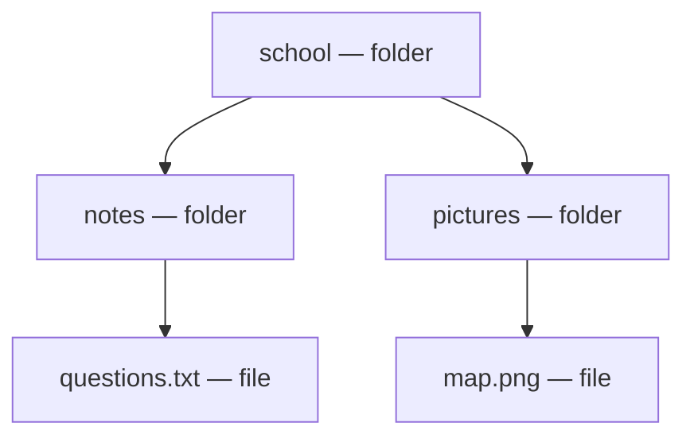
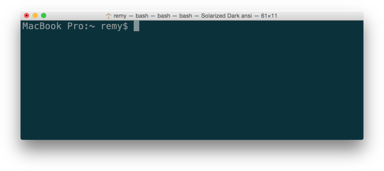

<!-- layout: workbook -->
# Week 04 — File System & Terminal

**100L · Semester 1 · Class workbook · 2 hours / 120 minutes**

## Your computer, one instruction at a time

You have seen how software communicates across a network. Today you work with something closer: the
files on your own machine. **Do first, read second.** Each section tells you to try something, shows
you what the screen really looks like, and only then names what happened.

## How to use these notes

Work in pairs: the **driver** types, the **navigator** reads, predicts and checks. Swap roles at each
checkpoint — both of you must use the keyboard. **▶ Try it** says what you need; **✓ What you should
see** shows the real result to compare against; **? Check** asks you to explain before you open the
answer. Steps marked **(laptop)**, **(phone)**, **(paper)** or **(watch)** say what they need. A
student working alone can use the results to check themselves. All core activities work offline.

## By the end, you can…

1. List a folder and point to a file's extension in the real listing.
2. Say where you are from the printed path, and reach a sibling folder in one command.
3. Create, move, copy, rename and delete one practice file, and prove which kept its source.
4. Show a failed path, then repair it using your location and a listing.
5. Launch the class kit installer and produce a version number or an open window as proof.

## Your two-hour route

| Time | Activity | Evidence |
|---|---|---|
| 00:00–00:10 | File detective · section 1 | Name, extension and folder |
| 00:10–00:35 | Follow-along · sections 2–4 | Practice folder and command checks |
| 00:35–01:40 | [Practical lab](lab.md) · use section 5 as a reference | Your independent drill and installation record |
| 01:40–01:50 | Show & tell | Demonstrate and explain one result |
| 01:50–02:00 | Save and submit | Check evidence and hand it in |

**This week:** install and verify tools. **Later:** VS Code features in week 5, HTML in week 6,
Git workflows in week 11. No AI assistance for your work at 100L.

<!-- pagebreak -->

## 1. Point at a file and its container

**Warm-up · 10 minutes · phone, laptop or paper**

**▶ Try it**

1. **(laptop or phone)** Open the harmless file you chose in the pre-read. Show its **full name** to
   your partner. On a shared machine, use a class file, not somebody's private folders.
2. **(laptop or phone)** Now find the folder that holds it. Say which is the file and which is the
   container. Some file managers hide the ending: turn file extensions on, or open file information.
3. **(paper)** Draw a box for that folder and a smaller labelled box inside it for the file. Underline
   the ending of the name.

**✓ What you should see:** a name with a dot near the end, sitting inside one folder. Phone Files apps
and Windows File Explorer both show the full name once you switch extensions on.



**What you just saw:** a **file** holds data; a **folder** (also called a **directory**) holds files
and other folders; the **file system** is how the computer organises them. The ending after the last
dot is the **extension** — a clue to the file type, not proof of it, and each arrow above means "contains".

**? Check:** If a file is called `report.pdf.txt`, which ending is its final extension?

<details><summary>Answer · check after you try</summary>

`.txt`. The earlier `.pdf` is part of the name. Renaming `photo.png` to `photo.txt` does not turn a
picture into a text document either.

</details>

### Record your observation

| What I found | My observation |
|---|---|
| File name and extension | ______________________________________________ |
| Containing folder | ______________________________________________ |
| One thing my partner noticed | ______________________________________________ |

<!-- pagebreak -->

## 2a. Open a window and read the line

**Guided practice · 2 minutes · laptop or paper**

**▶ Try it**

1. **(laptop)** Windows: search Start for **Command Prompt** or **Windows PowerShell**. macOS: open
   **Applications → Utilities → Terminal**. Use an ordinary window, not an administrator one.
   Windows Terminal can host either shell: check the tab's profile, not the window's colour.
2. **(paper)** Record which shell you opened. Point to the line that is waiting for you.
3. **(laptop or paper)** Compare your window with Figure 1 in your
   [pre-read](pre-read.md), which shows Command Prompt and PowerShell side by side.

**✓ What you should see:** one line ending in a symbol, then a blinking cursor. Two different Windows
shells print different leading symbols.



*Figure 1. MDN contributors' macOS Terminal screenshot, unchanged. Your name, colours and prompt may
look different. Full credit: Sources.*

**What you just saw:** a **terminal** is the window where you type; a **shell** is the program that
interprets what you type. The waiting line is the **prompt** — do not copy its symbols (`PS`, `$`, `%`,
`>`) into a command. Windows offers PowerShell and CMD; macOS commonly uses zsh, Linux often Bash.

**? Check:** If two windows both run on Windows, do they accept the same commands?

<details><summary>Answer · check after you try</summary>

No. CMD and PowerShell interpret commands differently. `Get-Location` is PowerShell only; `cd` with no
arguments reports your location in CMD. Pick one route and stay in it.

</details>

<!-- pagebreak -->

## 2b. Build a practice space

**Guided practice · 6 minutes · laptop · sections 2 total 8 minutes**

**▶ Try it (laptop)** — read only your platform's block, then run **one line at a time**, Enter after
each. `$HOME` (PowerShell), `%USERPROFILE%` (CMD) and `~` (macOS/Linux) all mean your own home folder.

### Windows · PowerShell

```powershell
Set-Location $HOME
Get-Location
Get-ChildItem
New-Item edupoint-week04-practice -ItemType Directory
Set-Location .\edupoint-week04-practice
```

### Windows · Command Prompt (CMD)

```bat
cd /d "%USERPROFILE%"
cd
dir
mkdir edupoint-week04-practice
cd edupoint-week04-practice
```

`/d` lets CMD's `cd` change drive as well as folder; `cd` alone shows where you are.

### macOS / Linux · Terminal

```sh
cd ~
pwd
ls
mkdir edupoint-week04-practice
cd edupoint-week04-practice
```

Before the `mkdir`, check the listing. If `edupoint-week04-practice` is already there, ask for help
choosing a fresh name and use it everywhere. Never overwrite somebody's folder.

**✓ What you should see.** Real output from a macOS run of the block above:

```sh
$ pwd
/Users/learner
$ cd edupoint-week04-practice
$ pwd
/Users/learner/edupoint-week04-practice
```

PowerShell's `Get-Location` prints a `Path` heading then your path; CMD's `cd` prints only the path.
CMD's `dir` also prints volume headings, a date column and totals. **A command that prints nothing, or
a folder that lists as empty, is normal — the new folder really is empty.**

**What you just saw:** your **current working directory** is the folder your commands start from. Each
line above ends in the folder you are standing in, not in a file.

**? Check:** Does an empty listing mean the terminal is broken?

<details><summary>Answer · check after you try</summary>

No. Confirm where you are first, then ask what should exist there. `mkdir` and `New-Item` often print
nothing at all when they succeed.

</details>

<!-- pagebreak -->

## 3. Walk up, then across

**Guided practice · 7 minutes · laptop and paper**

**▶ Try it (laptop)** — still inside `edupoint-week04-practice`.

1. Make two folders, then step into `inbox`.
2. Before you run the line containing `..`, point on paper at the folder you think it takes you to.
3. Confirm where you landed. Swap driver and navigator.

### Windows · PowerShell

```powershell
New-Item -ItemType Directory -Name inbox
New-Item -ItemType Directory -Name "study notes"
Set-Location .\inbox
Get-Location
Set-Location ..
Get-ChildItem
```

### Windows · Command Prompt (CMD)

```bat
mkdir inbox
mkdir "study notes"
cd inbox
cd
cd ..
dir
```

### macOS / Linux · Terminal

```sh
mkdir inbox
mkdir "study notes"
cd inbox
pwd
cd ..
ls
```

**✓ What you should see.** The same macOS run, continued:

```sh
$ cd inbox
$ pwd
/Users/learner/edupoint-week04-practice/inbox
$ cd ..
$ ls
inbox        study notes
```

Two entries, and **one** folder named `study notes` — the quotes are what kept that name in one piece.
Neither folder moved when you moved yourself.


**▶ Try it again (laptop):** from `inbox`, reach `study notes` in **one** command. Return to the
practice folder before section 4.

**What you just saw:** an **absolute path** names a place from the file-system root, such as
`C:\Users\Learner\school` or `/Users/learner/school`. A **relative path** starts from where you
stand. `.` means here, `..` means the parent. Illustrative names, not commands to copy.

**? Check:** From `inbox`, why doesn't the relative path `study notes` reach its sibling?

<details><summary>Answer · check after you try</summary>

It looks **inside** `inbox`, where there is no such folder. Go up first:
`Set-Location "..\study notes"` (PowerShell), `cd "..\study notes"` (CMD),
`cd "../study notes"` (macOS/Linux). Then `Set-Location ..` or `cd ..` returns you.

</details>

<!-- pagebreak -->

## 4. Create, move, copy, delete — and know which was which

**Guided practice · 10 minutes · laptop**


**▶ Try it (laptop)**

1. Confirm you are in `edupoint-week04-practice`. Predict the first three commands to your partner.
2. Run as far as the first listing. Say which file is the original and which is the copy.
3. Before deleting, say the target aloud. Agree **only** to deleting `discard.txt`. List again.
   No wildcards, no recursive deletion, no force options.

### Windows · PowerShell

```powershell
New-Item -ItemType File -Path .\inbox\route.txt
Move-Item .\inbox\route.txt ".\study notes"
Set-Location ".\study notes"
Copy-Item route.txt discard.txt
Get-ChildItem
Remove-Item discard.txt -Confirm
Get-ChildItem
Set-Location ..
```

`-Confirm` pauses and asks before deleting. Answer it out loud, then read what the listing says.

### Windows · Command Prompt (CMD)

```bat
echo Practice> inbox\route.txt
move inbox\route.txt "study notes"
cd "study notes"
copy route.txt discard.txt
dir
del /p discard.txt
dir
cd ..
```

CMD's `echo` makes text and `>` writes it into the file, **replacing any contents already there** — so
use a fresh name. At `del /p`, read the name it shows you: `Y` confirms, `N` cancels.

### macOS / Linux · Terminal

```sh
touch inbox/route.txt
mv inbox/route.txt "study notes"
cd "study notes"
cp route.txt discard.txt
ls
rm -i discard.txt
ls
cd ..
```

**✓ What you should see.** Verbatim output from running that macOS block:

```sh
$ ls
discard.txt    route.txt
$ rm -i discard.txt
remove discard.txt? y
$ ls
route.txt
$ ls inbox
```

Two files, then one. The last line printed **nothing**, which is how you know `mv` carried
`route.txt` out of `inbox` instead of copying it.

**What you just saw:** **moving** changes where an item is found and leaves nothing behind;
**copying** makes another item and keeps the source. Terminal deletion does **not** normally send a
file to the Recycle Bin or Trash — what you delete is gone.

**▶ Break and repair (laptop):** run `cd missing` (PowerShell: `Set-Location .\missing`). Read the
error, then check where you are and what is here. Do not create `missing`.

```sh
$ cd missing
cd: no such file or directory: missing
$ pwd
/Users/learner/edupoint-week04-practice
```

**? Check:** Does a path error mean you should reopen the terminal as administrator?

<details><summary>Answer · check after you try</summary>

No. Check spelling, case, quotes and your current folder first. This one failed simply because
`missing` does not exist, and the failed command left your location exactly where it was.

</details>

<!-- pagebreak -->

## 5. Install offline; prove the tool runs

**Reference for the lab's 20-minute installation station**

**▶ Try it (laptop)**

1. Keep any working installation as it is. Use the prepared station to practise a missing step.
2. Your class kit sits in `edupoint-installers` inside your home folder. The short names below are
   renamed copies of official installers, matched to your machine's operating system.
3. Use **only your platform's route**. Finish the installer, then check its version.

### Windows · PowerShell or CMD

```powershell
Set-Location "$HOME\edupoint-installers"
Get-ChildItem
msiexec /i ".\node.msi"
```

```bat
cd /d "%USERPROFILE%\edupoint-installers"
dir
msiexec /i ".\node.msi"
```

Both open the Node installer window. Keep optional build-tool downloads switched off. Afterwards,
**close and reopen your shell**, then run `node --version`.

### macOS · Terminal

```sh
cd ~/edupoint-installers
ls
open ./node.pkg
```

`open` starts the Installer wizard; finish it, then open a new terminal window and run
`node --version`.

### Linux · Terminal · prepared portable archive

```sh
cd ~/edupoint-installers
ls
mkdir node
tar -xf node.tar.xz -C node --strip-components=1
./node/bin/node --version
```

Stop if `node` is already there. `tar` unpacks the archive, `-C node` picks the destination, and
`--strip-components=1` drops the outer folder — so the program lands at `node/bin/node`. This portable
install needs that full path every time; a bare `node` will not find it.

**✓ What you should see:**

```sh
$ node --version
v22.15.0
```

Any version beginning with `v` and matching your kit record. Write it down. Then open the browser and
VS Code, and run `git --version`. Use the tutor's other offline installers if a tool is missing. No
editor settings and no Git workflows today.

**What you just saw:** a **toolchain** is the set of tools used together to build software — here a
browser, VS Code, Git and Node.js. **Node.js** runs JavaScript outside a browser; we meet that language
later. An **installer** is the program that sets software up. Downloading one proves nothing; a version
number or an open window does.

**? Check:** Is a screenshot of an installer file proof that the tool works?

<details><summary>Answer · check after you try</summary>

No. Show the running application or its version output. If you were blocked, or only watched someone
else do it, record that honestly — it counts as a real result, not a failure.

</details>

<!-- pagebreak -->

## Keep this beside your keyboard

Read this as a vocabulary list. `path` and `file` below are placeholders — supply the real name.

| Intent | PowerShell | Command Prompt (CMD) | macOS / Linux |
|---|---|---|---|
| Where am I? | `Get-Location` | `cd` | `pwd` |
| What is here? | `Get-ChildItem` | `dir` | `ls` |
| Change folder | `Set-Location path` | `cd /d path` | `cd path` |
| Go to parent | `Set-Location ..` | `cd ..` | `cd ..` |
| Make folder | `New-Item name -ItemType Directory` | `mkdir name` | `mkdir name` |
| Make practice file | `New-Item file -ItemType File` | `echo Practice> file` | `touch file` |
| Move / rename | `Move-Item source destination` | `move source destination` | `mv source destination` |
| Copy file | `Copy-Item source destination` | `copy source destination` | `cp source destination` |
| Delete one file, asking first | `Remove-Item file -Confirm` | `del /p file` | `rm -i file` |

Use fresh filenames when creating; CMD's `>` overwrites what is already there. Never mix shell columns.

**Shortcuts:** Up Arrow recalls your previous command — read it before pressing Enter. Tab completes a
partly typed name — look at what it chose. Ctrl+C cancels the line you are typing, or asks a running
command to stop; it does **not** undo a command already run.

### Key words

| Word | Meaning |
|---|---|
| File / folder | A stored item of data / a container for items |
| Extension | The ending of a file name, such as `.txt` |
| Path | A route identifying a file or folder |
| Absolute / relative | From the file-system root / from the current folder |
| Terminal / shell | The command window / the interpreter of your commands |
| Prompt | The line waiting for your command |
| Argument / option | Information given to a command / a setting that changes its behaviour |
| Installer / toolchain | A program that sets up software / the tools used together to build it |

<!-- pagebreak -->

## Common questions

<details><summary>“Cannot find path” or “No such file or directory”?</summary>

Check where you are, list what is here, then compare spelling and case. Keep letter case exact on every
system: some treat `Notes` and `notes` as different folders. Quote any path with a space. Retry one step.

</details>

<details><summary>My command is “not recognised” or “not found”.</summary>

Check spelling and which shell you are in. `Get-Location` needs PowerShell; `cd /d` is our CMD route.
After installing a tool, close and reopen the terminal. If Node still fails, ask the tutor to check the
installation and its executable search path — do not reinstall it again and again.

</details>

<details><summary>Nothing printed — did my command work?</summary>

Usually yes. `mkdir`, `New-Item`, `mv` and `cd` normally print nothing when they succeed. Confirm with a
location check and a listing.

</details>

## Read more

- MDN: [Dealing with files](https://developer.mozilla.org/en-US/docs/Learn_web_development/Getting_started/Environment_setup/Dealing_with_files)
  and [Command line crash course](https://developer.mozilla.org/en-US/docs/Learn_web_development/Getting_started/Environment_setup/Command_line).
  Read the naming advice and “What does the terminal look like?”. Skip the editor setup, HTML tasks,
  advanced commands, pipes and scripting.
- Software Carpentry: [Navigating files and directories](https://swcarpentry.github.io/shell-novice/02-filedir.html).

### Sources

Links checked 26 October 2026. These notes use original activities and diagrams; the references below
support the command behaviour and teaching sequence.

- Microsoft Learn: [about locations](https://learn.microsoft.com/en-us/powershell/module/microsoft.powershell.core/about/about_locations?view=powershell-7.6),
  [New-Item](https://learn.microsoft.com/en-us/powershell/module/microsoft.powershell.management/new-item?view=powershell-5.1),
  [Move-Item](https://learn.microsoft.com/en-us/powershell/module/microsoft.powershell.management/move-item?view=powershell-7.6),
  [Copy-Item](https://learn.microsoft.com/en-us/powershell/module/microsoft.powershell.management/copy-item?view=powershell-5.1),
  [Remove-Item](https://learn.microsoft.com/en-us/powershell/module/microsoft.powershell.management/remove-item?view=powershell-5.1);
  Command Prompt: [cd](https://learn.microsoft.com/en-us/windows-server/administration/windows-commands/cd),
  [dir](https://learn.microsoft.com/en-us/windows-server/administration/windows-commands/dir),
  [mkdir](https://learn.microsoft.com/en-us/windows-server/administration/windows-commands/mkdir),
  [echo](https://learn.microsoft.com/en-us/windows-server/administration/windows-commands/echo),
  [move](https://learn.microsoft.com/en-us/windows-server/administration/windows-commands/move),
  [copy](https://learn.microsoft.com/en-us/windows-server/administration/windows-commands/copy),
  [del](https://learn.microsoft.com/en-us/windows-server/administration/windows-commands/del),
  [msiexec](https://learn.microsoft.com/en-us/windows-server/administration/windows-commands/msiexec).
- Node.js: [downloads](https://nodejs.org/en/download) and
  [`--version`](https://nodejs.org/api/cli.html#-v---version). Apple:
  [execute commands and run tools](https://support.apple.com/guide/terminal/execute-commands-and-run-tools-apdb66b5242-0d18-49fc-9c47-a2498b7c91d5/mac).
  VS Code setup: [Windows](https://code.visualstudio.com/docs/setup/windows),
  [macOS](https://code.visualstudio.com/docs/setup/mac), [Linux](https://code.visualstudio.com/docs/setup/linux).
- Software Carpentry: [Working with files and directories](https://swcarpentry.github.io/shell-novice/03-create.html).
  Local curriculum §4, week 4; the lead tutor's two-hour correction of 26 October 2026 governs the plan.

**Figure 1:** unmodified [macOS Terminal screenshot](https://developer.mozilla.org/en-US/docs/Learn_web_development/Getting_started/Environment_setup/Command_line/mac-terminal.png)
by MDN / Mozilla Contributors, shown smaller. CC BY-SA 2.5, per
[MDN's content licence](https://developer.mozilla.org/en-US/docs/MDN/Writing_guidelines/Attrib_copyright_license).
The Windows comparison image is Figure 1 of the [pre-read](pre-read.md), same source and licence.
The Mermaid diagrams are original and stay editable in the Markdown source.

### Your exit reflection

Before submitting, explain to your partner: “When a command fails, the first two things I check are…”

________________________________________________________________________

“Today I can do this without my partner typing for me…”

________________________________________________________________________
