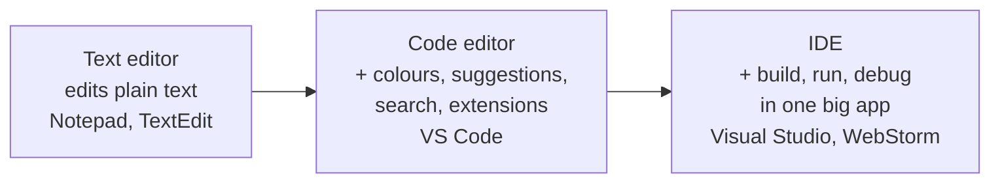
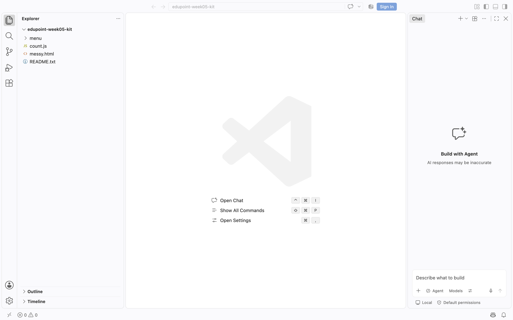
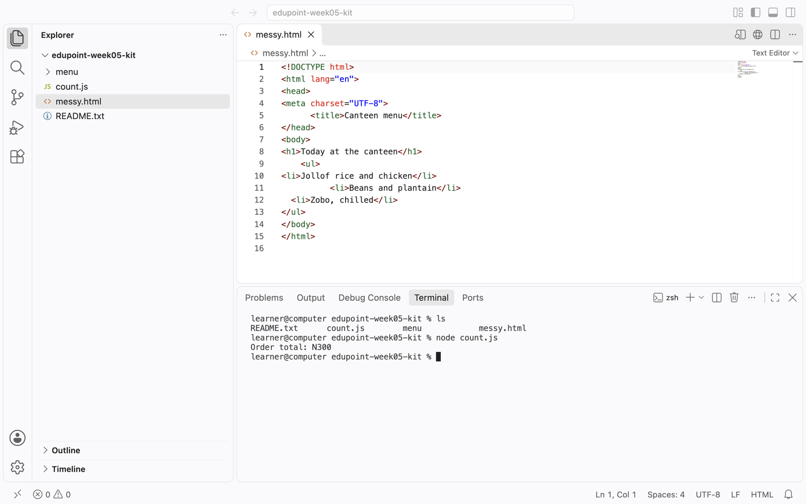
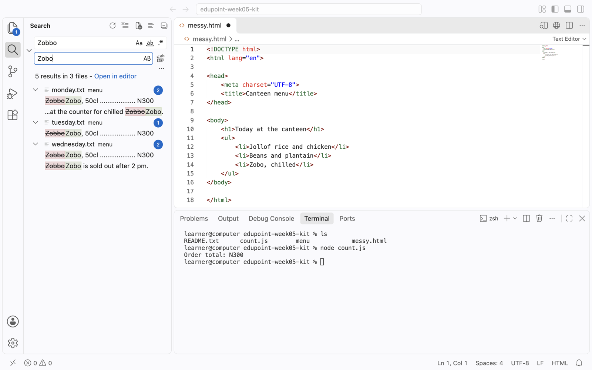
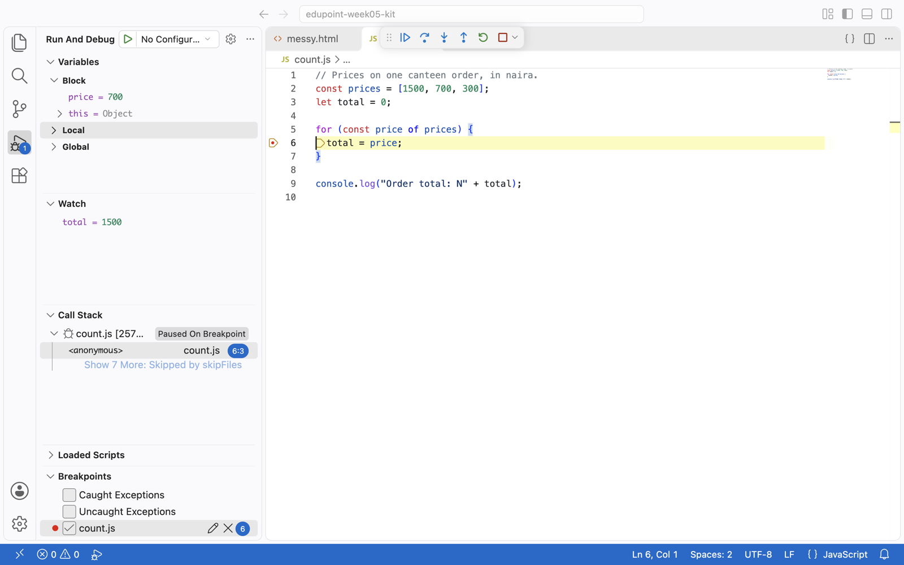
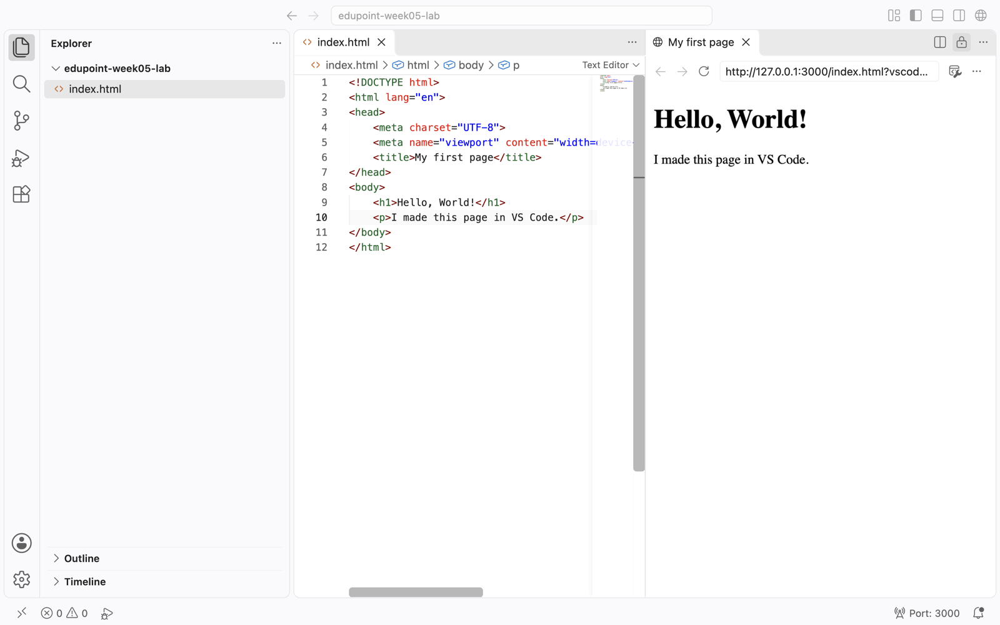

<!-- layout: workbook -->
# Week 05 — Code Editor / IDE

**100L · Semester 1 · Class workbook · 2 hours / 120 minutes**

## Your editor, set up to help you

Last week you worked in a terminal. Today you move into **VS Code**, the editor you will use for the rest
of the programme. You will see what it does that a plain text editor cannot, set it up, and open your
first page in a browser. **Do first, read second.** Each section tells you to try something, shows you
the real screen, and only then names what happened.

## How to use these notes

Work in pairs: the **driver** types, the **navigator** reads, predicts and checks. Swap at each
checkpoint; both of you must use the keyboard. **▶ Try it** says what to do; **✓ What you should see**
shows the real result; **? Check** asks you to explain before you open the answer. Steps marked
**(laptop)**, **(phone)**, **(paper)** or **(watch)** say what they need. Shortcuts are written
**Windows/Linux · macOS**. All core activities work offline.

## By the end, you can…

1. Open the same file in a plain editor and in VS Code, and point to three things only VS Code shows.
2. Open a folder in VS Code, switch its AI features off, and run a command in its built-in terminal.
3. Accept an IntelliSense suggestion and use Format Document, then compare before and after.
4. Search a word across several files, read the count, then replace every match.
5. Spot an unsaved file, and pause a program on a breakpoint to read a value.
6. In the lab: configure VS Code, install an extension offline and open a Hello World page live in the browser.

## Your two-hour route

| Time | Activity | Evidence |
|---|---|---|
| 00:00–00:10 | Two editors, one file · section 1 | Three differences you can point to |
| 00:10–00:35 | Follow-along · sections 2–5 | Kit folder open, terminal, search count, breakpoint value |
| 00:35–01:40 | [Practical lab](lab.md) · use section 6 as a reference | Settings, extension, live Hello World page |
| 01:40–01:50 | Show & tell | Demonstrate and explain one result |
| 01:50–02:00 | Save and submit | Check evidence and hand it in |

**Before you start:** copy the tutor's `edupoint-week05-kit` folder into your home folder.
**This week:** the editor. **Later:** HTML in week 6, CSS after it, JavaScript in 100L S2, Git in week 11.
No AI assistance for your work at 100L.

<!-- pagebreak -->

## 1. Two editors, one file

**Warm-up · 10 minutes · laptop or paper**

**▶ Try it**

1. **(laptop)** Open `count.js` from your kit in the plain editor: right-click it, choose **Open with**,
   then **Notepad** (Windows), **TextEdit** (macOS) or **Text Editor** (Linux).
2. **(laptop)** Now open the same file in VS Code: **File → Open File…**, choose `count.js`.
   Put the two windows side by side.
3. **(paper)** List three differences you can **point to**. You don't need to understand the code;
   it is JavaScript, which you learn next semester. Swap roles and find a fourth.

**✓ What you should see:** in the plain editor, black text and nothing else. In VS Code, words in several
colours, a number at the start of every line, and the file's name in a tab at the top. At the bottom
right, VS Code names the language: `JavaScript`.



**What you just saw:** a **text editor** edits plain text and nothing more. A **code editor** understands
code: it adds **syntax highlighting** (colours for different parts), line numbers, suggestions and search.
An **IDE**, an integrated development environment, bundles even more tools into one large application.

**? Check:** Why is Microsoft Word a poor choice for writing code?

<details><summary>Answer · check after you try</summary>

Word saves formatting, fonts and layout inside its file, not plain text. Code must be plain text, and
Word may also swap straight quotes `"` for curly ones `“ ”`, which breaks code.

</details>

### Record your observation

| Difference | Where I pointed |
|---|---|
| 1 | ______________________________________________ |
| 2 | ______________________________________________ |
| 3 | ______________________________________________ |

<!-- pagebreak -->

## 2a. Open the folder, switch the AI off

**Guided practice · 6 minutes · laptop**

**▶ Try it (laptop)**

1. Close the single file. Choose **File → Open Folder…** and pick `edupoint-week05-kit` itself, not a
   file inside it. If VS Code asks whether you trust the authors, choose **Yes**: these are class files.
2. If a **Welcome to VS Code** dialog offers Copilot, choose **Continue without Signing In**, pick a
   theme, then **Get Started**.
3. Open **Settings** with **Ctrl+, · ⌘,**. In the search box type `disable AI features` and tick
   **Chat: Disable AI Features**. Close the Settings tab.
4. Press **Ctrl+Shift+P · ⇧⌘P** to open the **Command Palette**, type `word wrap`, and press Enter.
   Then press **Ctrl+P · ⌘P**, type `mess` and press Enter to open `messy.html` by name.



*Figure 1. A fresh VS Code after opening the kit folder. The **Chat** panel on the right is the AI
assistant. Original screenshot, VS Code 1.144 on macOS.*

**✓ What you should see:** before step 3, the window looks like Figure 1. After it, the Chat panel, the
**Sign In** button and the Copilot icon in the bottom bar disappear. The **Explorer** on the left lists the
kit's files.

**What you just saw:** opening a **folder** gives VS Code your whole project, called the **workspace**.
**Settings** change how the editor behaves. The **Command Palette** finds any command by name; **Quick
Open** finds any file by name.

**? Check:** Why open the folder rather than one file?

<details><summary>Answer · check after you try</summary>

With the folder open, the Explorer shows every file, search looks through all of them, and the terminal
starts in that folder. A single file gives VS Code none of that context.

</details>

<!-- pagebreak -->

## 2b. A terminal inside the editor

**Guided practice · 4 minutes · laptop**

**▶ Try it (laptop)**

1. Press **Ctrl+\` · ⌃\`** (the backtick key, usually left of `1`), or choose **Terminal → New Terminal**.
2. Before typing, predict: which folder will this terminal start in?
3. Run your shell's listing, then the same second line for everyone:

| Shell | Listing | Then run |
|---|---|---|
| Windows · PowerShell (VS Code's usual choice) | `Get-ChildItem` | `node count.js` |
| Windows · Command Prompt (CMD) | `dir` | `node count.js` |
| macOS / Linux | `ls` | `node count.js` |

To change shell, open the **˅** next to **+** in the terminal panel and choose another one.

**✓ What you should see.** Real output from macOS:

```sh
learner@computer edupoint-week05-kit % ls
README.txt      count.js        menu            messy.html
learner@computer edupoint-week05-kit % node count.js
Order total: N300
```



*Figure 2. Editor above, **Panel** below with its **Terminal** tab. Original screenshot.*

The order has three items, N1500 + N700 + N300, so **N300 is wrong**. Keep that in mind for section 5.
`node` is the Node.js you installed in week 4; it runs this file so you can see its result.

**What you just saw:** the **integrated terminal** is the same shell as last week, inside VS Code. It
**starts in the workspace folder**, so you don't need to `cd` there first.

**? Check:** If `node` is “not recognised”, what do you check first?

<details><summary>Answer · check after you try</summary>

Whether Node.js passed its week 4 version check. If you installed it while VS Code was open, close VS Code
completely and reopen it, so the new terminal can find the program.

</details>

<!-- pagebreak -->

## 3. Let the editor help you type

**Guided practice · 5 minutes · laptop**

**▶ Try it (laptop)** — in `messy.html`. This is HTML, which you learn next week; today you only watch
what the editor does with it.

1. Look at the indentation, the spaces at the start of each line. It is a mess.
2. Run **Format Document**: **Shift+Alt+F** on Windows, **Ctrl+Shift+I** on Linux, **⇧⌥F** on macOS. Or
   type `Format Document` into the Command Palette.
3. Click at the end of the line `<li>Zobo, chilled</li>` and press Enter. Type `<li>` **slowly** and
   watch what appears after your cursor. Then type `Kunu`.
4. On a new empty line, type `<ul` and stop. Read the suggestion list. Press **Esc** to close it, or
   **Ctrl+Space · ⌃Space** to bring it back. Delete that unfinished line.

**✓ What you should see.** Before and after step 2, copied from the real file:

```html
<body>
<h1>Today at the canteen</h1>
    <ul>
<li>Jollof rice and chicken</li>
          <li>Beans and plantain</li>
  <li>Zobo, chilled</li>
</ul>
</body>
```

```html
<body>
    <h1>Today at the canteen</h1>
    <ul>
        <li>Jollof rice and chicken</li>
        <li>Beans and plantain</li>
        <li>Zobo, chilled</li>
    </ul>
</body>
```

Nothing was added or removed except spaces; VS Code may also insert a blank line before `<head>` and
`<body>`. In step 3, `</li>` appears by itself the moment you type `>`.

**What you just saw:** **formatting** rearranges spacing so the structure is visible, without changing
meaning. **IntelliSense** is VS Code's name for suggestions and completions while you type; **Tab** or
**Enter** accepts one.

**? Check:** Does Format Document fix a misspelled word?

<details><summary>Answer · check after you try</summary>

No. It changes only spacing and line breaks. It will never notice that `Zobbo` should be `Zobo`. For
that you need search, coming next.

</details>

<!-- pagebreak -->

## 4. Find every match before you change one

**Guided practice · 5 minutes · laptop**

**▶ Try it (laptop)**

1. Open **Search** across files with **Ctrl+Shift+F · ⇧⌘F**. Type `Zobbo`, the misspelling.
2. **(paper)** Before you change anything, record the count VS Code reports and the file names.
   Click one result: VS Code opens that file at that line.
3. Click the small **›** to the left of the search box to show the **Replace** box. Type `Zobo`.
   Read the preview: red text will go, green text will replace it.
4. Press the **Replace All** button to the right of the Replace box. VS Code asks
   `Replace 5 occurrences across 3 files with 'Zobo'?`; choose **Replace**. Then search for `Zobbo` again.



*Figure 3. A replacement preview before Replace All. Original screenshot.*

**✓ What you should see:** `5 results in 3 files`: two in `monday.txt`, one in `tuesday.txt`, two in
`wednesday.txt`. After Replace All, a new search for `Zobbo` reports `No results found.`

**What you just saw:** **search** looks inside every file in the workspace; **replace** changes each match.
**Ctrl+F · ⌘F** finds inside one file and **Ctrl+H · ⌥⌘F** replaces inside one file.

**? Check:** Why read the results before pressing Replace All?

<details><summary>Answer · check after you try</summary>

Replace All changes every match at once, including ones you didn't expect, such as a word inside a longer
word. Reading the count and the preview first is how you notice. **Ctrl+Z · ⌘Z** in each changed file
can undo a mistake.

</details>

<!-- pagebreak -->

## 5. Debugging basics: unsaved work and a paused program

**Guided practice · 5 minutes · laptop**

**▶ Try it: the dot (laptop)**

1. Type a space in `messy.html`. Watch its tab and the Explorer icon, then save with **Ctrl+S · ⌘S**.

**✓ What you should see:** while unsaved, a **●** replaces the tab's **×** and the Explorer icon shows a
number. Both go when you save.

**▶ Try it: the breakpoint (laptop)** — in `count.js`, which printed `N300` instead of `N2500`.

1. Click in the margin just left of line **6**'s number, `total = price;`. A red dot appears: a
   **breakpoint**. **F9** does the same.
2. Press **F5** (macOS: **fn+F5** if needed). If asked to **Select debugger**, choose **Node.js**.
3. The program pauses on line 6. In **Run and Debug**, find **Watch**, click **+**, type `total` and
   press Enter. Read `price` under **Variables**.
4. **(paper)** Press **F5** to continue. Record `price` and `total` at each pause. Then stop with
   **Shift+F5**.



*Figure 4. The second pause. Original screenshot.*

**✓ What you should see:**

| Pause | `price` | `total` before line 6 runs |
|---|---|---|
| 1 | 1500 | 0 |
| 2 | 700 | 1500 |
| 3 | 300 | 700 |

`total` never grows: each time round, it is **replaced** by the newest price.

**What you just saw:** a **bug** is a difference between what you expect and what happens. **Debugging**
is finding where that difference starts. A **breakpoint** pauses a running program so you can read its
values before carrying on.

**? Check:** What should line 6 say so that the total keeps adding up?

<details><summary>Answer · check after you try</summary>

`total = total + price;` means “new total = old total plus this price”. Save, then run `node count.js`:
it prints `Order total: N2500`.

</details>

<!-- pagebreak -->

## 6. Open your page live in the browser

**Reference for the lab's Parts 2 and 3**

### Install an extension from a file, without internet

1. Find `live-preview.vsix` in your `edupoint-installers` folder. A **VSIX** file is an extension packed
   into one file.
2. Open **Extensions** with **Ctrl+Shift+X · ⇧⌘X**. Click **···** at the top of the Extensions view and
   choose **Install from VSIX…**. Or run **Extensions: Install from VSIX…** from the Command Palette.
3. Choose the file. When **Live Preview** by Microsoft appears under Installed, it worked.

**Terminal route, all shells:** from your home folder, run
`code --install-extension edupoint-installers/live-preview.vsix`. On macOS, first run
**Shell Command: Install 'code' command in PATH** from the Command Palette.

### Make the page

1. Make and open a folder named `edupoint-week05-lab`. In the Explorer, click the **New File** icon and
   name the file `index.html`.
2. Type `!` and choose **!** **Emmet Abbreviation** from the list. Press **Esc** once.
3. Change the word `Document` between `<title>` and `</title>`. On the empty line between `<body>`
   and `</body>`, type `<h1>` and then `Hello, World!`. Save.


*Figure 5. Emmet, part of IntelliSense, offering a whole page skeleton. Original screenshot.*

### Open it live

Click **Show Preview** in the top-right corner of the editor: the first icon, a page with a magnifier.
Then copy the address it shows into **your browser**, Chrome, Edge or Firefox, and edit the page.



*Figure 6. Live Preview's built-in tab. Its address works in your own browser too. Original screenshot.*

**✓ What you should see:** an address starting `http://127.0.0.1:3000/` and your heading. As you type, the
page in your browser updates by itself, even before you save. Save anyway: the file is what you submit.

**No extension?** Open the file directly. Use the integrated terminal in `edupoint-week05-lab`:
PowerShell `Start-Process index.html`, CMD `start index.html`, macOS `open index.html`, Linux
`xdg-open index.html`. The address starts `file:///`. After each save, refresh the browser with
**F5 · ⌘R**. If the file opens in VS Code instead, drag `index.html` onto a browser window.

**What you just saw:** an **extension** adds a feature to VS Code. Live Preview runs a small **local
server**, the client–server idea from week 1, on your own machine: `127.0.0.1` means *this computer* and
`3000` is the port it listens on.

**? Check:** Your browser still shows the old text after you edited the file. What is the first thing to
check?

<details><summary>Answer · check after you try</summary>

Which address the browser shows. A `file:///` page shows only **saved** changes, so look for the tab's
**●**, save, then refresh. Then check that it is **this** `index.html`, not a copy in another folder.

</details>

<!-- pagebreak -->

## Keep this beside your keyboard

| Intent | Windows / Linux | macOS |
|---|---|---|
| Command Palette: find any command | Ctrl+Shift+P | ⇧⌘P |
| Quick Open: find any file | Ctrl+P | ⌘P |
| Settings | Ctrl+, | ⌘, |
| Extensions | Ctrl+Shift+X | ⇧⌘X |
| Integrated terminal | Ctrl+\` | ⌃\` |
| Save | Ctrl+S | ⌘S |
| Find / replace in this file | Ctrl+F / Ctrl+H | ⌘F / ⌥⌘F |
| Search / replace in all files | Ctrl+Shift+F / Ctrl+Shift+H | ⇧⌘F / ⇧⌘H |
| Format Document | Shift+Alt+F (Linux: Ctrl+Shift+I) | ⇧⌥F |
| Show suggestions | Ctrl+Space | ⌃Space |
| Toggle word wrap | Alt+Z | ⌥Z |
| Breakpoint / start or continue / step over / stop | F9 / F5 / F10 / Shift+F5 | same; add fn if needed |

### Key words

| Word | Meaning |
|---|---|
| Text editor / code editor / IDE | Edits plain text / understands code / bundles building, running and debugging |
| Workspace | The folder you opened in VS Code |
| Syntax highlighting | Colours that show the different parts of code |
| IntelliSense | Suggestions and completions while you type |
| Formatting | Tidying spaces and line breaks without changing meaning |
| Extension / VSIX | An add-on feature / an extension packed into one file |
| Integrated terminal | The shell inside VS Code, starting in the workspace |
| Bug / breakpoint | A gap between expected and actual / a line where the program pauses |

<!-- pagebreak -->

## Common questions

<details><summary>VS Code keeps showing Chat or asking me to sign in.</summary>

Open Settings and check that **Chat: Disable AI Features** is ticked. Close any Chat panel with its **×**.
You never need an account for this programme's 100L work.

</details>

<details><summary>Search finds nothing, but I can see the word in a file.</summary>

Check that you opened the **folder**, not a single file: the Explorer should show the folder's name at
the top. Then check the spelling in the search box.

</details>

<details><summary>Format Document did nothing.</summary>

Check the language name at the bottom right. It should say `HTML` for `messy.html`. A plain text file has
no formatter. If VS Code asks you to choose a formatter, choose the built-in **HTML Language Features**.

</details>

<details><summary>I see “Open in Integrated Browser”.</summary>

Newer VS Code versions include a browser tab. It is fine for a quick look, but the lab asks you to open
the page in your own browser, so you see it the way visitors will.

</details>

## Read more

- MDN: [Code editors](https://developer.mozilla.org/en-US/docs/Learn_web_development/Getting_started/Environment_setup/Code_editors).
  Skip the Prettier installation; VS Code's built-in formatter is enough for now.
- Flavio Copes: [How to use VS Code](https://flaviocopes.com/vscode/). Read Explorer, Search, The Terminal,
  The Command Palette and Editing. Skip Source Control (week 11) and the extensions showcase.
- VS Code docs: [Basic editing](https://code.visualstudio.com/docs/editing/codebasics) and
  [Debugging](https://code.visualstudio.com/docs/debugtest/debugging), the parts about breakpoints.

### Sources

Links checked 29 October 2026. Every command, count and output above was run in VS Code 1.144 and
Live Preview 0.4.20 on a clean profile.

- Microsoft, VS Code docs: [User interface](https://code.visualstudio.com/docs/editing/getting-started/userinterface),
  [IntelliSense](https://code.visualstudio.com/docs/editing/intellisense),
  [Terminal basics](https://code.visualstudio.com/docs/terminal/getting-started),
  [Basic editing](https://code.visualstudio.com/docs/editing/codebasics),
  [HTML](https://code.visualstudio.com/docs/languages/html),
  [Extension Marketplace](https://code.visualstudio.com/docs/configure/extensions/extension-marketplace),
  [Settings](https://code.visualstudio.com/docs/configure/settings),
  [Debugging](https://code.visualstudio.com/docs/debugtest/debugging); keyboard shortcut sheets for
  [Windows](https://code.visualstudio.com/shortcuts/keyboard-shortcuts-windows.pdf),
  [macOS](https://code.visualstudio.com/shortcuts/keyboard-shortcuts-macos.pdf) and
  [Linux](https://code.visualstudio.com/shortcuts/keyboard-shortcuts-linux.pdf).
- Microsoft: [Live Preview](https://marketplace.visualstudio.com/items?itemName=ms-vscode.live-server)
  extension page. MDN contributors: [Code editors](https://developer.mozilla.org/en-US/docs/Learn_web_development/Getting_started/Environment_setup/Code_editors).
- Local curriculum §4, week 5; the lead tutor's two-hour correction of 26 October 2026 governs the plan.

**Figures 1–6:** original screenshots of Visual Studio Code (Microsoft) taken for this workbook, using the
practice kit beside these notes. The Mermaid diagram is original and stays editable here.

### Your exit reflection

Before submitting, explain to your partner: “When my page doesn't change in the browser, I check…”

________________________________________________________________________

“The VS Code feature that saved me the most time today was…”

________________________________________________________________________
