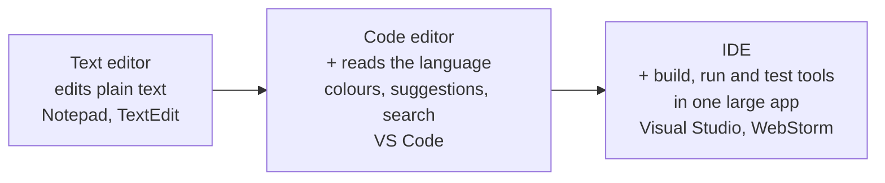
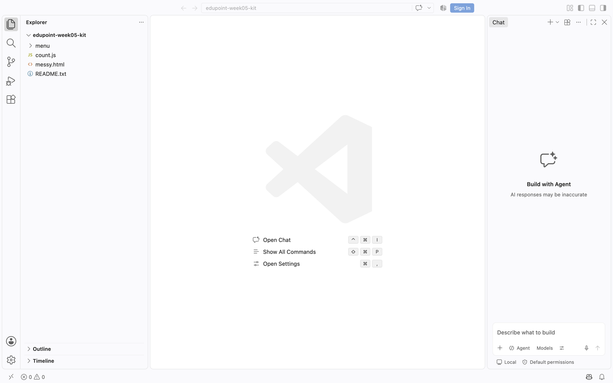
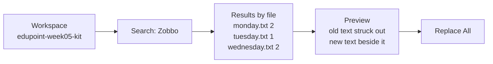
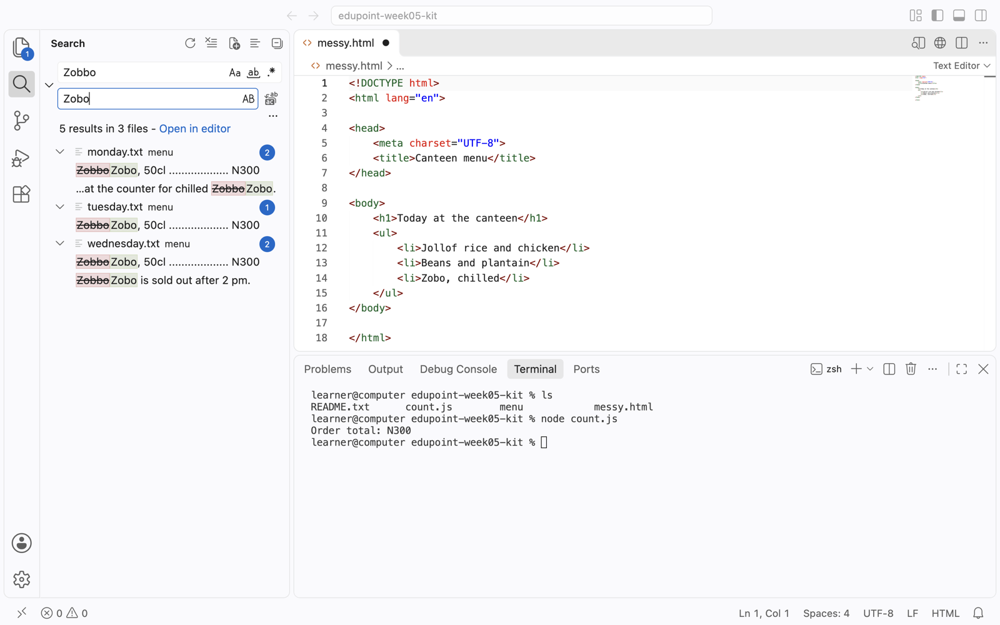
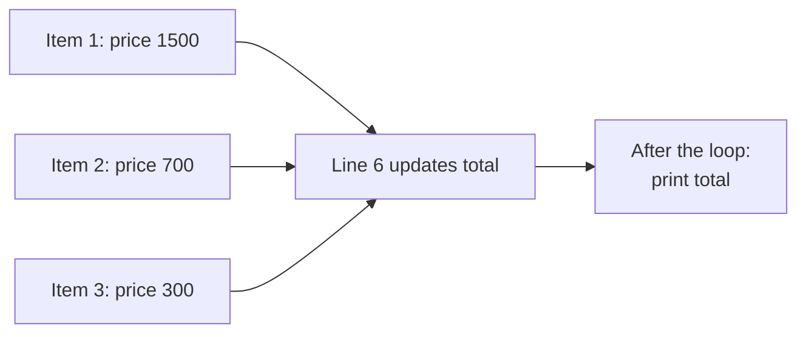
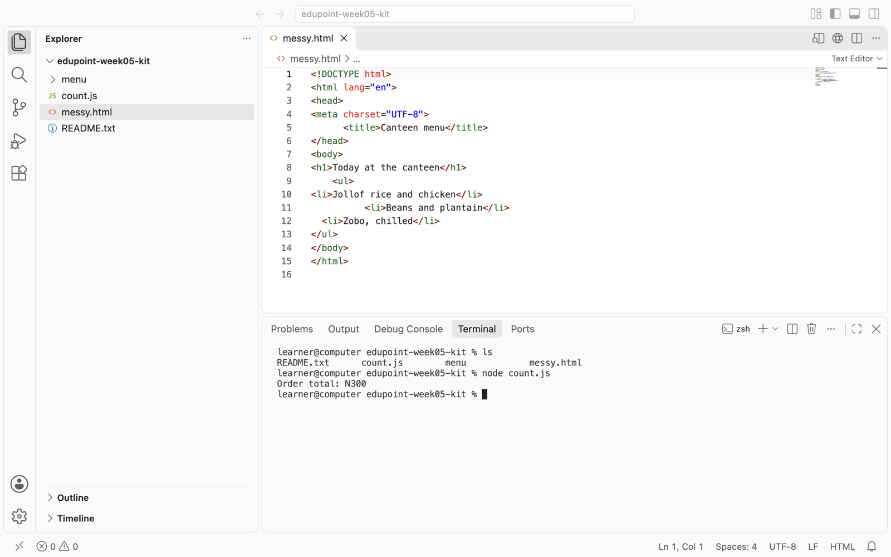
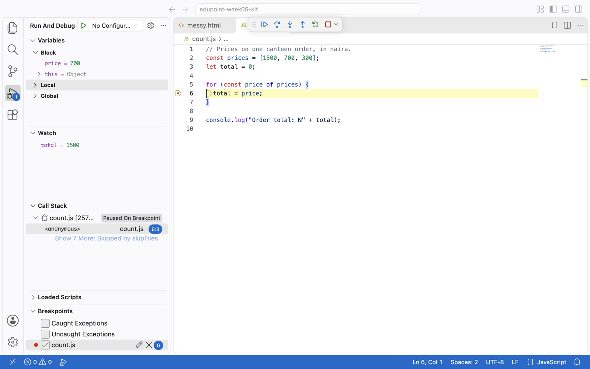
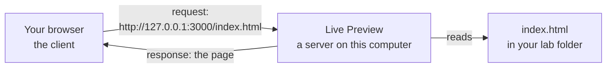
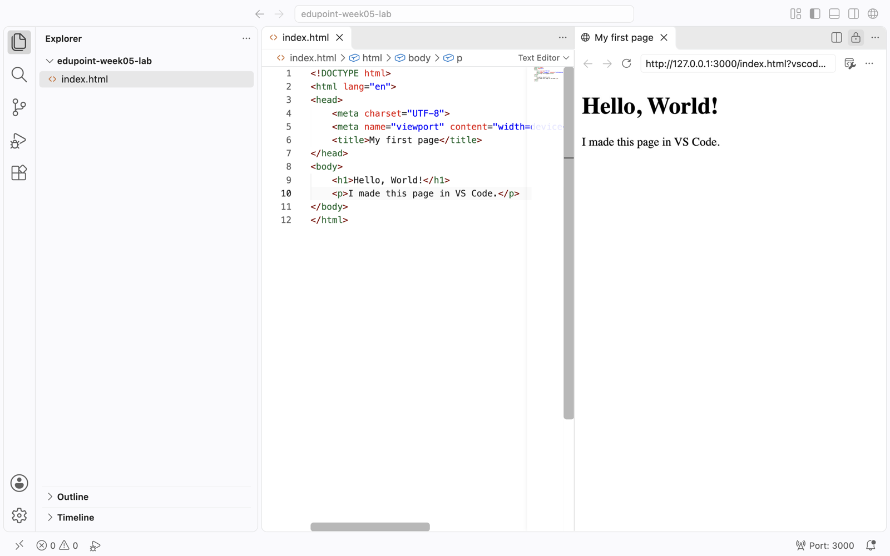

<!-- layout: workbook -->
# Week 05 — Mama Titi's Broken Total

**100L · Semester 1 · Code Editor / IDE · Episode 1 · 2 hours / 120 minutes**

## So far, and today

In weeks 1–4 you learnt how the web carries a request, who builds which part of an app, how to use AI
honestly, and how to work with files in a terminal. Now you start work as a **junior developer at Tiny
Lamp Studio**, a small web studio near campus. Your first client has three problems. To fix them, you
need a developer's main tool: a **code editor**. This week you use **VS Code**, the editor you will keep
for the rest of the programme.

Tiny Lamp, Mama Titi and her canteen are made up. The files you fix are real, in your practice kit.

## How to use these notes

This week is one **episode**: a cold open, three **beats** and a lab. Each beat follows the same order:

| Part | What it does |
|---|---|
| **The problem** | What went wrong for the client, in a few lines |
| **The idea** | The concept, with a picture of how it works |
| **Myth** | A belief many beginners hold, and why it is wrong |
| **▶ Try it** | Steps you do yourself, marked **(laptop)**, **(phone)** or **(paper)** |
| **✓ What you should see** | The real result, so you can compare |
| **On the job** | Where working developers use this |
| **? Check** | One question. Answer it before you open the answer. |

Work in pairs. The **driver** types, and the **navigator** reads, predicts and checks. Swap at each beat,
so both of you use the keyboard. The **exact clicks, shell variants and shortcuts are in the
[Appendix](#appendix--step-by-step)** at the end. Use them when a step says *(Appendix A)* or when
you get stuck. Shortcuts are written **Windows/Linux · macOS**. Everything works offline.

## By the end, you can…

1. Open one file in a plain editor and in VS Code, point to three things only VS Code shows, and say
   what each tells you.
2. Open a folder as a workspace, switch VS Code's AI features off, and run a file in its terminal.
3. Format a messy file and accept a suggestion, then point to what changed and what didn't.
4. Predict how many matches a search will find, run it across a whole folder, explain any surprise, and
   then replace safely.
5. Pause a program on a breakpoint, read a value, and point to the line where the bug starts.
6. Show that a program runs the **saved** file, not the one on your screen.
7. In the lab: set up VS Code, install an extension from a file, and open a Hello World page live in
   your browser.

## Your two-hour route

| Time | Part | You produce |
|---|---|---|
| 00:00–00:10 | **Cold open** · the order slip | A prediction on paper |
| 00:10–00:18 | **Beat 1** · a tool that reads code | Three differences, a tidied file |
| 00:18–00:26 | **Beat 2** · find every Zobbo | Two search counts, one replace |
| 00:26–00:35 | **Beat 3** · why ₦300? | A table of values, a working total |
| 00:35–01:40 | **The job** · [practical lab](lab.md) | Settings, an extension, a live page |
| 01:40–01:50 | Show & tell | Show one result and explain it |
| 01:50–02:00 | Ship | Check your evidence and submit it |

**Before you start:** copy the tutor's `edupoint-week05-kit` folder into your home folder.
**This week:** the editor. **Coming later:** HTML in week 6, CSS after it, JavaScript in 100L S2 and Git
in week 11. At 100L you work without AI help.

<!-- pagebreak -->

## Cold open · The order slip

**Warm-up · 10 minutes · paper**

On Monday morning, Mama Titi's files arrive on the studio phone, and so do her problems.

> **Mama Titi** · 7:42 am
>
> Good morning o. I have three problems.
> 1. A customer bought jollof (₦1,500), beans (₦700) and zobo (₦300). My order slip says ₦300. I nearly
>    lost ₦2,200.
> 2. Funmi says every menu spells it "Zobbo". Every day of the week.
> 3. My nephew opened the slip program in Microsoft Word to fix it. Now it won't run at all.
> Abeg, can you look at it today?

> **Funmi** · 7:50 am
>
> I've sent the folder. Please don't laugh at the spelling.

Tolu, the senior developer, reads over your shoulder. "Before you touch anything," Tolu says, "what will
you open those files in?"

**▶ Try it (paper)**

1. Add up the order yourself. What **should** the slip say?
2. Recall week 4: the slip program is a file named `count.js`. What does the part after the dot tell
   the computer?
3. Predict: why might editing it in Word stop it from running? Write one guess. The room votes.

**✓ What you should see:** ₦1,500 + ₦700 + ₦300 = **₦2,500**. The `.js` extension says the file is
JavaScript. Guesses for question 3 vary. Keep yours, because Beat 1 answers it.

<details><summary>Answer to question 3 · open after Beat 1</summary>

Word is a **word processor**: it saves fonts, layout and formatting inside its own file format, not
plain text. It also swaps straight quotes `"` for curly ones `“ ”`. A program must be plain text, and
JavaScript doesn't treat curly quotes as quotes, so the file stops making sense to it.

</details>

<!-- pagebreak -->

## Beat 1 · A tool that reads code

**Guided practice · 8 minutes · laptop**

**The problem.** In Notepad, `count.js` looks like a shopping list: black text, no line numbers, no
help. You can't tell where one part of the code ends and the next begins. Word is worse, because it
changes the file. You need a tool that knows it is looking at code.

**The idea.** There are three kinds of tool for editing code, each adding to the one before:



A **text editor** treats every file as plain letters. A **code editor** also *reads the language*. It
works out the language from the file extension you met in week 4 (`.js` → JavaScript, `.html` → HTML).
Because it reads the code, it can:

- colour each part differently, called **syntax highlighting**
- number the lines, so "line 6" means the same to everyone
- suggest what you might type next, which VS Code calls **IntelliSense**
- tidy the spacing, called **formatting**

An **IDE** (integrated development environment) bundles even more tools into one large application.
VS Code sits between the two: a code editor that grows with **extensions**, which you add in the lab.

A code editor also works on a whole **project**, not one file. When you open a **folder**, VS Code calls
it the **workspace**. It shows every file in the folder and searches all of them, which Beat 2 needs.

Think of it this way: Notepad is a blank sheet of paper. A code editor is a proofreader who knows the
grammar of the language. It can see that a sentence is badly laid out or unfinished. It can't know
what you *meant* to say.

**Myth: "The colours are decoration."** The colours show how the editor has read your code. If the
colours suddenly look wrong from some point on, the editor has read something you didn't intend. Look
just before that point first.

**▶ Try it (laptop)**

1. Open `count.js` in the plain editor, then in VS Code with **File → Open File…**. Put the two windows
   side by side, and in the table below, list three differences you can **point to**.
2. Close the file. Open the **folder** `edupoint-week05-kit` instead, then switch the AI features off
   *(Appendix A)*.
3. Open `messy.html`. Run **Format Document**: **Shift+Alt+F · ⇧⌥F** *(Linux in Appendix C)*.
4. Click at the end of `<li>Zobo, chilled</li>`, press Enter and type `<li>` **slowly**. Then type `Kunu`.



*Figure 1. A fresh VS Code with the kit folder open. The **Chat** panel on the right is the AI assistant.
It disappears when you switch AI features off. Original screenshot, VS Code 1.144 on macOS.*

**✓ What you should see:** in step 1, VS Code shows colours, a number on every line, the file name in a
tab, and `JavaScript` at the bottom right. In step 3, the spacing changes and nothing else does:

```html
<body>
<h1>Today at the canteen</h1>
    <ul>
<li>Jollof rice and chicken</li>
          <li>Beans and plantain</li>
  <li>Zobo, chilled</li>
</ul>
</body>
```

```html
<body>
    <h1>Today at the canteen</h1>
    <ul>
        <li>Jollof rice and chicken</li>
        <li>Beans and plantain</li>
        <li>Zobo, chilled</li>
    </ul>
</body>
```

VS Code may also add a blank line before `<head>` and `<body>`. In step 4, `</li>` appears by itself the
moment you type `>`. That is IntelliSense finishing the pair for you.

| Difference | Where I pointed | What it tells me |
|---|---|---|
| 1 | ______________________ | ______________________ |
| 2 | ______________________ | ______________________ |
| 3 | ______________________ | ______________________ |

**On the job.** Teams switch on *format on save*, so every file is spaced the same way whoever wrote it.
Then code reviews can discuss what the code does, not where the spaces go. You switch it on in the lab.

**? Check:** Does Format Document fix a misspelt word, such as `Zobbo`?

<details><summary>Answer · check after you try</summary>

No. Formatting changes only spaces and line breaks. The proofreader knows the layout rules, not your
menu. Finding the word `Zobbo` is a job for search, in Beat 2.

</details>

<!-- pagebreak -->

## Beat 2 · Find every Zobbo

**Guided practice · 8 minutes · laptop**

**The problem.** Funmi's folder has three menu files, and `Zobbo` is somewhere in all of them. You could
open each one and read every line. That works for three files. CampusChop holds hundreds of menus, and
Mama Titi is clear: "If one is left, a customer will screenshot it."

**The idea.** **Search** across the workspace reads every file in the open folder and lists every match,
grouped by file, **before** you change anything. **Replace** then changes the matches it found.



Search is a **net**, not a fishing hook: it catches every match, including some you didn't want. It
comes in two sizes:

| Size | Shortcut | Looks in |
|---|---|---|
| Find in this file | **Ctrl+F · ⌘F** | The open file only |
| Search the workspace | **Ctrl+Shift+F · ⇧⌘F** | Every file in the folder |

**Myth: "Search finds words."** Search finds **letters in a row**. A search for `rice` finds "Jollof
rice", and it also finds the "rice" inside "price". A replace that looks safe can change words you
never meant to touch.

**▶ Try it (laptop)**

1. **(paper)** Predict: how many results will a search for `rice` find in the kit? Write your number.
2. Press **Ctrl+Shift+F · ⇧⌘F** and type `rice`. Read the count and the file names. Click the result in
   `count.js` to jump to it.
3. Now search for `Zobbo`. Record the count and the files. Click **›** to the left of the box to show
   **Replace**, type `Zobo`, and read the preview.
4. Press **Replace All** and confirm. Then search for `Zobbo` again.



*Figure 2. The preview before Replace All. Original screenshot.*

**✓ What you should see:**

| Search | VS Code reports | Where |
|---|---|---|
| `rice` | `8 results in 3 files` | `count.js` 5 (from "price" and "prices"), `monday.txt` 2, `messy.html` 1 |
| `Zobbo` | `5 results in 3 files` | `monday.txt` 2, `tuesday.txt` 1, `wednesday.txt` 2 |
| `Zobbo` after Replace All | `No results found.` | |

Most people predict two or three results for `rice`. The extra five come from the program, not the
menus. VS Code's confirmation reads `Replace 5 occurrences across 3 files with 'Zobo'?`.

**On the job.** Renaming a product, a price or a piece of code across hundreds of files is everyday
work. Professionals read the count and the preview first, and narrow the net with two buttons in the
search box: **Aa** (match case) and **ab** (match whole word). **Ctrl+Z · ⌘Z** in each changed file
undoes a mistake.

**? Check:** You want to change `rice` to `Rice` in the menus only. Which button do you press first, and
how many results should you then see?

<details><summary>Answer · check after you try</summary>

**ab**, *Match Whole Word*. "Price" and "prices" no longer count, so VS Code reports `3 results in 2
files`: `monday.txt` 2 and `messy.html` 1. Always read the new count before Replace All.

</details>

<!-- pagebreak -->

## Beat 3 · Why ₦300?

**Guided practice · 9 minutes · laptop**

**The problem.** ₦1,500 + ₦700 + ₦300 should be ₦2,500, but the slip program prints ₦300. You can't
read JavaScript yet, because that is next semester, so staring at the code won't help. You need to
**watch the program run**.

**The idea.** Three things, in order.

**Run it where you edit it.** VS Code has an **integrated terminal**. It is the same shell you used in
week 4, inside the editor, and it starts in the workspace folder, so you don't need `cd`.

**Pause it and look.** A program runs one line at a time. A **loop** runs the same lines again for each
item in a list. A **breakpoint** pauses the program on a line, so you can read its values before it
carries on. Picture a cashier adding up an order, writing a running total on a notepad after each item.
A breakpoint says: *stop after each item and show me the notepad.* VS Code's **Variables** and
**Watch** panels are that notepad.



**Two copies of every file.** The file on your screen and the file saved on disk can differ. A **●** on
the tab means *unsaved*. A program run from the terminal reads the **saved** file.

A **bug** is a gap between what you expected and what happened. **Debugging** means finding where that
gap starts.

**Myth: "The bug is where the wrong answer shows up."** ₦300 appears on the last line, but that line is
fine: it prints whatever the total holds. The bug starts earlier, where the total gets a wrong value.
Debugging means following the wrong value back to where it began.

**▶ Try it (laptop)**

1. Open the terminal with **Ctrl+\` · ⌃\`**. Predict which folder it starts in, then run `node count.js`.
2. Click just left of line **6**'s number, `total = price;`. A red dot appears: that's the breakpoint.
3. Press **F5** and choose **Node.js** if asked *(Appendix D)*. Under **Watch**, click **+** and add
   `total`. Read `price` under **Variables**.
4. **(paper)** Press **F5** to continue. Record both values at each pause, then stop with **Shift+F5**.
5. Change line 6 to `total = total + price;` and **don't save**. Run `node count.js` again.
6. Predict, then save with **Ctrl+S · ⌘S** and run it once more.

**✓ What you should see.** Real output from macOS. Your prompt will look different:

```sh
learner@computer edupoint-week05-kit % node count.js
Order total: N300
```



*Figure 3. The editor above, and the terminal in the panel below, already in the kit folder. Original
screenshot.*

| Pause | `price` | `total` before line 6 runs |
|---|---|---|
| 1 | 1500 | 0 |
| 2 | 700 | 1500 |
| 3 | 300 | 700 |



*Figure 4. The second pause. Original screenshot.*

`total` never grows: line 6 **replaces** it with the newest price each time. In step 5, the tab shows
**●** and the program still prints `Order total: N300`, because the fix isn't saved yet. After step 6 it
prints:

```sh
learner@computer edupoint-week05-kit % node count.js
Order total: N2500
```

**On the job.** Developers find bugs by reading values while the program runs, not by guessing and
re-running. Many "my fix didn't work" moments turn out to be an unsaved file, or a different copy of the
file in another folder.

**? Check:** Your fix is on screen, but the terminal still prints `N300`. Name two things to check, in
order.

<details><summary>Answer · check after you try</summary>

First, the tab: a **●** means the fix isn't saved, so save it. Second, the folder: make sure the
terminal is running **this** `count.js`, not a copy somewhere else. Week 4's `pwd` (or `Get-Location`)
tells you where the terminal is.

</details>

<!-- pagebreak -->

## The job · Show her the page

**Lab · 65 minutes · see [lab.md](lab.md)**

> **Mama Titi** · 11:15 am
>
> Funmi says the total is correct now. Thank you o! But I don't understand code. Show me something I
> can see in a browser.

**The problem.** Mama Titi can't read code, so a web page is the only proof she trusts. To show her one,
you need two things VS Code doesn't have yet: a way to add a feature **without internet**, and a way
to view your page the way a browser would.

**The idea.**

- An **extension** adds a feature to VS Code. A **VSIX** file is a whole extension packed into one file.
  You can install it from a USB stick, just like the offline installers in week 4.
- The **Live Preview** extension runs a small **local server** on your own computer. It is week 1's
  client and server, both on one machine. Your browser is the client. It asks `127.0.0.1`, which means
  *this computer*, on port `3000`, and Live Preview answers with your file.



Without the extension, the browser can open the file straight from disk. The address then starts
`file:///`: there is no server, and you refresh by hand after each save.

**Myth: "My live page is on the internet now."** It is not. `127.0.0.1` always means *the device you
are typing on*. If Funmi types that address on her phone, she gets her phone, not your laptop. Putting a
site on the internet for real comes later in the programme.

**▶ Try it:** the lab, in five parts.

| Part | Time | You do |
|---|---|---|
| 1. Configure VS Code | 15 min | Turn on the settings a developer uses, including format on save |
| 2. Install an extension offline | 10 min | Live Preview from its VSIX file *(Appendix E)* |
| 3. Hello World, live | 20 min | Build `index.html` and watch it change in your browser *(Appendix F, G)* |
| 4. Search, format and debug drill | 15 min | Beats 1–3 again, on new words |
| 5. Evidence check | 5 min | Check that you have everything to submit |

**✓ What you should see:** an address starting `http://127.0.0.1:3000/` (or `file:///` without the
extension) and your own heading in the browser.

**On the job.** Every web developer builds against a local server first, and only then puts the site
online. The server your company runs in production does the same job as Live Preview: it answers
requests with files.

**? Check:** Your browser still shows the old text after you edited the file. What is the first thing to
check?

<details><summary>Answer · check after you try</summary>

The address bar. A `file:///` page shows only **saved** changes, so look for the **●**, save, then
refresh. Then check that it is **this** `index.html`, not a copy in another folder: the same two
suspects as in Beat 3.

</details>

<!-- pagebreak -->

## Next episode

> **Mama Titi** · 4:58 pm
>
> "Hello, World!" Ha. Very nice. Now where is my menu? With the prices. And a picture of the jollof.

Tolu laughs. "That's HTML, next week. And while you build hers, start your own portfolio. Every
developer needs one."

**Next week · HTML I — Structure:** headings, lists, links, images and tables for Mama Titi's menu, and
the first page of your portfolio.

## The episode in one table

| Mama Titi's problem | Tool you used | The idea to remember |
|---|---|---|
| Code edited in Word stopped working | A code editor | Code is plain text. A code editor reads the language, not your meaning. |
| A misspelling in many files | Search across the workspace | Search finds letters in a row. Read the count before you replace. |
| A wrong total | The terminal and a breakpoint | Follow the wrong value back to where it starts. Run the saved file. |
| "Show me something I can see" | An extension and a local server | `127.0.0.1` is this computer. The browser is the client. |

## Key words

| Word | Meaning |
|---|---|
| Text editor | A tool that edits plain text and nothing more |
| Code editor | A text editor that reads the language: colours, suggestions, search |
| IDE | An integrated development environment, which bundles building, running and testing tools |
| Workspace | The folder you opened in VS Code |
| Syntax highlighting | Colours showing how the editor has read each part of the code |
| IntelliSense | VS Code's suggestions and completions while you type |
| Formatting | Tidying spaces and line breaks without changing meaning |
| Integrated terminal | The shell inside VS Code, starting in the workspace |
| Bug | A gap between what you expected and what happened |
| Breakpoint | A line where a running program pauses so you can read its values |
| Extension · VSIX | An add-on feature for VS Code · an extension packed into one file |
| Local server | A server running on your own computer, at `127.0.0.1` |

## Common questions

<details><summary>VS Code keeps showing Chat or asking me to sign in.</summary>

Open Settings and check that **Chat: Disable AI Features** is ticked. Close any Chat panel with its
**×**. You never need an account for 100L work.

</details>

<details><summary>Search finds nothing, but I can see the word in a file.</summary>

Check that you opened the **folder**, not a single file: the Explorer shows the folder's name at the
top. Then check the spelling, and whether **Aa** or **ab** is switched on.

</details>

<details><summary>Format Document did nothing.</summary>

Check the language name at the bottom right. It should say `HTML` for `messy.html`. A plain text file has
no formatter. If VS Code asks you to choose one, choose the built-in **HTML Language Features**.

</details>

<details><summary>The program didn't pause at my breakpoint.</summary>

Check that the red dot is on line 6 and that you pressed **F5**, not run `node` in the terminal. Only
the debugger stops at breakpoints.

</details>

<details><summary>I see "Open in Integrated Browser".</summary>

Newer VS Code versions include a browser tab. It is fine for a quick look, but the lab asks you to open
the page in your own browser, so you see it the way Mama Titi will.

</details>

## Read more

- MDN: [Code editors](https://developer.mozilla.org/en-US/docs/Learn_web_development/Getting_started/Environment_setup/Code_editors).
  Skip the Prettier installation, because VS Code's built-in formatter is enough for now.
- Flavio Copes: [How to use VS Code](https://flaviocopes.com/vscode/). Read Explorer, Search, The
  Terminal, The Command Palette and Editing. Skip Source Control (week 11) and the extensions showcase.
- VS Code docs: [Basic editing](https://code.visualstudio.com/docs/editing/codebasics) and
  [Debugging](https://code.visualstudio.com/docs/debugtest/debugging), the parts about breakpoints.

### Sources

Every command, count and output above was run in VS Code 1.144 and Live Preview 0.4.20 on a clean
profile, using the practice kit beside these notes.

- Microsoft, VS Code docs: [User interface](https://code.visualstudio.com/docs/editing/getting-started/userinterface),
  [IntelliSense](https://code.visualstudio.com/docs/editing/intellisense),
  [Terminal basics](https://code.visualstudio.com/docs/terminal/getting-started),
  [Basic editing](https://code.visualstudio.com/docs/editing/codebasics),
  [HTML](https://code.visualstudio.com/docs/languages/html),
  [Extension Marketplace](https://code.visualstudio.com/docs/configure/extensions/extension-marketplace),
  [Settings](https://code.visualstudio.com/docs/configure/settings),
  [Debugging](https://code.visualstudio.com/docs/debugtest/debugging); keyboard shortcut sheets for
  [Windows](https://code.visualstudio.com/shortcuts/keyboard-shortcuts-windows.pdf),
  [macOS](https://code.visualstudio.com/shortcuts/keyboard-shortcuts-macos.pdf) and
  [Linux](https://code.visualstudio.com/shortcuts/keyboard-shortcuts-linux.pdf).
- Microsoft: [Live Preview](https://marketplace.visualstudio.com/items?itemName=ms-vscode.live-server)
  extension page. MDN contributors: [Code editors](https://developer.mozilla.org/en-US/docs/Learn_web_development/Getting_started/Environment_setup/Code_editors).
- Local curriculum §4, week 5. The lead tutor's two-hour correction of 26 October 2026 governs the plan.
  The story follows the 100L S1 story bible, `curriculum/100L-S1/story.md`.

**Figures 1–6:** original screenshots of Visual Studio Code (Microsoft), taken for this workbook. The
Mermaid diagrams are original and stay editable here.

### Your exit reflection

Explain to your partner: "When my fix doesn't seem to work, I check…"

________________________________________________________________________

"The VS Code feature I would show Mama Titi first is…, because…"

________________________________________________________________________

<!-- pagebreak -->

## Appendix · Step by step

Use these when a beat says *(Appendix …)* or when you are stuck. You don't read them in class.

### A. Open the folder and switch the AI off

1. **File → Open Folder…** and pick `edupoint-week05-kit` itself, not a file inside it. If VS Code asks
   whether you trust the authors, choose **Yes**: these are class files.
2. If a **Welcome to VS Code** dialog offers Copilot, choose **Continue without Signing In**, pick a
   theme, then **Get Started**.
3. Open **Settings** with **Ctrl+, · ⌘,**. Type `disable AI features` in the search box and tick
   **Chat: Disable AI Features**. Close the Settings tab. The Chat panel, the **Sign In** button and the
   Copilot icon in the bottom bar disappear.
4. **Command Palette**, to find any command by name: **Ctrl+Shift+P · ⇧⌘P**. Try `word wrap`.
   **Quick Open**, to find any file by name: **Ctrl+P · ⌘P**. Try `mess`.

### B. The terminal in each shell

Open it with **Ctrl+\` · ⌃\`** (the backtick key, usually left of `1`) or **Terminal → New Terminal**.
To change shell, open the **˅** next to **+** in the terminal panel.

| Shell | List the folder | Run the program |
|---|---|---|
| Windows · PowerShell (VS Code's usual choice) | `Get-ChildItem` | `node count.js` |
| Windows · Command Prompt (CMD) | `dir` | `node count.js` |
| macOS / Linux | `ls` | `node count.js` |

The macOS listing reads `README.txt  count.js  menu  messy.html`. If `node` is "not recognised", check
that Node.js passed its week 4 version check. If you installed it while VS Code was open, quit VS Code
completely and reopen it.

### C. Formatting and suggestions

| Action | Windows | Linux | macOS |
|---|---|---|---|
| Format Document | Shift+Alt+F | Ctrl+Shift+I | ⇧⌥F |
| Show suggestions again | Ctrl+Space | Ctrl+Space | ⌃Space |
| Close suggestions | Esc | Esc | Esc |

Or type `Format Document` into the Command Palette. **Tab** or **Enter** accepts a suggestion.

### D. The debugger

- Toggle a breakpoint: click left of the line number, or press **F9**.
- Start or continue: **F5**. On a Mac keyboard, you may need **fn+F5**. If asked to **Select debugger**,
  choose **Node.js**.
- Step over one line: **F10**. Stop: **Shift+F5**.
- **Run and Debug** shows **Variables** (values the program has now) and **Watch** (values you asked
  for with **+**).

### E. Install an extension from a file

1. Find `live-preview.vsix` in your `edupoint-installers` folder.
2. Open **Extensions** with **Ctrl+Shift+X · ⇧⌘X**. Click **···** at the top of the view and choose
   **Install from VSIX…**, or run **Extensions: Install from VSIX…** from the Command Palette.
3. Choose the file. When **Live Preview** by Microsoft appears under Installed, it worked.

**Terminal route, all shells:** from your home folder, run
`code --install-extension edupoint-installers/live-preview.vsix`. On macOS, first run **Shell Command:
Install 'code' command in PATH** from the Command Palette.

### F. Make the page

1. Make and open a folder named `edupoint-week05-lab`. In the Explorer, click the **New File** icon and
   name the file `index.html`.
2. Type `!` and choose **!** marked **Emmet Abbreviation** from the list. Press **Esc** once.
3. Change the word `Document` between `<title>` and `</title>`. On the empty line between `<body>` and
   `</body>`, type `<h1>` and then `Hello, World!`. Save.


*Figure 5. Emmet, part of IntelliSense, offering a whole page skeleton. Original screenshot.*

### G. Open it live

Click **Show Preview** in the top-right corner of the editor: the first icon, a page with a magnifier.
Copy the address it shows into **your browser** (Chrome, Edge or Firefox) and edit the page. The page
updates as you type, even before you save. Save anyway, because the file is what you submit.



*Figure 6. Live Preview's built-in tab. Its address works in your own browser too. Original screenshot.*

**No extension?** Open the file directly from the integrated terminal in `edupoint-week05-lab`:

| Shell | Command |
|---|---|
| PowerShell | `Start-Process index.html` |
| CMD | `start index.html` |
| macOS | `open index.html` |
| Linux | `xdg-open index.html` |

The address starts `file:///`. Refresh after each save with **F5 · ⌘R**. If the file opens in VS Code
instead, drag `index.html` onto a browser window.

### H. Keep this beside your keyboard

| Intent | Windows / Linux | macOS |
|---|---|---|
| Command Palette: find any command | Ctrl+Shift+P | ⇧⌘P |
| Quick Open: find any file | Ctrl+P | ⌘P |
| Settings | Ctrl+, | ⌘, |
| Extensions | Ctrl+Shift+X | ⇧⌘X |
| Integrated terminal | Ctrl+\` | ⌃\` |
| Save | Ctrl+S | ⌘S |
| Find / replace in this file | Ctrl+F / Ctrl+H | ⌘F / ⌥⌘F |
| Search / replace in all files | Ctrl+Shift+F / Ctrl+Shift+H | ⇧⌘F / ⇧⌘H |
| Format Document | Shift+Alt+F (Linux: Ctrl+Shift+I) | ⇧⌥F |
| Show suggestions | Ctrl+Space | ⌃Space |
| Toggle word wrap | Alt+Z | ⌥Z |
| Breakpoint / start or continue / step over / stop | F9 / F5 / F10 / Shift+F5 | same; add fn if needed |
