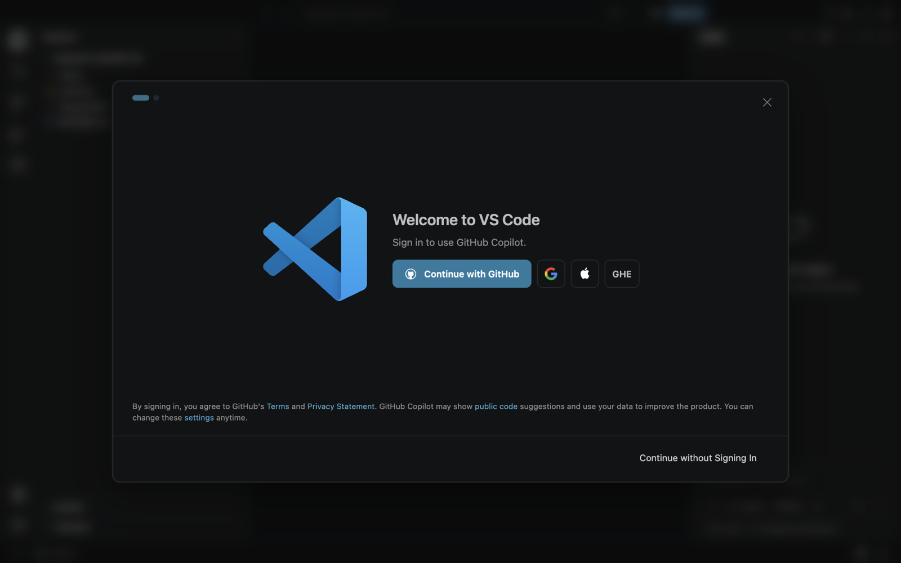

<!-- layout: workbook -->
# Week 05 — Before You Come

**100L · Semester 1 · Code Editor / IDE · Preparation: 35 minutes**

## Same words, better tools

Last week you typed commands into a terminal. This week you move into a **code editor**: a program
built for writing code, with colours, suggestions, search across files, a terminal inside it and tools
for finding mistakes. You will set it up and open your first page in the browser. Class lasts
**2 hours**; this preparation happens before class and is not graded.

> **Bring:** your laptop and charger if available, a notebook, a pen and these downloaded notes.
> No laptop? Tell the tutor so you can take a turn on a shared machine. VS Code is free; no account,
> sign-in or purchase is needed.

## 1. Write in the plainest editor · 8 minutes

1. **(laptop)** Open the plain text editor that came with your computer: **Notepad** on Windows,
   **TextEdit** on macOS (choose **Format → Make Plain Text** first), or **Text Editor** on Linux.
2. Type these three lines exactly, including the spaces at the start of the second line:

   ```text
   Monday: Jollof rice
       Tuesday: Beans
   Wednesday: Amala
   ```

3. Save it as `menu.txt` inside the `edupoint-week04-practice` folder you made last week, or in your
   home folder if that folder is gone. Close the editor and reopen the file. Did anything change?
4. **(paper)** Answer: what would help you if this file had 500 lines and one mistake hidden in it?
   Write two wishes, such as “show line numbers”.

**Record:** editor used __________ · saved in folder __________ · wish 1 __________ · wish 2 __________

**No laptop?** Do step 4 for a 500-line shopping list written on paper.

## 2. Read with a question · 15 minutes

Read in this order and stop at the boundaries below. You do not need to install anything.

1. **MDN — [Code editors](https://developer.mozilla.org/en-US/docs/Learn_web_development/Getting_started/Environment_setup/Code_editors)**
   (10 min). Read “What code editors are available?” and “Basic code editor functionality”. In
   “Enhancing your code editor with extensions”, read the first two paragraphs only. **Skip** installing
   Prettier and changing its settings: in class you will use VS Code's built-in formatter. The examples
   are JavaScript, which you learn next semester; look at their shape, not their meaning.
   **Question:** Which three features does a code editor give you that Notepad does not?
2. **VS Code docs — [User interface](https://code.visualstudio.com/docs/editing/getting-started/userinterface)**
   (5 min). Read only the first part, up to and including the labelled picture of the window.
   **Skip** everything about Chat, agents, Copilot and source control (Git arrives in week 11).
   **Question:** Which area of the window will hold the terminal?

## 3. Know what the first screen asks · 5 minutes



*Figure 1. The first screen of a fresh VS Code 1.144 on macOS. Windows and Linux show the same
dialog. Original screenshot for this workbook.*

New copies of VS Code start by offering an AI assistant called GitHub Copilot. At 100L you build skills
**unaided**, so in class you will choose **Continue without Signing In** and then switch the AI features
off. Find that link in Figure 1 now and circle it on paper.

<!-- pagebreak -->

## 4. Check VS Code opens · 5 minutes

1. **(laptop)** In week 4 you checked that VS Code launches. Open it again from the Start menu,
   Applications folder or app menu.
2. If Figure 1 appears, choose **Continue without Signing In**, then close the next screen. If it does
   not appear, VS Code has been opened on this device before; that is fine.
3. Find the version: **Help → About** on Windows and Linux, **Code → About Visual Studio Code** on
   macOS. Record the first number pair, such as `1.144`. Close VS Code.

**Record:** VS Code opens: yes / no · version __________ · shared device needed: yes / no

**No laptop, or VS Code missing?** Record that honestly. The tutor has an offline installer and a shared
station; you will not fall behind.

> **Offline route:** Tasks 1, 3 and 4 need no internet. For Task 2, use this summary: a plain text
> editor only edits text. A **code editor** adds colours for different parts of the code, line numbers,
> suggestions while you type, search and replace across many files, and **extensions** that add new
> features. An **IDE** (integrated development environment) bundles even more, such as running and
> debugging programs, into one larger application. VS Code is a code editor that can grow towards an
> IDE through extensions.

## Ready check

- I have saved and reopened a plain text file, and written two wishes for a better editor.
- I know which link to choose on VS Code's first screen, and why.
- I have recorded whether VS Code opens on my device. I have not used AI to answer the tasks.

## Sources and image credit

- MDN contributors: [Code editors](https://developer.mozilla.org/en-US/docs/Learn_web_development/Getting_started/Environment_setup/Code_editors);
  Microsoft: [VS Code user interface](https://code.visualstudio.com/docs/editing/getting-started/userinterface).
  Links checked 29 October 2026.
- Figure 1: original screenshot of Visual Studio Code 1.144 (Microsoft), taken for this workbook on a
  clean profile with no account signed in. The activities are original.
