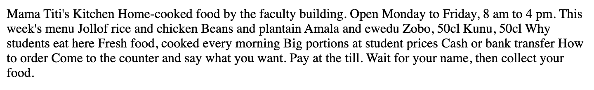
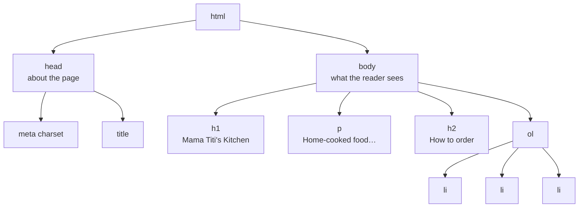
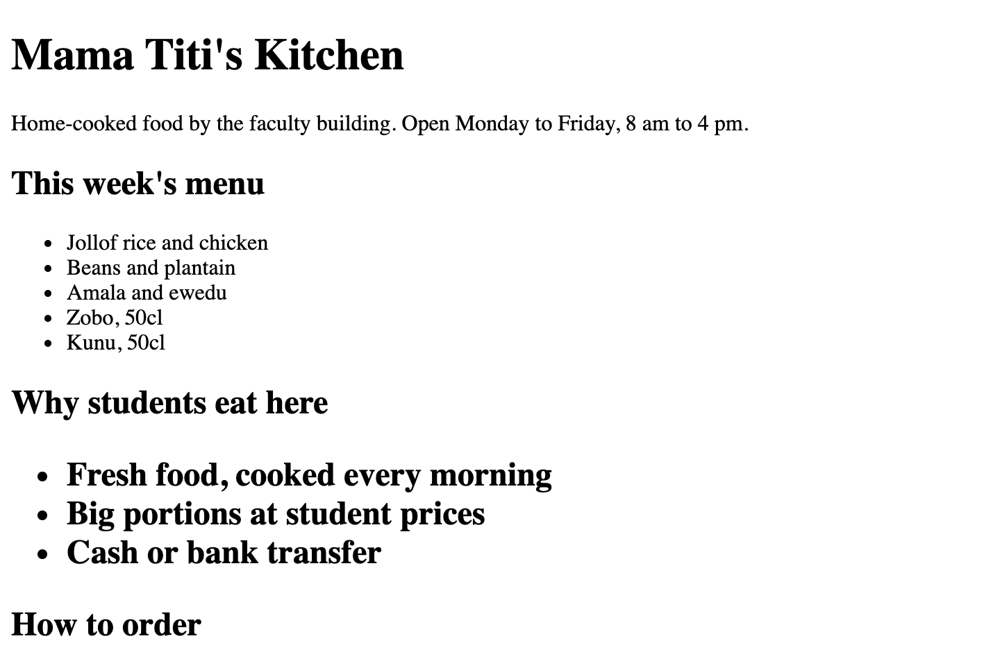
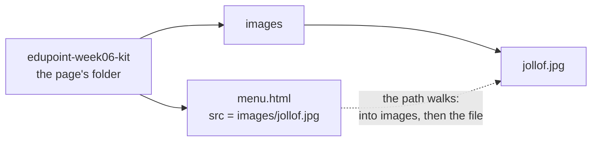
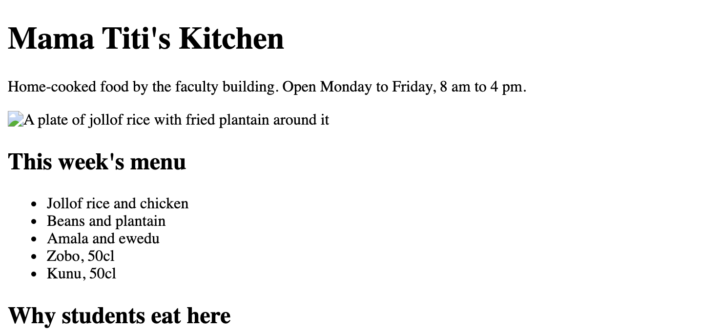
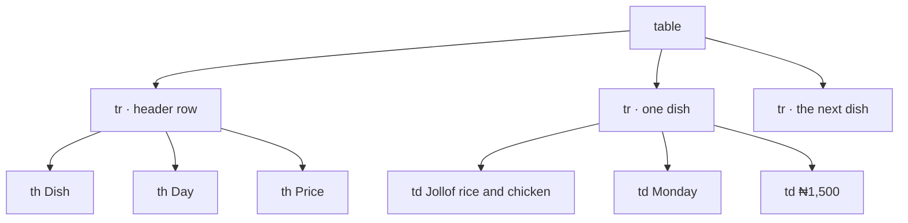
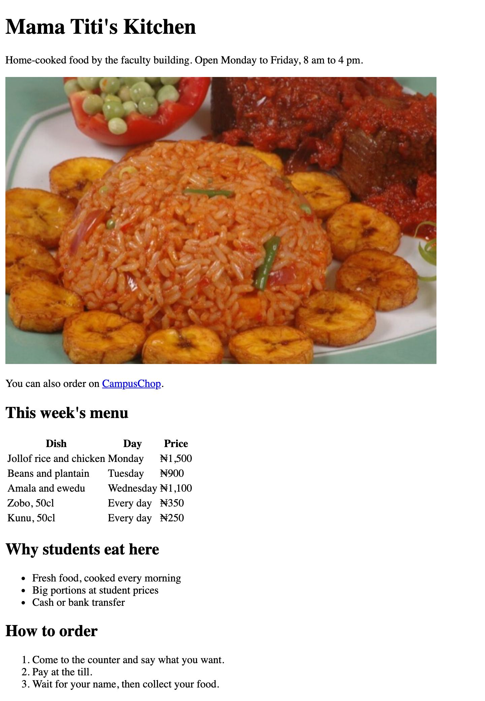
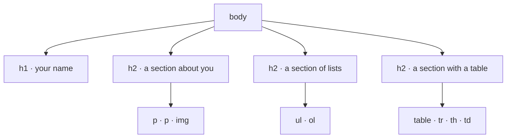

<!-- layout: workbook -->
# Week 06 — Mama Titi's One-Line Menu

**100L · Semester 1 · HTML I — Structure · Episode 2 · 2 hours / 120 minutes**

## So far, and today

Last week, at **Tiny Lamp Studio**, you fixed Mama Titi's order slip in VS Code and opened your first page
live in a browser. Now she wants a real menu page: headings, a price table, a photo of the jollof and a
link to her CampusChop shop. Funmi has already typed the words. Your job is to tell the browser **what
each piece of text is**. That is **HTML**, the language every web page is written in. By the end you
also start the page that will follow you through the programme: your own **portfolio**.

Tiny Lamp, Mama Titi and her canteen are made up. The page you build is real, in your practice kit.

## How to use these notes

This week is one **episode**: a cold open, three **beats** and a lab. Each beat follows the same order:

| Part | What it does |
|---|---|
| **The problem** | What went wrong for the client, in a few lines |
| **The idea** | The concept, with a picture of how it works |
| **Myth** | A belief many beginners hold, and why it is wrong |
| **▶ Try it** | Steps you do yourself, marked **(laptop)**, **(phone)** or **(paper)** |
| **✓ What you should see** | The real result, so you can compare |
| **On the job** | Where working developers use this |
| **? Check** | One question. Answer it before you open the answer. |

Work in pairs. The **driver** types, and the **navigator** reads, predicts and checks. Swap at each beat,
so both of you use the keyboard. The **exact clicks, paths, symbols and zip steps are in the
[Appendix](#appendix--step-by-step)** at the end. Use them when a step says *(Appendix A)* or when
you get stuck. Shortcuts are written **Windows/Linux · macOS**. Everything works offline.

## By the end, you can…

1. Open plain text in a browser, predict how it shows, and point to where the line breaks went.
2. Turn plain lines into an `h1`, `h2` sections, a paragraph and both kinds of list, then draw the page as
   a tree.
3. Delete a closing tag, spot the damage in the browser, and point to the line that caused it.
4. Add a photo with `src` and `alt`, break its path, show the `alt` text standing in, then fix it.
5. Add a link, click it, and show that a page copied without its folder loses its photo.
6. Build a price table, then count its `tr`, `th` and `td` elements.
7. In the lab: build your portfolio page, structure only, and move its folder to show every image and
   link still works.

## Your two-hour route

| Time | Part | You produce |
|---|---|---|
| 00:00–00:10 | **Cold open** · one long line | A prediction on paper |
| 00:10–00:19 | **Beat 1** · label every line | Headings, a paragraph and three lists |
| 00:19–00:27 | **Beat 2** · the photo and the link | A broken photo, fixed; a link |
| 00:27–00:35 | **Beat 3** · the price table | A table with six rows |
| 00:35–01:40 | **The job** · [practical lab](lab.md) | Your portfolio page, structure only |
| 01:40–01:50 | Show & tell | Show one part of your page and explain it |
| 01:50–02:00 | Ship | Check your evidence and submit it |

**Before you start:** copy the tutor's `edupoint-week06-kit` folder into your home folder, and open it in
VS Code as a **folder**, as you did last week. **This week:** structure. **Coming later:** forms and
accessibility in week 7, CSS for colour and layout in weeks 8–10, Git in week 11. At 100L you work
without AI help.

<!-- pagebreak -->

## Cold open · One long line

**Warm-up · 10 minutes · paper, then laptop**

On Tuesday morning, the studio phone buzzes before Tolu has finished their tea.

> **Mama Titi** · 8:05 am
>
> Good morning o. You said you will make my menu page. I want the prices, a photo of my jollof and a
> link to my CampusChop shop. Funmi has typed everything already, so it should be quick, abi?

> **Funmi** · 8:09 am
>
> The file is `menu.html` in the kit. I pressed Enter after every line, so it is very neat. 😊

Tolu opens the file in VS Code and turns the screen towards you. Here is what Funmi typed between
`<body>` and `</body>`:

```text
Mama Titi's Kitchen
Home-cooked food by the faculty building. Open Monday to Friday, 8 am to 4 pm.

This week's menu
Jollof rice and chicken
Beans and plantain
Amala and ewedu
Zobo, 50cl
Kunu, 50cl

Why students eat here
Fresh food, cooked every morning
Big portions at student prices
Cash or bank transfer

How to order
Come to the counter and say what you want.
Pay at the till.
Wait for your name, then collect your food.
```

"Before you open it in a browser," Tolu says, "what will the browser do with all those Enter keys?"

**▶ Try it**

1. **(paper)** Predict what the browser shows. Write one letter. The room votes.
   **A** every line on its own line, as typed · **B** all the words in one long paragraph ·
   **C** a blank page · **D** an error message
2. **(paper)** Beside each line above, write **T** if it is a title, **L** if it is one item in a list, or
   **S** if it is a step that must happen in order.
3. **(laptop)** Open `menu.html` from the kit in your browser *(Appendix A)*. Compare with your prediction.

**✓ What you should see:** answer **B**, one long paragraph.



*Figure 1. Funmi's file in Google Chrome. Every Enter key has gone. Original screenshot of the practice
kit.*

For question 2 there are four titles (the shop's name and three section titles), eight list items, three
steps and one sentence that is none of these.

<details><summary>Answer · why did the line breaks disappear?</summary>

A browser does not copy your layout; it reads **tags**, which you meet in Beat 1. It treats every run of
spaces, tabs and line breaks as **one space**, then wraps the words to fit the window. This is called
**collapsing whitespace**.

</details>

<!-- pagebreak -->

## Beat 1 · Label every line

**Guided practice · 9 minutes · laptop**

**The problem.** All of Funmi's words are there, but the browser can't tell the shop's name from a dish.
You marked the text's shape on paper: titles, lists, steps. The browser needs that shape spelled out.

**The idea.** You **mark up** each piece of text: you wrap it in a pair of labels that say what it is. The
labels are called **tags**. This is where the name comes from: **HTML**, *HyperText Markup Language*.

```html
<h2>Why students eat here</h2>
```

| Piece | Name | What it does |
|---|---|---|
| `<h2>` | Opening tag | Starts the label: "a level-2 heading begins here" |
| `Why students eat here` | Content | The text the reader sees |
| `</h2>` | Closing tag | Ends the label. Note the slash **/** |
| The whole line | **Element** | Opening tag + content + closing tag |

Think of food packs for a delivery, each with a label: *heading*, *paragraph*, *list*. A list pack holds
smaller packs, one per item. Packs inside packs are called **nesting**. Close the inner one first:
`<ul><li>Zobo</li></ul>`, never `<ul><li>Zobo</ul></li>`.

The whole page is nested packs too. Last week **!** gave you this page **skeleton**:

| Line | What it does |
|---|---|
| `<!DOCTYPE html>` | Not an element: it says "this is modern HTML". Without it, browsers use **quirks mode**, copying 1990s browsers. Keep it as line 1. |
| `<html lang="en">` | Holds the whole page, which is in English. |
| `<head>` | Information **about** the page. None of it shows on the page. |
| `<meta charset="UTF-8">` | Names the character set, so symbols such as ₦ show correctly. |
| `<meta name="viewport" …>` | Fits the page to a phone screen. You use it in week 9. |
| `<title>` | The text on the browser **tab**. |
| `<body>` | Everything the reader sees. All of today's work goes here. |

The browser holds the page as a **tree**, the *document tree*: each element is a branch holding the
elements inside it.



Four kinds of element label today's text:

| Element | Use it for | The browser shows |
|---|---|---|
| `<h1>` … `<h6>` | Headings. `h1` is the most important, `h2` is a section, `h3` a part of a section | Bold text, largest for `h1` |
| `<p>` | A paragraph | A block of text with a gap around it |
| `<ul>` with `<li>` inside | An **unordered** list: the order of the items doesn't matter | A bullet before each item |
| `<ol>` with `<li>` inside | An **ordered** list: the order matters | A number before each item |

`li` means *list item*. It always sits inside a `ul` or an `ol`.

**Myth: "Choose a heading by its size."** Headings are **levels in an outline**, like a book's chapters
and sections. Size is only the browser's default look, which CSS changes in week 8. Use one `h1` per page
and don't skip levels. People using a **screen reader**, a program that reads the page aloud, jump from
heading to heading through that outline.

**▶ Try it (laptop)**

1. Open the folder `edupoint-week06-kit` in VS Code, then open `menu.html`. Preview it in your browser
   *(Appendix A)* and put the editor and the browser side by side.
2. Wrap the first line in `<h1>` … `</h1>` and the second in `<p>` … `</p>`. Save and refresh.
3. Wrap the three section titles in `<h2>` … `</h2>`.
4. Put `<ul>` on a new line above the five dishes and `</ul>` below them. Wrap each dish in `<li>` …
   `</li>`. Do the same for the three lines under "Why students eat here".
5. Make the three steps under "How to order" an **ordered** list. Save, refresh, and run
   **Format Document** if the spacing is messy.
6. Delete the `</h2>` after `Why students eat here`. Predict, save and refresh. Then put it back.

When you type `<li>` and the closing `>`, VS Code adds `</li>` for you, as it did last week. Type your
text between the two.

**✓ What you should see.** Your `<body>` now reads like this. Your spacing may differ:

```html
<body>
    <h1>Mama Titi's Kitchen</h1>
    <p>Home-cooked food by the faculty building. Open Monday to Friday, 8 am to 4 pm.</p>

    <h2>This week's menu</h2>
    <ul>
        <li>Jollof rice and chicken</li>
        <li>Beans and plantain</li>
        <li>Amala and ewedu</li>
        <li>Zobo, 50cl</li>
        <li>Kunu, 50cl</li>
    </ul>

    <h2>Why students eat here</h2>
    <ul>
        <li>Fresh food, cooked every morning</li>
        <li>Big portions at student prices</li>
        <li>Cash or bank transfer</li>
    </ul>

    <h2>How to order</h2>
    <ol>
        <li>Come to the counter and say what you want.</li>
        <li>Pay at the till.</li>
        <li>Wait for your name, then collect your food.</li>
    </ol>
</body>
```

In the browser: a large bold title, smaller bold section titles, bullets, and the numbers 1–3 before the
steps. You typed no numbers: `ol` adds them. In step 6, the three reasons turn big and bold:



*Figure 2. One missing `</h2>`. The heading never ended, so the list was packed inside it. The damage
stops at the next `<h2>`. Original screenshot.*

**On the job.** When part of a page suddenly looks wrong, developers look **just before** the point where
it goes wrong, for a tag that never closed. It is the same habit as last week's colours in the editor.

**? Check:** Why is "How to order" an `ol`, while "Why students eat here" is a `ul`?

<details><summary>Answer · check after you try</summary>

Steps must happen in order: you can't collect your food before you pay. Swapping the reasons changes
nothing. Choose `ol` when the order carries meaning, and `ul` when it doesn't.

</details>

<!-- pagebreak -->

## Beat 2 · The photo and the link

**Guided practice · 8 minutes · laptop**

**The problem.** Funmi saves Mama Titi's jollof photo in the kit's `images` folder, types
``, and gets a broken picture. Then she sends `menu.html` to a friend on WhatsApp,
who sees no photo at all. And the page still needs its CampusChop link.

**The idea.** Some facts don't fit between two tags: *where is the photo? where does the link go?* They go
**inside the opening tag**, as **attributes**: a name, `=`, and a value in quotes.

```html

<a href="https://campuschop.example/mama-titi">CampusChop</a>
```

| Attribute | Goes on | Says |
|---|---|---|
| `src` | `img` (image) | *Source*: where the image file is |
| `alt` | `img` | *Alternative text*: words that stand in for the image. A screen reader reads them aloud, and the browser shows them when the image can't load. Describe what the picture shows. |
| `href` | `a` (anchor, a link) | *Hypertext reference*: where the link goes. The text between `<a>` and `</a>` is what the reader clicks. |

`img` has **no closing tag**. It has no content to wrap: the browser puts the picture in its place. HTML
calls elements like this **void elements**.

The value of `src` or `href` is an **address**, and you met two kinds in week 4:

- A **relative path** starts from the page's own folder. `images/jollof.jpg` means: *from the folder
  `menu.html` is in, go into `images`, then take `jollof.jpg`*.
- An **absolute URL** is a full web address, starting `https://`. It works from anywhere.



In HTML, paths always use a forward slash **/**, even on Windows, where File Explorer shows `\`.

Think of a canteen board that says *"See the photo by the door."* It holds **directions** to the photo,
not the photo. Carry the board to another room and the directions point at nothing.

**Myth: "The photo is inside the HTML file."** It never is. The photo is a separate file; the page holds
only its path. To share a page with its pictures, share the **whole folder**. Funmi sent only
`menu.html`.

**▶ Try it (laptop)**

1. Under the first paragraph, type ``. **(paper)** Predict what appears, then save and refresh.
2. Change the `src` to `images/jollof.jpg`. Save and refresh.
3. Under the photo, add `<p>You can also order on <a href="https://campuschop.example/mama-titi">CampusChop</a>.</p>`.
   Save, refresh and click the link.
4. Copy **only** `menu.html` into your home folder, outside the kit *(Appendix D)*. Open that copy in the
   browser. Then delete the copy.

**✓ What you should see.** In step 1 there is no photo: the browser shows a small broken-image icon and
your `alt` text instead.



*Figure 3. A wrong `src`. The `alt` text stands in for the photo. Original screenshot.*

In step 2 the photo appears. In step 3 **CampusChop** turns blue and underlined. Clicking it shows an
error such as *This site can't be reached*: names ending `.example` are reserved for examples and never
belong to a real site. Press **Back**. In step 4 the photo is broken again: there is no `images` folder
beside the copy.

**On the job.** Windows and macOS usually treat `Jollof.JPG` and `jollof.jpg` as the same file; most web
servers don't. So developers name files in lowercase, with hyphens for spaces: `jollof-rice.jpg`.

**? Check:** Funmi renames the `images` folder to `photos`. What must change in `menu.html`, and what will
the page show until it does?

<details><summary>Answer · check after you try</summary>

The `src` must become `photos/jollof.jpg`. Until then the path points at a folder that no longer exists,
so the page shows the broken-image icon and the `alt` text.

</details>

<!-- pagebreak -->

## Beat 3 · The price table

**Guided practice · 8 minutes · laptop**

**The problem.** The prices arrive on WhatsApp, in the kit's `prices.txt`. Funmi adds them to the list as
`Jollof rice and chicken ...... Monday ...... ₦1,500`, and the columns wander: letters have different
widths, and the browser squashes her extra spaces into one.

**The idea.** Picture the exam timetable on your department's noticeboard. Each **row** is one paper.
Each **column** is one kind of fact: course, day, venue. That grid is a **table**, and HTML builds it
**one row at a time**:

| Element | Stands for | Holds |
|---|---|---|
| `<table>` | The table | Every row |
| `<tr>` | *Table row* | The cells of one row, left to right |
| `<th>` | *Table header* | A heading cell that names its column |
| `<td>` | *Table data* | One ordinary cell |



There is no tag for a column. Columns appear because every row has the **same number of cells, in the
same order**.

**Myth: "Tables are for arranging a page in columns."** Tables are for **data**: prices, timetables,
results. Page layout uses CSS, in week 9. A screen reader reads a table cell by cell with its header, so a
layout table reads as nonsense.

**▶ Try it (laptop)**

1. **(paper)** Read `prices.txt`. How many rows will the table need, counting the header row? How many
   columns?
2. In `menu.html`, delete the `<ul>` … `</ul>` under "This week's menu". Type `<table>` and `</table>` in its
   place.
3. Inside the table, build the header row: one `<tr>` holding three `<th>` cells: `Dish`, `Day`,
   `Price`. Save and refresh.
4. Add one `<tr>` per dish, each with three `<td>` cells in the same order. Copy the text from
   `prices.txt`, which already has the ₦ sign *(Appendix E)*. Refresh after each row.

**✓ What you should see.** Your first two rows look like this, and the other four follow the same
pattern:

```html
<table>
    <tr>
        <th>Dish</th>
        <th>Day</th>
        <th>Price</th>
    </tr>
    <tr>
        <td>Jollof rice and chicken</td>
        <td>Monday</td>
        <td>₦1,500</td>
    </tr>
```

In the browser, the three columns line up, with each header bold and centred above its column. There are
**no lines** between the cells: borders are a job for CSS in week 8.



*Figure 4. Mama Titi's finished page, structure only. Original screenshot. Photo: "Jollof rice and Dodo"
by Skarfmacaronne, Wikimedia Commons, CC BY-SA 4.0, resized.*

**On the job.** Bank statements, the student portal's result slip and every admin dashboard are tables.
When a page shows data you might sort, compare or read down a column, developers reach for `<table>`.

**? Check:** In your finished table, how many `<tr>`, `<th>` and `<td>` elements are there?

<details><summary>Answer · check after you try</summary>

**6** `tr` (one header row and five dishes), **3** `th` and **15** `td` (five rows of three). If your count
differs, compare each row's cells with the header: a missing cell shifts everything after it into the
wrong column.

</details>

<!-- pagebreak -->

## The job · Your own page

**Lab · 65 minutes · see [lab.md](lab.md)**

> **Mama Titi** · 2:30 pm
>
> Ehen! Now that is a menu. Funmi showed her coursemates, and they keep asking who made it and what else
> you have built. What should she tell them?

Tolu looks up. "That's a fair question, and every developer needs an answer to it. Start your own page
today: your **portfolio**. Structure only. The colours come in week 8."

**The problem.** You can't show "what else you have built" without a page of your own. It will grow every
week this semester, so it needs a sound structure now. Readers need a quick way to reach the part they
want, and CSS will later need a way to pick out groups of elements.

**The idea.** Two more attributes give elements names:

- **`id`** is a **unique** name for **one** element, like a matric number. A link can jump to it:
  `href="#skills"` jumps to the element with `id="skills"`. The **#** means *a place on this page*.
- **`class`** is a **group** name many elements share, like a department. In week 8, CSS styles a whole
  class at once.

```html
<a href="#skills">Jump to my skills</a>
…
<h2 id="skills">Skills</h2>
<ul>
    <li class="learnt">Opening files in the terminal</li>
    <li class="learnt">Debugging with a breakpoint</li>
</ul>
```

An `id` value has no spaces. A `class` value can hold several names separated by spaces, such as
`class="learnt week-05"`.

A portfolio is an outline before it is a page. One possible shape; your sections will be your own:



**Myth: "I can give every project the same `id`."** An `id` must be unique on its page. With two
`id="project"` elements, a `#project` link reaches only the first. Elements in a group share a **class**.

**▶ Try it:** the lab, in five parts.

| Part | Time | You do |
|---|---|---|
| 1. Plan on paper | 10 min | An outline and a tree for your page |
| 2. Skeleton | 10 min | A `portfolio` folder, `index.html` and its `head` |
| 3. Fill the structure | 25 min | Headings, text, two lists, an image, links, a table, `id` and `class` |
| 4. Test it like a stranger | 15 min | Move test, `alt` test, jump test, outline test |
| 5. Evidence check | 5 min | Check that you have everything to submit |

**✓ What you should see:** your own page in the browser, plain black text on white. Clicking your jump
link moves the page to that section, and the address bar ends with its `#` name.

**On the job.** Developers build structure before styling. Long pages, such as documentation, use `id`
jump links for a contents list at the top.

**? Check:** Your link `<a href="#Skills">` doesn't jump. Your heading is `<h2 id="skills">`. What is wrong?

<details><summary>Answer · check after you try</summary>

The capital **S**. An `id` must match **exactly**, letter for letter, and capitals count. Make both
`skills`. Then check that the `href` starts with `#` and the `id` doesn't.

</details>

<!-- pagebreak -->

## Next episode

> **Mama Titi** · 6:40 pm
>
> The page is fine o. But my phone has not rested since lunch. "Is there jollof today?" "Can I order for
> 1 pm?" "Do you deliver to the hostel?" Can the page collect the questions, so WhatsApp can rest?

Tolu smiles. "That's a **form**. Next week."

**Next week · HTML II — Forms, semantics and accessibility:** a pre-order form for Mama Titi, a page
everyone can use, and a contact form for your portfolio.

## The episode in one table

| Mama Titi's problem | Tool you used | The idea to remember |
|---|---|---|
| The menu showed as one long line | Tags and elements | The browser reads tags, not your Enter keys. |
| Every line looked the same | Headings, paragraphs and lists | Headings are an outline. `ol` when order matters. |
| No photo, then a broken photo | `img` with `src` and `alt` | The page holds the photo's path, not the photo. Share the folder. |
| A link to CampusChop | `a` with `href` | A relative path starts from the page's folder; a URL works from anywhere. |
| Prices that wouldn't line up | `table`, `tr`, `th`, `td` | Tables are built row by row, and they are for data. |
| "What else have you built?" | Your portfolio, `id` and `class` | `id` names one element; `class` names a group. |

## Key words

| Word | Meaning |
|---|---|
| HTML | HyperText Markup Language: the language that tells a browser what each part of a page is |
| Tag | A label in angle brackets, such as `<p>` (opening) or `</p>` (closing) |
| Element | An opening tag, its content and its closing tag, taken together |
| Nesting | Putting elements inside other elements; close the inner one first |
| Void element | An element with no content and no closing tag, such as `img` |
| Attribute | Extra information inside an opening tag, written `name="value"` |
| DOCTYPE | Line 1 of a page, telling the browser to use modern HTML, not quirks mode |
| Document tree | The page as nested elements, the way the browser holds it |
| Collapsing whitespace | The browser turning any run of spaces and line breaks into one space |
| Relative path · absolute URL | An address that starts from the page's folder · a full web address |
| `alt` text | Words that stand in for an image when it can't be seen |
| `id` · `class` | A unique name for one element · a group name many elements share |

## Common questions

<details><summary>My browser shows the tags themselves, such as &lt;h1&gt;, as text.</summary>

The file is probably not named `.html`. On Windows, hidden extensions can make a file
`menu.html.txt`. Check the name in VS Code's Explorer and the language at the bottom right of the window,
which should say `HTML`. Week 4 showed you how to make extensions visible.

</details>

<details><summary>My image is broken.</summary>

Work through Appendix F. Most often the `src` path is wrong, a capital letter differs, or the file is not
where the path says. Compare the path, letter by letter, with what the Explorer shows.

</details>

<details><summary>Where are the lines around my table?</summary>

A plain HTML table has none. Borders, colours and spacing are CSS, from week 8. Old tutorials use a
`border` attribute on `<table>`. It is out of date, and this week is structure only, so leave it out.

</details>

<details><summary>Do I need a photo of my face on my portfolio?</summary>

No. Use any image you have the right to share: something you made, a drawing, a photo of your work, or a
screenshot of last week's Hello World page. Keep phone numbers, your home address and your matric
number off the page.

</details>

## Read more

- MDN: [Basic HTML syntax](https://developer.mozilla.org/en-US/docs/Learn_web_development/Core/Structuring_content/Basic_HTML_syntax),
  from "Anatomy of an HTML element" to "Whitespace in HTML".
- MDN: [Creating links](https://developer.mozilla.org/en-US/docs/Learn_web_development/Core/Structuring_content/Creating_links)
  and [HTML table basics](https://developer.mozilla.org/en-US/docs/Learn_web_development/Core/Structuring_content/HTML_table_basics).
  Skip anything about CSS, which starts in week 8.
- Flavio Copes: [An introduction to HTML](https://flaviocopes.com/html-introduction/), a short overview.

### Sources

Every output, count and figure above comes from the practice kit beside these notes, opened in Google
Chrome on macOS. VS Code behaviour matches version 1.144, as in week 5.

- MDN contributors: [Basic HTML syntax](https://developer.mozilla.org/en-US/docs/Learn_web_development/Core/Structuring_content/Basic_HTML_syntax),
  [Webpage metadata](https://developer.mozilla.org/en-US/docs/Learn_web_development/Core/Structuring_content/Webpage_metadata),
  [Headings and paragraphs](https://developer.mozilla.org/en-US/docs/Learn_web_development/Core/Structuring_content/Headings_and_paragraphs),
  [Lists](https://developer.mozilla.org/en-US/docs/Learn_web_development/Core/Structuring_content/Lists),
  [Creating links](https://developer.mozilla.org/en-US/docs/Learn_web_development/Core/Structuring_content/Creating_links),
  [HTML images](https://developer.mozilla.org/en-US/docs/Learn_web_development/Core/Structuring_content/HTML_images),
  [HTML table basics](https://developer.mozilla.org/en-US/docs/Learn_web_development/Core/Structuring_content/HTML_table_basics),
  [Quirks mode and standards mode](https://developer.mozilla.org/en-US/docs/Web/HTML/Guides/Quirks_mode_and_standards_mode),
  [Void element](https://developer.mozilla.org/en-US/docs/Glossary/Void_element), the
  [`id`](https://developer.mozilla.org/en-US/docs/Web/HTML/Reference/Global_attributes/id) and
  [`class`](https://developer.mozilla.org/en-US/docs/Web/HTML/Reference/Global_attributes/class) attributes.
- Flavio Copes: [An introduction to HTML](https://flaviocopes.com/html-introduction/),
  [The HTML img tag](https://flaviocopes.com/html-img-tag/),
  [The HTML a tag](https://flaviocopes.com/html-links/), [HTML tables](https://flaviocopes.com/html-tables/).
  Microsoft: [Emmet in VS Code](https://code.visualstudio.com/docs/languages/emmet). Links checked 12
  November 2026.
- Local curriculum §4, week 6. The lead tutor's two-hour correction of 26 October 2026 governs the plan.
  The story follows the 100L S1 story bible, `curriculum/100L-S1/story.md`.

**Figures 1–4:** original screenshots of the practice kit in Google Chrome, taken for this workbook. The
jollof photo in Figure 4 and in the kit is
["Jollof rice and Dodo"](https://commons.wikimedia.org/wiki/File:Jollof_rice_and_Dodo.jpg) by
Skarfmacaronne, [CC BY-SA 4.0](https://creativecommons.org/licenses/by-sa/4.0/), resized. The Mermaid
diagrams are original and stay editable here.

### Your exit reflection

Explain to your partner: "When part of my page looks wrong, I look…"

________________________________________________________________________

"The page holds the photo's ______, not the photo, so when I share a page I…"

________________________________________________________________________

<!-- pagebreak -->

## Appendix · Step by step

Use these when a beat says *(Appendix …)* or when you are stuck. You don't read them in class.

### A. Open the kit and see the page

1. **File → Open Folder…** and pick `edupoint-week06-kit` itself. Check that **Chat: Disable AI
   Features** is still ticked in Settings (**Ctrl+, · ⌘,**).
2. Open `menu.html`. Click **Show Preview** in the top-right corner of the editor, the page with a
   magnifier, and copy its address, such as `http://127.0.0.1:3000/menu.html`, into **your browser**.
   Live Preview updates the page as you type.
3. **No Live Preview?** Open the file from the integrated terminal (**Ctrl+\` · ⌃\`**) in the kit folder,
   then refresh with **F5 · ⌘R** after each save:

| Shell | Command |
|---|---|
| PowerShell | `Start-Process menu.html` |
| CMD | `start menu.html` |
| macOS | `open menu.html` |
| Linux | `xdg-open menu.html` |

The address then starts `file:///`. If the file opens in VS Code instead, drag it onto a browser window.

### B. Start a new page

1. In the Explorer, click **New File** and type a name ending `.html`, such as `index.html`.
2. Type `!` and choose **!** marked **Emmet Abbreviation** from the suggestion list. Press **Esc** once.
3. Change `Document` in the `<title>`. Type your content between `<body>` and `</body>`.

Emmet also builds repeated structure. Type the abbreviation, then choose it from the suggestion list with
**Enter** or **Tab**:

| Type | You get |
|---|---|
| `ul>li*3` | A `ul` holding three empty `li` elements |
| `ol>li*3` | The same, numbered |
| `tr>td*3` | One table row with three cells |
| `img` | ``, ready to fill in |
| `a` | `<a href=""></a>` |

### C. Today's elements

| Write | For | Closing tag? |
|---|---|---|
| `<h1>…</h1>` to `<h6>…</h6>` | Headings, in outline order | Yes |
| `<p>…</p>` | A paragraph | Yes |
| `<ul><li>…</li></ul>` | A bulleted list | Yes |
| `<ol><li>…</li></ol>` | A numbered list | Yes |
| `<a href="…">…</a>` | A link | Yes |
| `` | An image | **No** |
| `<table>`, `<tr>`, `<th>`, `<td>` | A table, a row, a header cell, a data cell | Yes |
| `id="…"` · `class="…"` | A unique name · a group name, on any element | — |

### D. Paths in `src` and `href`

Paths start from the folder of the page you are editing:

| The file is… | Write | Example |
|---|---|---|
| In the same folder as the page | Just its name | `href="hello.html"` |
| In a folder beside the page | Folder, `/`, name | `src="images/jollof.jpg"` |
| One folder up | `../` then the name | `href="../notes.html"` |
| On the web | The full URL | `href="https://developer.mozilla.org/"` |
| On this page | `#` and an `id` | `href="#skills"` |

- Use `/` in every path, on every system.
- Capitals count online: keep file and folder names lowercase, with hyphens instead of spaces.
- To copy a single file for Beat 2, right-click it in VS Code's Explorer and choose **Reveal in File
  Explorer** (Windows), **Reveal in Finder** (macOS) or **Open Containing Folder** (Linux). Then copy it
  as you did in week 4, or use week 4's copy command: `Copy-Item`, `copy` or `cp`.

### E. Typing ₦ and other symbols

Most keyboards have no ₦ key. Use one of these:

1. Copy it from the kit's `prices.txt`, or from a line you have already typed.
2. Type the **character reference** `&#8358;`. The browser shows ₦: `<td>&#8358;1,500</td>` displays as
   ₦1,500.

Three characters have special meanings in HTML. To show them as text, type their references: `&lt;` for
**<**, `&gt;` for **>**, and `&amp;` for **&**.

### F. When the page looks wrong

| You see | Look for |
|---|---|
| Everything on one line | Missing tags; or the file is not saved as `.html` |
| A whole section is too big and bold | A heading's closing tag is missing just above it |
| Tags shown as text | The file name ends `.txt`, not `.html` |
| A broken-image icon and words | A wrong `src`: spelling, capitals, folder, or the file is missing |
| No icon and no words at all | `src` is empty, and `alt` too |
| A link that goes nowhere | `href` is empty, or an `#id` that doesn't match exactly |
| Table cells in the wrong column | One row has a missing or extra cell |
| `₦` shows as strange characters | `<meta charset="UTF-8">` is missing from `head` |
| The browser hasn't changed | Not saved (**●** on the tab), or you are viewing another copy |

### G. Zip your portfolio folder for submission

Compress the **whole** `portfolio` folder, so its images travel with it.

| System | Clicks |
|---|---|
| Windows 11 | Right-click the folder → **Compress to** → **ZIP File** |
| Windows 10 | Right-click the folder → **Send to** → **Compressed (zipped) folder** |
| macOS | Right-click the folder → **Compress "portfolio"** |
| Linux | Right-click the folder → **Compress…** (names vary by desktop) |

Or, in a terminal opened in the folder **above** `portfolio`:

| Shell | Command |
|---|---|
| PowerShell | `Compress-Archive -Path portfolio -DestinationPath week-06-surname-firstname-portfolio.zip` |
| CMD | `tar -a -c -f week-06-surname-firstname-portfolio.zip portfolio` |
| macOS / Linux | `zip -r week-06-surname-firstname-portfolio.zip portfolio` |

Replace `surname-firstname` with your own names. Rename the zip afterwards if you used the clicks.

### H. Keep this beside your keyboard

| Intent | Windows / Linux | macOS |
|---|---|---|
| Save | Ctrl+S | ⌘S |
| Refresh the browser | F5 | ⌘R |
| Format Document | Shift+Alt+F (Linux: Ctrl+Shift+I) | ⇧⌥F |
| Show suggestions (Emmet) | Ctrl+Space | ⌃Space |
| Quick Open: find a file | Ctrl+P | ⌘P |
| Integrated terminal | Ctrl+\` | ⌃\` |
| Toggle word wrap | Alt+Z | ⌥Z |
