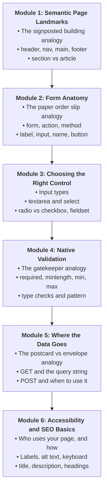
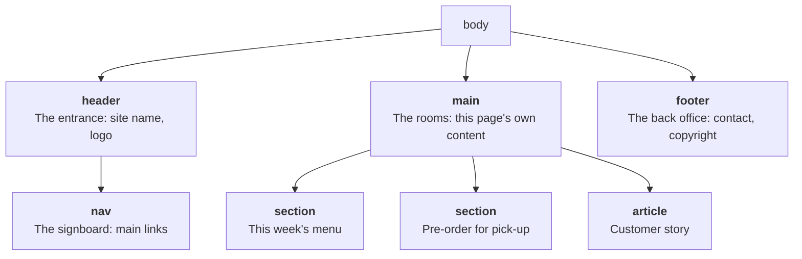
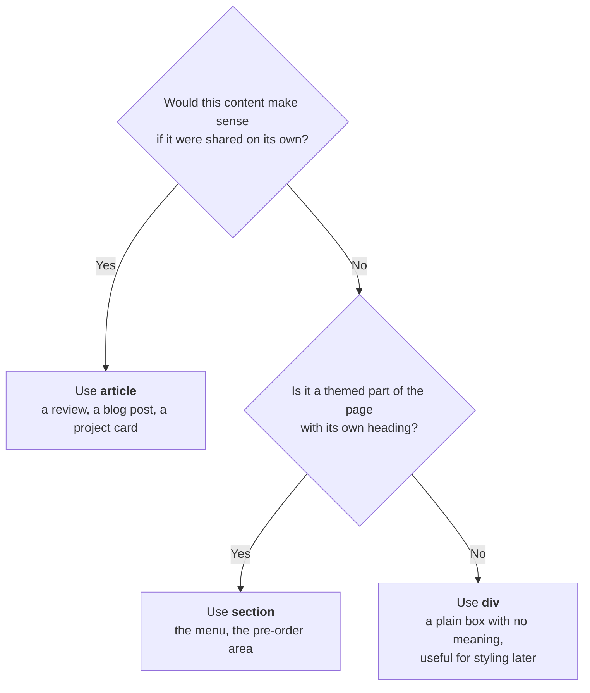
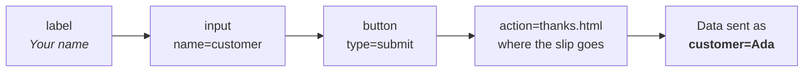
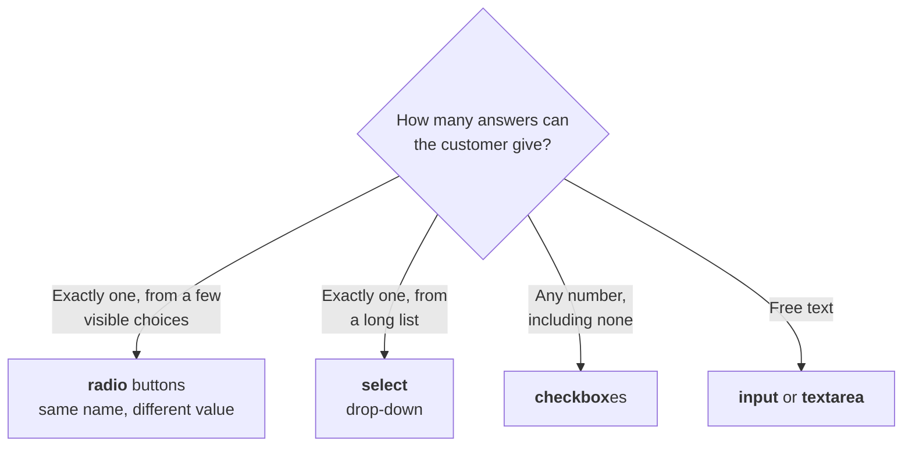
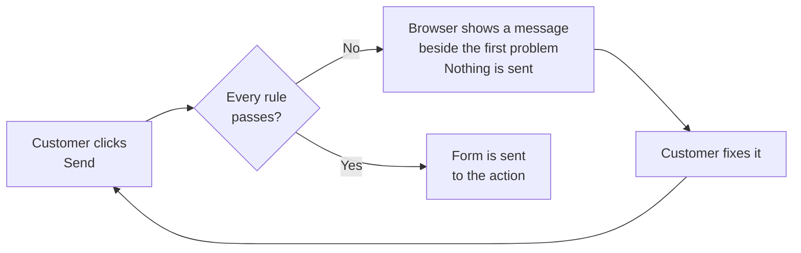
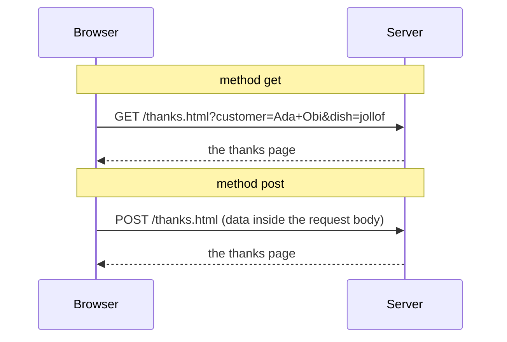

# Week 7: HTML II — Forms, Semantics & Accessibility

**100L · Semester 1 · Week 07 · Class notes · Six modules and three exercise levels**

Welcome to Week 7! Last week you gave a page its **structure**: headings, paragraphs, lists, links,
images and tables. You built Mama Titi's menu and started your own portfolio.

But every page you have made so far only **talks**. It can't **listen**. A customer who wants to
pre-order jollof for 1 pm still has to send Mama Titi a WhatsApp message. And a page built only from
headings and paragraphs gives a screen reader very few signposts: it can't tell where the menu is,
where the main content starts, or where the page ends.

This week you fix both. You will mark out the **regions** of a page with semantic elements, build
**forms** that collect a customer's answers, let the browser **check** those answers, see **where the
data goes** when a form is sent, and test your page the way people with disabilities and search
engines use it.

---

## Pedagogical Roadmap



---

## Module 1: Semantic Page Landmarks

### 1. The Problem with "Just Headings"

Here is the outline of a page built only with Week 6 elements:

```html
<body>
  <h1>Mama Titi's Kitchen</h1>
  <a href="#menu">Menu</a> <a href="#order">Pre-order</a>
  <h2 id="menu">This week's menu</h2>
  ...
  <h2 id="order">Pre-order for pick-up</h2>
  ...
  <p>Mama Titi's Kitchen, by the faculty building.</p>
</body>
```

It works. But nothing tells the browser that the two links are the **site's menu bar**, that the last
paragraph is the **footer**, or where the **main content** begins. You can see those regions with your
eyes. A screen reader, a search engine and a phone's "reader view" can't.

---

### 2. Landmarks: The Signposted Building Analogy

> [!NOTE]
> **The Mental Model:** A page is a building. Every building has the same kinds of area: an
> **entrance** with the name over the door, a **signboard** that points to the rooms, the **rooms**
> where the real business happens, and a **back office** with contact details.
> **Semantic elements** are the signposts on those areas. They don't change how the page looks;
> they tell every visitor, human or machine, what each area is *for*.

"Semantic" means "about meaning". A semantic element describes **what its content is**, not how it
should look.



| Element | What it marks | Rule of thumb |
| :--- | :--- | :--- |
| **`<header>`** | The introduction to the page (or to a section): name, logo, often the `nav` | Usually at the top of `body` |
| **`<nav>`** | A block of **major** navigation links | For the main menu, not for every link on the page |
| **`<main>`** | The content that is **unique to this page** | **Exactly one** visible `main` per page |
| **`<section>`** | A themed group of content | Should have its own heading (`h2`, `h3`…) |
| **`<article>`** | A self-contained piece that makes sense **on its own** | Could be lifted out and shared: a news item, a review, a project card |
| **`<aside>`** | Content related to, but separate from, the main flow | A tip box, a "did you know?" |
| **`<footer>`** | Closing information: contact, copyright, related links | Usually at the bottom of `body` |

---

### 3. Rebuilding the Page with Landmarks

```html
<body>
  <header>
    <h1>Mama Titi's Kitchen</h1>
    <nav>
      <ul>
        <li><a href="#menu">Menu</a></li>
        <li><a href="#order">Pre-order</a></li>
        <li><a href="#reviews">Reviews</a></li>
      </ul>
    </nav>
  </header>

  <main>
    <section id="menu">
      <h2>This week's menu</h2>
      <!-- the price table from Week 6 -->
    </section>

    <section id="reviews">
      <h2>What customers say</h2>
      <article>
        <h3>Best jollof near the faculty</h3>
        <p>Big portion, hot food, and it was ready at 12 on the dot.</p>
      </article>
    </section>

    <section id="order">
      <h2>Pre-order for pick-up</h2>
      <!-- the form, from Module 2 -->
    </section>
  </main>

  <footer>
    <p>Mama Titi's Kitchen, by the faculty building. Open Monday to Friday, 8:00 to 16:00.</p>
  </footer>
</body>
```

> [!TIP]
> Putting the `nav` links in a `ul` is the common pattern: a screen reader then announces
> "list, 3 items", so the listener knows how many choices there are before hearing them.

---

### 4. `section` vs `article` vs `div`



> [!IMPORTANT]
> **Semantic elements don't change the look.** If you swap `<div>` for `<main>` and refresh, the page
> looks exactly the same. That is expected. The difference is in what the browser *knows*, which
> you will see in Module 6 when you test with a screen reader.

### 🏋️ Try It Now (Drill 1)

1. Open your Week 6 copy of Mama Titi's `menu.html` (or any page you built last week) in VS Code.
2. Wrap the `h1` in a `header`. Add a `nav` inside it with a `ul` of two jump links.
3. Wrap everything between the header and the last paragraph in `main`, and each `h2` group in a
   `section` with an `id`.
4. Wrap the closing paragraph in a `footer`. Save and refresh.

**What you should see:** the page looks the same as before, apart from the new list of links at the
top. Clicking a link jumps to its section, and the address bar ends with `#menu` or `#order`.

---

## Module 2: Form Anatomy

### 1. The Paper Order Slip Analogy

> [!NOTE]
> **The Mental Model:** A web form is a **paper order slip**.
> 1. Each box on the slip has a **printed label** beside it ("Name", "Dish"). In HTML: `<label>`.
> 2. Each box is where the customer writes. In HTML: `<input>` (and friends).
> 3. Each box has a **column heading** in the shop's order book, so the answers end up in the right
>    place. In HTML: the `name` attribute.
> 4. The slip goes into a **tray** when it's handed in. In HTML: the form's `action`.
> 5. Handing it in is the **Send** button. In HTML: `<button type="submit">`.



---

### 2. The Smallest Useful Form

```html
<form action="thanks.html" method="get">
  <label for="customer">Your name</label>
  <input type="text" id="customer" name="customer">

  <button type="submit">Send pre-order</button>
</form>
```

| Part | What it does |
| :--- | :--- |
| **`<form>`** | The slip. Groups every control that gets sent together. |
| **`action="thanks.html"`** | The tray: the address the browser opens when the form is sent. |
| **`method="get"`** | *How* the data travels. Module 5 explains `get` and `post`. |
| **`<label for="customer">`** | The printed label. Its `for` matches the input's `id`. |
| **`id="customer"`** | The input's unique name **on this page**, so the label can point to it. |
| **`name="customer"`** | The column heading **in the data that's sent**. No `name`, no data. |
| **`<button type="submit">`** | Sends the form. |

> [!IMPORTANT]
> **`id` and `name` do different jobs.** `id` connects the label to the box *on the page*.
> `name` labels the answer *in the data that leaves the page*. They are often the same word, which
> is fine, but a control with an `id` and no `name` is **never sent**.

> [!TIP]
> Labels, boxes and buttons sit **side by side** on one line, like words in a sentence. To give each
> pair its own line, wrap it in a paragraph: `<p><label …>…</label> <input …></p>`. Proper layout
> comes with CSS in Week 8.

---

### 3. Why the `label` Matters

A label is more than text beside a box:

- **Click the label, and the box gets the cursor.** A bigger target helps everyone, especially on a phone.
- **A screen reader reads the label** when the box is reached, so the user knows what to type.

There are two correct ways to connect them:

```html
<!-- 🟢 Way 1: for + id (works anywhere on the page) -->
<label for="email">Email</label>
<input type="email" id="email" name="email">

<!-- 🟢 Way 2: wrap the input inside the label -->
<label>Email <input type="email" name="email"></label>

<!-- 🔴 Not a label: just text that happens to sit nearby -->
<p>Email</p>
<input type="email" name="email">
```

### 🏋️ Try It Now (Drill 2)

1. In a new folder `week07-practice`, create `order.html` with the smallest form above, and a
   `thanks.html` that holds just `<h1>Thank you! Your pre-order is in.</h1>`.
2. Open `order.html` in your browser. Click the words **Your name**: the cursor jumps into the box.
3. Type `Ada Obi` and click **Send pre-order**.

**What you should see:** the browser opens `thanks.html`, and the end of the address bar reads:

```text
thanks.html?customer=Ada+Obi
```

That `?customer=Ada+Obi` is your form data. Hold that thought until Module 5.

---

## Module 3: Choosing the Right Control

### 1. Input Types: One Tag, Many Boxes

The `type` attribute changes what an `<input>` accepts and which keyboard a phone shows.

| `type` | Use it for | What changes |
| :--- | :--- | :--- |
| `text` | Short free text: a name | The default |
| `email` | An email address | Checked for an `@`; phones show an `@` key |
| `tel` | A phone number | Phones show a number pad (no format check on its own) |
| `number` | A quantity | Up/down arrows; letters are rejected |
| `date` / `time` | A day / a time | A date or time picker |
| `password` | A secret | Characters are hidden as dots |

```html
<label for="plates">Number of plates</label>
<input type="number" id="plates" name="plates" min="1" max="5">

<label for="pickup-day">Pick-up day</label>
<input type="date" id="pickup-day" name="pickup-day">
```

---

### 2. `textarea` and `select`

```html
<!-- textarea: several lines of free text. It has a closing tag; input does not. -->
<label for="note">Anything we should know?</label>
<textarea id="note" name="note" rows="3"></textarea>

<!-- select: pick one item from a drop-down list -->
<label for="dish">Dish</label>
<select id="dish" name="dish">
  <option value="">Choose a dish</option>
  <option value="jollof">Jollof rice and chicken (₦1,500)</option>
  <option value="beans">Beans and plantain (₦900)</option>
  <option value="amala">Amala and ewedu (₦1,100)</option>
</select>
```

> [!TIP]
> In an `<option>`, the **text** is what the customer reads; the **`value`** is what gets sent. The
> customer sees *Jollof rice and chicken (₦1,500)*; Mama Titi's order book receives `dish=jollof`.

---

### 3. Radio Buttons vs Checkboxes

> [!NOTE]
> **The Mental Model:** **Radio buttons** are the preset buttons on an old car radio: press one, and
> the one you pressed before pops back up. **One answer only.**
> **Checkboxes** are ticks on a shopping list: tick as many as you like, or none.



The browser knows which radio buttons belong together **by their `name`**:

```html
<fieldset>
  <legend>Pick-up time</legend>
  <label><input type="radio" name="time" value="12pm"> 12 pm</label>
  <label><input type="radio" name="time" value="1pm"> 1 pm</label>
  <label><input type="radio" name="time" value="2pm"> 2 pm</label>
</fieldset>

<fieldset>
  <legend>Extras</legend>
  <label><input type="checkbox" name="extras" value="plantain"> Extra plantain</label>
  <label><input type="checkbox" name="extras" value="zobo"> Zobo, 50cl</label>
</fieldset>
```

> [!WARNING]
> **Give every radio button in a group the same `name`.** If the three times have three different
> names, the browser treats them as three separate groups, and the customer can select **all three
> at once**. That's the most common radio-button bug.

---

### 4. `fieldset` and `legend`: The Question Above the Answers

A radio group needs two kinds of label: one for each choice (*12 pm*) and one for the whole
question (*Pick-up time*). The `<fieldset>` groups the choices, and its `<legend>` is the question.
A screen reader announces the legend when the user enters the group, with words like "Pick-up time, group".

### 🏋️ Try It Now (Drill 3)

1. Add the `select`, the two `fieldset`s and the `textarea` above to your `order.html`, inside the form.
2. Change the second radio button's `name` to `time2`. Refresh, and try to select two times. Then put
   it back.
3. Choose a dish, a time and both extras, then click **Send pre-order**.

**What you should see:** in step 2, two times stay selected together. In step 3, the address bar
shows every answer, and the checkbox name appears **twice**, once per tick:

```text
thanks.html?customer=Ada+Obi&dish=jollof&time=1pm&extras=plantain&extras=zobo&note=
```

---

## Module 4: Native Validation

### 1. The Gatekeeper Analogy

> [!NOTE]
> **The Mental Model:** Validation is a **gatekeeper** at the counter who reads each slip before it
> goes into the tray: "You didn't write your name." "That's not an email address." "We only take up to
> 5 plates." The slip is handed back until it passes. The browser can be that gatekeeper, and you
> set its rules with plain attributes. No programming needed.



---

### 2. The Validation Attributes

| Attribute | Rule | Example |
| :--- | :--- | :--- |
| `required` | Can't be left empty | `<input name="customer" required>` |
| `minlength` / `maxlength` | Number of characters allowed | `minlength="2" maxlength="40"` |
| `min` / `max` | Lowest / highest number or date | `type="number" min="1" max="5"` |
| `type="email"` | Must look like an email address | `type="email"` |
| `pattern` | Must match a pattern you write | `pattern="0[789][01][0-9]{8}"` |

```html
<label for="customer">Your name</label>
<input type="text" id="customer" name="customer" required minlength="2">

<label for="phone">Phone (11 digits)</label>
<input type="tel" id="phone" name="phone" required
       pattern="0[789][01][0-9]{8}"
       title="11 digits starting with 070, 071, 080, 081, 090 or 091">
```

> [!TIP]
> **Reading the `pattern`:** `0` means "the digit 0". `[789]` means "one of 7, 8 or 9".
> `[01]` means "0 or 1". `[0-9]{8}` means "any digit, eight times". So `08000000000` passes and
> `12345` fails. Add a `title` that says the rule in plain words: Chrome shows it under its message.

For a radio group, put `required` on **one** of the radio buttons. The whole group then needs an answer.

---

### 3. What the Customer Actually Sees

These are the real messages Google Chrome (version 157, English) shows. Other browsers word them
differently, but they block the same mistakes.

| The customer… | Chrome says |
| :--- | :--- |
| Leaves a `required` text box empty | *Please fill out this field.* |
| Types `A` where `minlength="2"` | *Please lengthen this text to 2 characters or more (you are currently using 1 character).* |
| Types `ada` in an email box | *Please include an '@' in the email address. 'ada' is missing an '@'.* |
| Types `ada@` in an email box | *Please enter a part following '@'. 'ada@' is incomplete.* |
| Types `9` where `max="5"` | *Value must be less than or equal to 5.* |
| Types `12345` where a `pattern` expects 11 digits | *Please match the requested format.* (and your `title` text) |
| Leaves a `required` `select` on "Choose a dish" | *Please select an item in the list.* |
| Picks no time in a `required` radio group | *Please select one of these options.* |

> [!IMPORTANT]
> For a `required` `select`, the first option must have **`value=""`** (empty). An empty value counts
> as "nothing chosen". If the first option is `<option>Choose a dish</option>` with no value, the
> browser sends `Choose a dish` as if it were a real dish.

---

### 4. Validation in the Browser Is Not Enough

> [!CAUTION]
> Browser validation is a **convenience for honest customers**, not a lock. Anyone can switch it off,
> edit the page in their own browser, or send data without using your form at all. A real website
> **always checks the data again on the server**, the computer that receives it. You'll write
> server-side checks in later semesters. For now, remember: *the browser helps; the server decides*.

### 🏋️ Try It Now (Drill 4)

1. Add `required` to the name, the dish `select` and one radio button. Add `type="email"` with
   `required` to a new email box, and `min="1" max="5"` to the plates box.
2. Click **Send pre-order** with everything empty. Read the message. Fill only the name and try again.
3. Type `ada` in the email box and send. Then `ada@`. Then `ada@example.com`.
4. Type `9` plates and send.

**What you should see:** the messages in the table above, one at a time, always beside the **first**
problem in the form. Only when every rule passes does the browser open `thanks.html`.

---

## Module 5: Where the Data Goes — GET vs POST

### 1. The Postcard vs Envelope Analogy

> [!NOTE]
> **The Mental Model:**
> - **GET** is a **postcard**. The message is written on the outside, in the address itself, where
>   anyone handling it can read it. It's quick, and you can photocopy it (bookmark or share the link).
> - **POST** is a **sealed envelope**. The address is on the outside, but the message travels inside,
>   in the *body* of the request. It's the right choice for anything private or anything that
>   *changes* something, such as placing an order.



---

### 2. Reading a Query String

When you used `method="get"`, the browser added your answers to the end of the address. That part,
after the `?`, is the **query string**.

```text
thanks.html?customer=Ada+Obi&email=ada%40example.com&note=No+pepper%2C+abeg+%26+thanks
           │└──── name=value ───┘│
           │                     └── & separates each pair
           └── ? starts the query string
```

Some characters have a special job in an address, so the browser **encodes** them:

| You typed | Sent as | Why |
| :--- | :--- | :--- |
| a space | `+` | Addresses can't contain spaces |
| `@` | `%40` | `@` has a meaning in some addresses |
| `,` | `%2C` | Encoded to stay safe |
| `&` | `%26` | A real `&` would look like the start of the next pair |

---

### 3. GET or POST?

| | **GET** | **POST** |
| :--- | :--- | :--- |
| Where the data travels | In the address (query string) | In the request body |
| Visible in the address bar? | Yes | No |
| Saved in browser history and bookmarks? | Yes | No |
| Good for | Searches, filters: "show me Wednesday's menu" | Orders, sign-ups, logins, messages, file uploads |
| Never use it for | Passwords or private details | — |

> [!CAUTION]
> **POST hides the data from the address bar, but it is not encryption.** Only `https://` protects
> data on its way across the network. A login form needs **both**: `method="post"` and an `https://`
> address.

---

### 4. What Happens on Your Laptop

Your forms are files opened straight from your folder. There is **no server** listening, so nobody
receives the data. That's fine for learning:

- With **`get`**, you can still *see* the data, in the address bar of `thanks.html`.
- With **`post`**, the browser simply opens `thanks.html`, and the address bar shows **no** query
  string. The data had nowhere to go.

In 200L (Track A) you'll write the server code that receives the data and stores the order.

### 🏋️ Try It Now (Drill 5)

1. Fill in your pre-order form completely, including a note with a comma and an `&`, such as
   `No pepper, abeg & thanks`. Send it, and copy the address bar into your notebook.
2. Find each `name=value` pair. Circle the encoded characters.
3. Change the form to `method="post"`. Send it again and compare the address bar.

<details><summary>Answer: what changes in step 3?</summary>

The page is the same `thanks.html`, but the address ends at `thanks.html`: no `?`, no answers. With
POST, the data would travel inside the request, and there is no server here to read it.

</details>

---

## Module 6: Accessibility and SEO Basics

### 1. Who Uses Your Page, and How?

**Accessibility** (often written **a11y**: "a", eleven letters, "y") means people can use your page
whatever their abilities, device or connection.

| Person | How they use the page | What your HTML must give them |
| :--- | :--- | :--- |
| A blind student | A **screen reader** reads the page aloud | Labels, `alt` text, headings, landmarks |
| Someone with a broken trackpad, or a tremor | Only the **keyboard**: Tab, Shift+Tab, Enter, Space | Real links and buttons, in a sensible order |
| Someone with low vision | **Zooms** the page to 200% or more | Text as text, not text inside images |
| A customer on a slow phone connection | Waits for images to load, or never gets them | `alt` text that says what the image showed |
| A search engine | A program reads your HTML to decide what the page is about | A clear `title`, headings and descriptive text |

> [!NOTE]
> **The Mental Model:** Your HTML is read by **two audiences**: people who look at the page, and
> programs (screen readers, search engines) that only read the code. Semantic HTML is the version of
> your page those programs can understand. **Good structure serves both audiences at once.**

---

### 2. The Accessibility Checklist for This Week

```html
<!-- 1. Say what language the page is in, so the screen reader uses the right voice -->
<html lang="en">

<!-- 2. Every control has a real label -->
<label for="email">Email</label>
<input type="email" id="email" name="email">

<!-- 🔴 3. A placeholder is NOT a label: it disappears when typing starts -->
<input type="email" name="email" placeholder="Email">

<!-- 4. Group radio buttons and checkboxes with fieldset + legend -->

<!-- 5. Every meaningful image has alt text; a purely decorative one has alt="" -->


<!-- 6. Link text makes sense out of context -->
<!-- 🔴 --> <a href="menu.html">Click here</a>
<!-- 🟢 --> <a href="menu.html">See this week's menu</a>

<!-- 7. Buttons are real buttons, so the keyboard can reach them -->
<button type="submit">Send pre-order</button>
```

> [!WARNING]
> **Headings are still an outline.** One `h1`, then `h2` for each section, `h3` inside those. Never
> pick a heading for its size. Screen-reader users jump from heading to heading the way you skim a
> book's contents.

---

### 3. Test It with Your Keyboard

You don't need any tool to run the most useful accessibility test: **put your mouse away**.

| Key | What it does in a form |
| :--- | :--- |
| **Tab** | Moves to the next link, box or button |
| **Shift + Tab** | Moves back |
| **Space** | Ticks or unticks a checkbox; presses a button |
| **Arrow keys** | Moves between radio buttons in the same group |
| **Enter** | Follows a link; in a text box, sends the form |

### 🏋️ Try It Now (Drill 6)

1. Open your `order.html`. Click once in the address bar, then put your hands on the keyboard only.
2. Press **Tab** until you reach the name box. Fill in **every** field and send the form without
   touching the mouse or trackpad.
3. Note any control you couldn't reach, or any moment you lost track of where you were.

**What you should see:** a visible outline (the **focus ring**) moving from control to control in the
same order you read the form. Arrow keys move between the pick-up times; Space ticks the extras.

> [!TIP]
> **Try a real screen reader** if your device has one. Each is built in and free:
> **Windows** Narrator, *Windows logo key + Ctrl + Enter* · **macOS** VoiceOver, *Cmd + F5* ·
> **Android** TalkBack, in *Settings → Accessibility* · **Linux (GNOME)** Orca, *Super + Alt + S*.
> Press the same keys again to turn it off. Tab through your form and listen: does each box announce
> its label?

---

### 4. SEO Basics: Helping Search Engines Understand the Page

**SEO** (Search Engine Optimisation) means making it easy for search engines to understand and show
your page. The basics are the same good habits as accessibility.

```html
<head>
  <meta charset="UTF-8">
  <meta name="viewport" content="width=device-width, initial-scale=1.0">
  <!-- 1. The title: shown as the clickable headline in search results and on the browser tab -->
  <title>Pre-order · Mama Titi's Kitchen</title>
  <!-- 2. The description: often shown as the grey text under the headline -->
  <meta name="description" content="Pre-order jollof, beans and amala for pick-up by the faculty building. Open Monday to Friday.">
</head>
```

| Habit | Why it helps search engines |
| :--- | :--- |
| A unique, specific `<title>` on every page | It's the headline people click in the results |
| A `<meta name="description">` of one or two sentences | Often used as the summary under the headline |
| One `h1` that says what the page is about | The clearest signal of the page's topic |
| `alt` text on images | Search engines can't see pictures; they read the `alt` |
| Descriptive link text and file names | `pre-order.html` says more than `page2.html` |

> [!IMPORTANT]
> Write for **people** first. Stuffing a title with repeated keywords ("jollof jollof best jollof")
> reads badly and doesn't help. A clear, honest title and description do.

---

## Module 7: Rookie Traps & Debugging Guide

| What you see | What happened | How to fix it |
| :--- | :--- | :--- |
| The form sends, but an answer is missing from the address bar | That control has no `name` attribute | Add `name="…"` to every control that should be sent |
| Clicking a label doesn't put the cursor in the box | The label's `for` doesn't match the input's `id` exactly | Copy the `id` into the `for`; check spelling and capitals |
| Two or three radio buttons stay selected together | They have **different** `name`s | Give every radio button in the group the same `name` |
| The address bar shows `dish=Choose+a+dish` | The first `option` has no `value=""` | Add `value=""` to the "Choose…" option, and `required` to the `select` |
| Clicking **Send** does nothing visible and nothing is sent | A rule failed, and the message closed before you read it | Click **Send** again and read the message; it points at the first problem |
| Clicking **Send** reloads the same page, with a `?` and your answers added to its address | The form has no `action`, so it sends to itself | Add `action="thanks.html"` and create that file |
| After sending, Chrome shows *Your file couldn't be accessed* and `ERR_FILE_NOT_FOUND` | The `action` points to a file that doesn't exist, or is misspelt | Check the file name and folder of the `action` page |
| Everything after the `textarea` appears inside the text box | `<textarea>` was never closed | Add `</textarea>` straight after the opening tag |
| `pattern` rejects a correct-looking number | The pattern has a typo, or the number has spaces | Test the pattern with a known good value, like `08000000000` |

---

## 🎯 Week 7 Hands-on Classroom Exercises

### Level 1: Landmark Makeover

Take Mama Titi's menu page from Week 6 (or the page from Drill 1) and give it a full set of landmarks:

1. A `header` holding the `h1` and a `nav` with a `ul` of jump links to every section.
2. A `main` holding at least two `section`s, each with an `h2` and an `id`.
3. One `article` inside a section: a short customer review with its own `h3`.
4. A `footer` with the opening hours.
5. Check: does your page have **exactly one** `main`? Does every `section` have a heading?

### Level 2: Mama Titi's Pre-order Form

Build `order.html` and `thanks.html` in your `week07-practice` folder. The form must have:

| Control | Details |
| :--- | :--- |
| Name | `text`, required, at least 2 characters |
| Email | `email`, required |
| Phone | `tel`, required, the 11-digit `pattern` with a `title` |
| Dish | `select` with an empty first option, required |
| Plates | `number`, from 1 to 5 |
| Pick-up time | three `radio` buttons in a `fieldset` with a `legend`, required |
| Extras | two `checkbox`es in a `fieldset` with a `legend` |
| Note | `textarea`, at most 200 characters (`maxlength`) |
| Send | `button type="submit"` |

Then run the three tests:

1. **Validation test:** try to break each rule once, and write down the message you get.
2. **GET test:** send a complete order and copy the query string into your notebook.
3. **Keyboard test:** fill in and send the whole form without the mouse.

### Level 3: Your Portfolio Gets a Front Desk

This starts the Week 7 curriculum deliverable: *"Add a contact form and semantic layout to the
portfolio."* **Assignment 04** finishes and submits it.

1. Open your `portfolio` folder from Week 6. Give `index.html` a semantic layout: `header` with `nav`,
   `main` with a `section` per topic, and a `footer`.
2. Put each thing you've built (your Week 5 Hello World page, your Week 6 page) in its own `article`.
3. Create `contact.html` with the same `header`, `nav` and `footer`, and a contact form: name, email,
   a reason for getting in touch (a `select` or `radio` group), and a message (`textarea`). All
   labelled, with sensible validation, sending with `method="get"` to a `thanks.html` of your own.
4. Add a `title` and a `meta name="description"` to every page.

> [!CAUTION]
> Your portfolio will be public from Week 11. Don't use your real phone number, address or matric
> number in your form's examples, placeholders or page text.

---

## 📚 Curated Deep-Dive References

* [MDN: Structuring documents](https://developer.mozilla.org/en-US/docs/Learn_web_development/Core/Structuring_content/Structuring_documents) — `header`, `nav`, `main`, `section`, `article` and `footer`, with a full example page.
* [MDN: Your first form](https://developer.mozilla.org/en-US/docs/Learn_web_development/Extensions/Forms/Your_first_form) — Builds a small contact form step by step. Skip "Basic form styling" until Week 8.
* [MDN: Basic native form controls](https://developer.mozilla.org/en-US/docs/Learn_web_development/Extensions/Forms/Basic_native_form_controls) — Text fields, checkboxes, radio buttons and their attributes.
* [MDN: How to structure a web form](https://developer.mozilla.org/en-US/docs/Learn_web_development/Extensions/Forms/How_to_structure_a_web_form) — `fieldset`, `legend` and labels in depth.
* [MDN: Client-side form validation](https://developer.mozilla.org/en-US/docs/Learn_web_development/Extensions/Forms/Form_validation) — Read up to "Validating forms using JavaScript"; JavaScript comes in 100L Semester 2.
* [MDN: Sending form data](https://developer.mozilla.org/en-US/docs/Learn_web_development/Extensions/Forms/Sending_and_retrieving_form_data) — GET and POST, with diagrams. Skip the server-side code for now.
* [MDN: HTML — A good basis for accessibility](https://developer.mozilla.org/en-US/docs/Learn_web_development/Core/Accessibility/HTML) — Why semantic HTML is the first step to an accessible page.
* [Google Search Central: SEO Starter Guide](https://developers.google.com/search/docs/fundamentals/seo-starter-guide) — Google's own plain-English guide to titles, descriptions and good content.

### Sources

- Programme curriculum §4, Week 07 (HTML II — Forms, Semantics & Accessibility): forms (input,
  textarea, select, radio, checkbox, validation, GET vs POST concept); semantic elements (header, nav,
  main, section, article, footer); accessibility and SEO basics. Deliverable: "Add a contact form and
  semantic layout to the portfolio".
- MDN Web Docs (pages above) for element behaviour; W3C WAI,
  [Introduction to Web Accessibility](https://www.w3.org/WAI/fundamentals/accessibility-intro/).
- Validation messages, the query strings and the POST behaviour were checked in Google Chrome 157 on
  14 November 2026. Links checked the same day.
- Mama Titi's Kitchen, its prices and its customers are made up.
