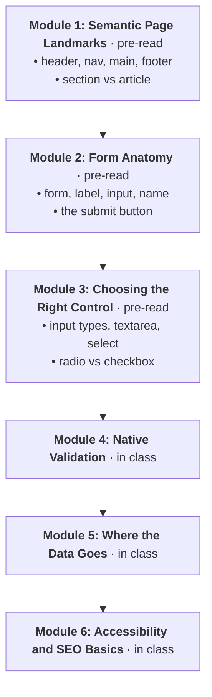
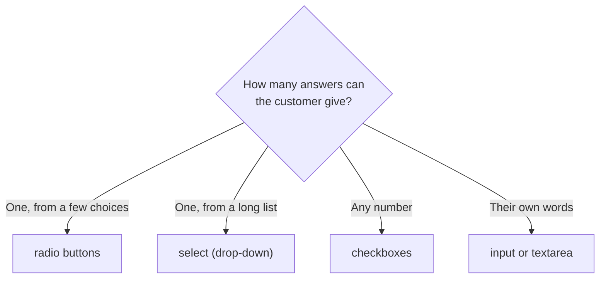

# Week 7 Pre-read: HTML II — Forms, Semantics & Accessibility

**100L · Semester 1 · Before class · About 40 minutes · Not graded**

Until now, your pages only **talk**: they show information. This week they learn to **listen**. In
class you will build a pre-order form for Mama Titi's Kitchen, mark out the regions of a page so
screen readers and search engines understand it, and give your portfolio a contact form.

This pre-read covers the foundations, so class time goes on building. You don't need to install
anything.

> [!TIP]
> **Bring:** your laptop and charger if you have one, a notebook, a pen, and your `portfolio` folder
> from Week 6. No laptop? Tell your tutor at the start of class, so you can take turns on a shared machine.

---

## Pedagogical Roadmap

This is the plan for the whole week. The pre-read covers **Modules 1–3**; the rest happens in class.



---

## Module 1: Semantic Page Landmarks · 12 minutes

> [!NOTE]
> **The Mental Model:** A page is a building. It has an **entrance** with the name over the door, a
> **signboard** pointing to the rooms, the **rooms** where the business happens, and a **back
> office** with contact details. **Semantic elements** are signposts for those areas. They don't
> change how the page looks; they tell browsers, screen readers and search engines what each area is
> *for*.

| Element | The area | Example on Mama Titi's page |
| :--- | :--- | :--- |
| `<header>` | The entrance | Her name and the menu bar |
| `<nav>` | The signboard | Links to *Menu*, *Pre-order*, *Reviews* |
| `<main>` | The rooms (one per page) | Everything unique to this page |
| `<section>` | One room, with its own heading | *This week's menu* |
| `<article>` | A piece that makes sense on its own | One customer's review |
| `<footer>` | The back office | Opening hours |

```html
<body>
  <header>
    <h1>Mama Titi's Kitchen</h1>
    <nav> <!-- links to the sections --> </nav>
  </header>
  <main>
    <section id="menu"> <h2>This week's menu</h2> </section>
  </main>
  <footer> <p>Open Monday to Friday, 8:00 to 16:00.</p> </footer>
</body>
```

### Read with a question

**MDN — [Structuring documents](https://developer.mozilla.org/en-US/docs/Learn_web_development/Core/Structuring_content/Structuring_documents)**.
Read from "Basic sections of a document" to the end of "HTML layout elements in more detail". The
example page's code is worth reading; skip anything about CSS.

**Question to keep in mind:** What is the difference between a `<section>` and an `<article>`?
Answer in one sentence, with an example from a site you use.

---

## Module 2: Form Anatomy · 12 minutes

> [!NOTE]
> **The Mental Model:** A web form is a **paper order slip**. Each box has a **printed label**
> (`<label>`), a space to write in (`<input>`), and a **column heading** in the shop's order book so
> the answer lands in the right place (the `name` attribute). Handing the slip in is the **Send**
> button, and the tray it goes into is the form's `action`.

```html
<form action="thanks.html" method="get">
  <label for="customer">Your name</label>
  <input type="text" id="customer" name="customer">
  <button type="submit">Send pre-order</button>
</form>
```

| Part | Its job |
| :--- | :--- |
| `<form action="thanks.html">` | The slip, and the page the browser opens when it's sent |
| `<label for="customer">` | The printed label; `for` points at the box's `id` |
| `id="customer"` | The box's unique name on the page |
| `name="customer"` | The answer's name in the data that's sent |
| `<button type="submit">` | Sends the form |

### Read with a question

**MDN — [Your first form](https://developer.mozilla.org/en-US/docs/Learn_web_development/Extensions/Forms/Your_first_form)**.
Read "What are web forms?", "Designing your form" and "Implementing our form HTML", up to "Basic form
styling". Stop there: styling is Week 8, and the server code is for a later year.

**Question to keep in mind:** The `id` and `name` attributes often hold the same word. What different
job does each one do?

---

## Module 3: Choosing the Right Control · 8 minutes

> [!NOTE]
> **The Mental Model:** **Radio buttons** are the preset buttons on an old car radio: press one and the
> last one pops up, so there's only **one** answer. **Checkboxes** are ticks on a shopping list: tick
> as many as you like.



| Control | Use it for |
| :--- | :--- |
| `<input type="email">` | An email address; phones show an `@` key |
| `<input type="number">` | A quantity, such as plates of jollof |
| `<textarea>` | Several lines of text, such as a message |
| `<select>` with `<option>`s | One choice from a list, such as the dish |

---

## 🏋️ Warm-up Drill · 8 minutes

**(paper)** Here is a real-life form, written out as plain text. It's the sign-up sheet for a made-up
campus coding club.

```text
Coding Club sign-up
Full name
Email address
Level: 100L / 200L / 300L / 400L
Which days can you come? Monday, Wednesday, Friday
Have you written code before? Yes / No
Tell us one thing you want to build
Sign up
```

1. For each line, write which HTML control you would use: `text`, `email`, `select`, `radio`,
   `checkbox`, `textarea` or `button`.
2. Two lines need the student to pick **only one** answer. Which ones?
3. One line lets them pick **several**. Which one?
4. Write the `name` you would give each answer, in lowercase with hyphens, such as `full-name`.

**Record:** my controls __________ · one answer only __________ · several answers __________

---

## No Internet?

Here is what the two readings say, in short.

- **Structuring documents.** Most pages share the same regions: a header, a navigation bar, the main
  content, sometimes a sidebar, and a footer. HTML has an element for each: `header`, `nav`, `main`,
  `aside` and `footer`. Inside `main`, a `section` groups content on one theme and should have a
  heading, while an `article` is a piece that would still make sense if it were moved somewhere else,
  such as a news story. A `div` is a plain box with no meaning; use it only when no semantic element
  fits.
- **Your first form.** A form is built from **controls** (text boxes, drop-downs, buttons) inside a
  `<form>` element. Every control needs a `<label>`, connected by matching the label's `for` to the
  control's `id`; clicking the label then focuses the control. `<input>` has no closing tag, but
  `<textarea>` does. Each control needs a `name`: that is how its answer is identified when the form
  is sent. The form's `action` says where the data goes, and `method` says how.

---

## ✅ Ready Check

- [ ] I can name the six landmark elements and say what each area is for.
- [ ] I can answer: `section` or `article`? `id` or `name`? radio or checkbox?
- [ ] I have done the Warm-up Drill on paper.
- [ ] My Week 6 `portfolio` folder opens in the browser, and I know where it is.
- [ ] I did this on my own, without AI tools.

---

## 📚 References

* [MDN: Structuring documents](https://developer.mozilla.org/en-US/docs/Learn_web_development/Core/Structuring_content/Structuring_documents) — The page regions and their elements.
* [MDN: Your first form](https://developer.mozilla.org/en-US/docs/Learn_web_development/Extensions/Forms/Your_first_form) — A small form, built step by step.
* [MDN: Basic native form controls](https://developer.mozilla.org/en-US/docs/Learn_web_development/Extensions/Forms/Basic_native_form_controls) — Optional: every kind of text box, checkbox and radio button.

### Sources

- Programme curriculum §4, Week 07 (HTML II — Forms, Semantics & Accessibility).
- MDN Web Docs, the pages above. Links checked 14 November 2026.
- The coding club, Mama Titi's Kitchen and all examples are made up.
